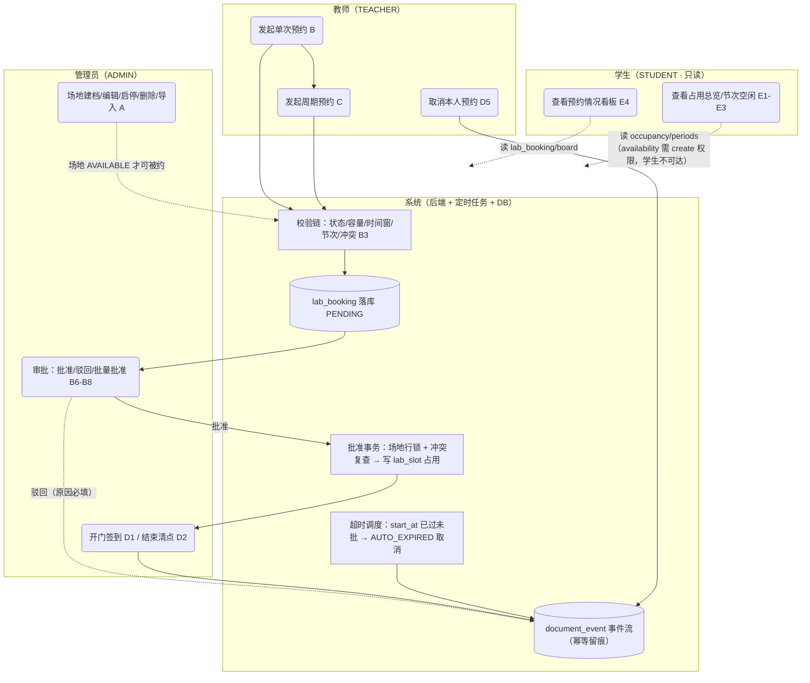
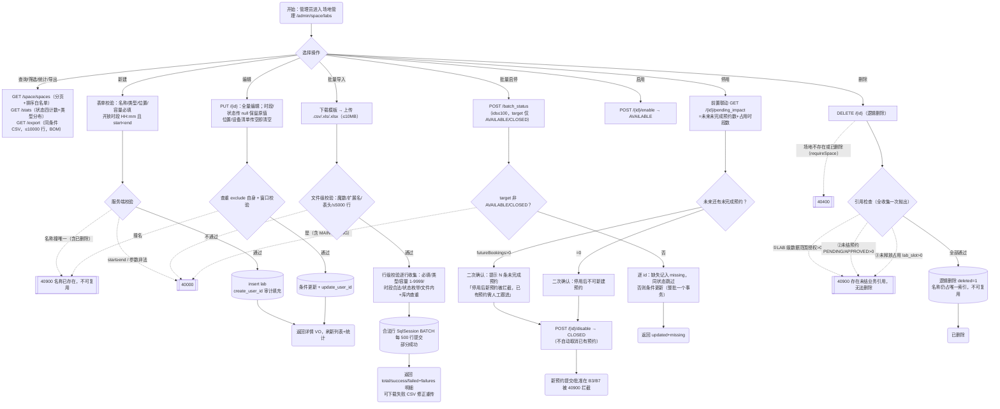
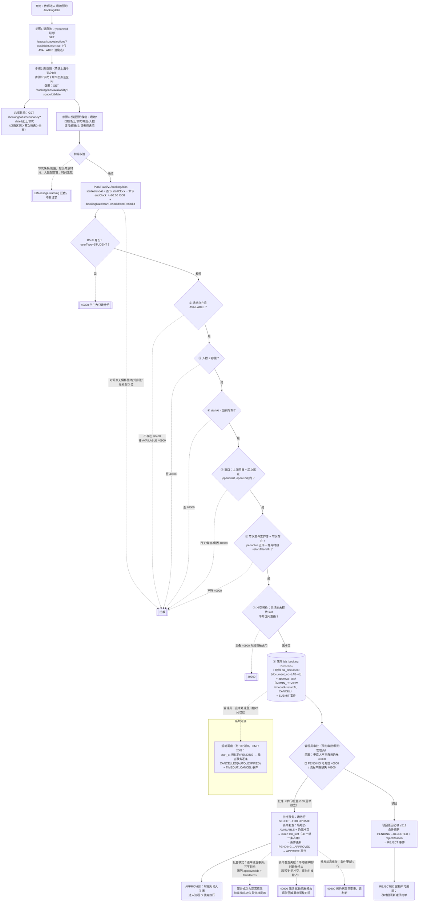
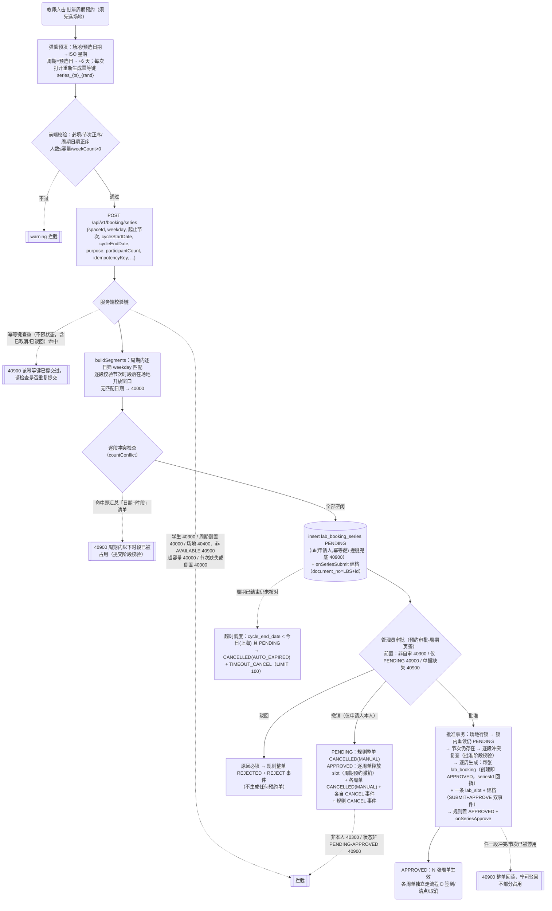
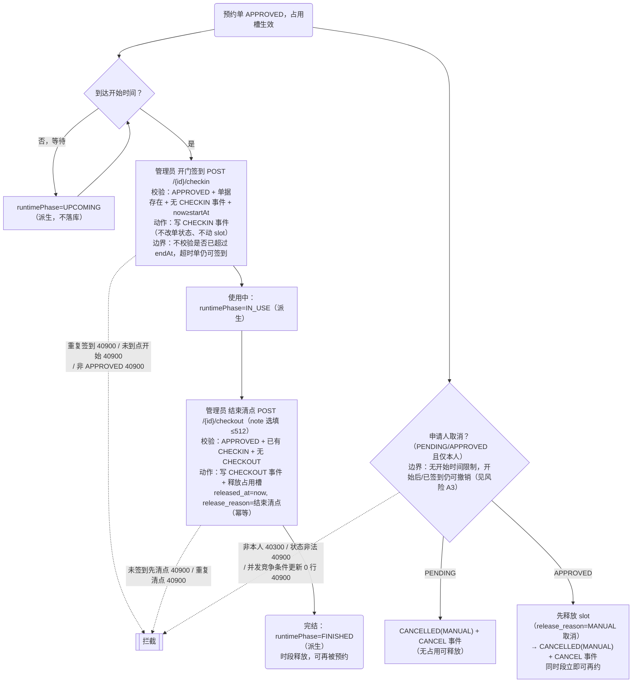
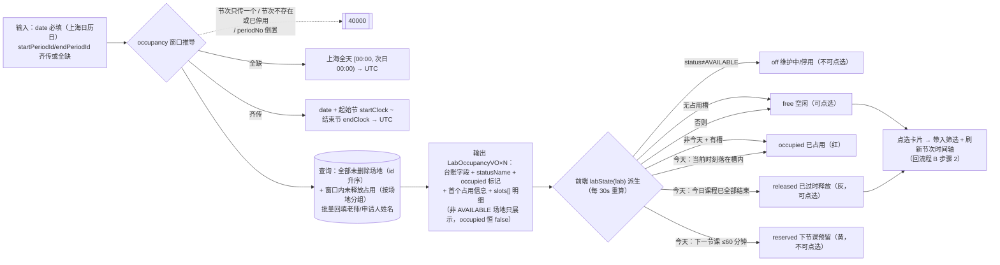
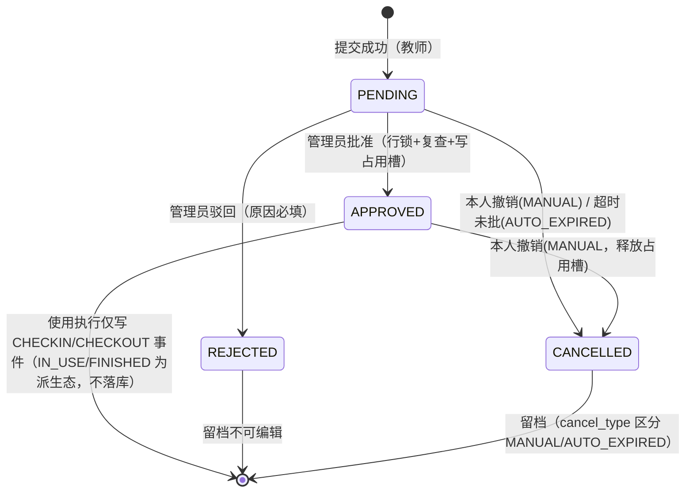
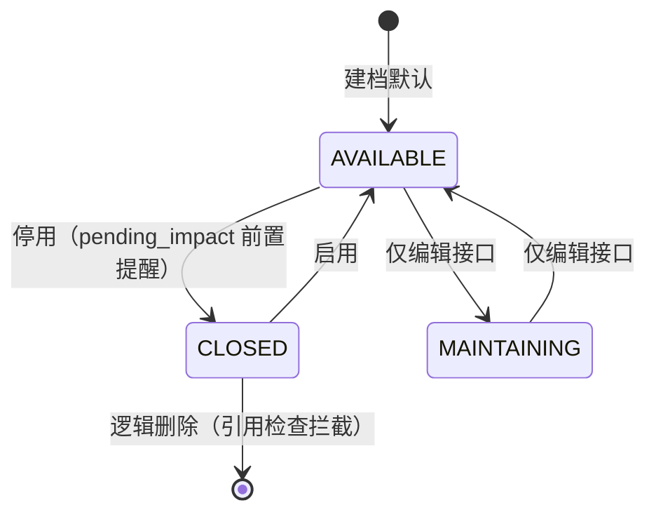

# 场地业务流程图与流程说明（一期实现基准）

> 版本：v1.1；整理日期：2026-10-24；依据：[流程清单.md](流程清单.md)、[权限清单.md](权限清单.md)、[数据库设计.md](数据库设计.md)（评审稿 v1.1）、[场地模块开发文档清单.md](场地模块开发文档清单.md)（v1.1.1）、[智联教室PRD.md](智联教室PRD.md)（V1.8）、[RBAC实施清单.md](RBAC实施清单.md)，并整合仓库根目录上传材料《场地流程说明文档.md》（N1–N20 节点明细与风险清单）、《场地模块流程文档 v1.2》（App Store 审核流程对照）与《场地业务全流程图.html》（手绘 SVG 泳道图），以一期实际代码（`module/space`、`module/booking`、`module/booking/flow`、`frontend/src/views/{admin/space,booking,admin/booking,grant}`）为最终基准。
>
> v1.1 变更：新增第 2 节数据流转路径、第 10 节风险清单（A1–A12，逐条经源码复核）、第 11 节审批机制优化对照；修正 D6 取消边界标注（无开始时间限制）；原差异登记顺延为第 12 节并补取消时限一行。
>
> v1.2 变更（2026-10-26）：A1（超时自动完结）/A2（管理员强制取消）按 10.1 设计稿实施完毕，A13/A14/A15（=B22/B23/B24）全部修复，第 10 节表格与 10.1 标题同步标注；对应图档《场地业务全流程图_v2.html》同步升级 v2.2 并重新导出三张 PNG。
>
> **基准声明**：本文所有流程按"一期已落地实现"绘制。PRD / 流程清单中的二期愿景项（学生背书 PENDING_ENDORSE、到点自动 IN_USE 落库、end+2h 自动 FINISHED 落库、课表冲突检测、配套器材/物料预登记、管理员强制结束 FORCE_FINISH、审批催办消息）在代码中均未实现，统一在第 12 节"差异登记"标注，不混入主流程图。注：「管理员强制取消」（CancelType.FORCE + force_cancel 接口）已于 2026-10-26 v1.5 落地，不再是二期项。

---

## 1. 角色、泳道与图例

### 1.1 角色泳道（按一期权限种子）

| 泳道 | 主体 | 场地相关权限码 | 入口菜单 |
| --- | --- | --- | --- |
| 教师 | TEACHER 用户 | `booking:lab:create/list/cancel/view`、`space:space:list/read`、`system:grant:*` | 场地预约（/booking/labs）、助理管理（/grant） |
| 学生 | STUDENT 用户（纯只读） | 仅 `booking:lab:view`（+`space:space:list/read`） | 预约情况（/booking/labs，同路径只读组件态） |
| 管理员 | ADMIN 用户 | `space:space:*`（155-159）、`booking:lab:*`（3001-3005） | 场地中心目录：场地管理 / 预约管理 / 预约审批 |
| 系统 | 后端服务 + 定时任务 + 数据库 | — | `BookingTimeoutScheduler`（每 10 分钟扫描） |

### 1.2 图例

- 圆角矩形：开始 / 结束节点；矩形：执行动作；菱形：判断分支；圆柱：数据库读写；虚线：异常 / 拦截路径；粗箭头：主流程。
- 节点编号全局唯一（A=建档管理、B=单次预约、C=周期预约、D=使用执行、E=查询派生），与第 3~7 节节点说明表一一对应。
- 时间点（startAt/endAt 等）全程 UTC `Instant` 传输与存储（`DATETIME(3)`）；开放窗口与节次时刻为上海本地 `HH:mm`（`TIME(0)`），不换算；纯日期为上海日历日。

---

## 2. 端到端总览图



**总览流转规则**：场地生命周期 = 建档（A）→ 开放预约（status=AVAILABLE）→ 预约与审批（B/C）→ 占用生效（lab_slot）→ 使用执行（D：签到→清点）→ 完结/取消归档（事件流留痕）→ 场地停用/删除（A，受未结业务引用拦截）。学生全程只读，不产生任何写路径。

**逻辑闭环自查**（贯穿 8 张图的不变量，任一点被破坏即视为缺陷）：

| 不变量 | 保障机制 | 对应节点 |
| --- | --- | --- |
| 同时段同场地占用唯一 | 半开区间互斥判定；提交+审批双重校验；批准经场地行 `SELECT ... FOR UPDATE` 串行化；`uk_lab_slot_booking` 一单一条占用 | V7、B7、C6、C9 |
| 状态守恒 | 预约落库仅四态（PENDING/APPROVED/REJECTED/CANCELLED）；IN_USE/FINISHED 为派生态无写路径；场地三态仅经启停/编辑两条路径变更 | 8.1~8.4 |
| 权限三层兜底 | 菜单按角色下发 + 前端 v-permission 显隐 + 后端 @SaCheckPermission 逐接口校验；学生另有 userType 服务端兜底 | 1.1、V1、C4 |
| 时间口径三分离 | 时间点 UTC Instant；开放窗口/节次为上海 CLOCK 不换算；纯日期为上海日历日 | 1.2、B5、E2 |
| 幂等防重 | 单据 document_no 查重建档；事件 requestKey 唯一（撞键保留首次）；周期 idempotencyKey 不限状态查重；slot 释放条件更新 `released_at IS NULL`；超时取消条件更新竞争跳过 | V8、D2/D4、C3、B11 |
| 异常有归宿 | 全部异常分支映射到 40000/40100/40300/40400/40900/50000 六档，无静默吞错 | 第 9 节 |

**数据流转路径**（单视角看全链，与流程 B/C/D 节点一一对应）：

```text
教师提交 → lab_booking(PENDING)
        ┬ biz_document(LAB+id) + approval_task(ADMIN_REVIEW/READY, timeout_at=start_at, CANCEL) + document_event(SUBMIT)
        ↓ 管理员核对（申请人不审自己的单）
  批准 → 场地行锁 → 锁内复查（场地 AVAILABLE + 无冲突）→ lab_slot(占用写入) + APPROVED + APPROVE 事件
         （周期规则：行锁内逐段复检 → 逐周生成 APPROVED 子单 + lab_slot + 档案双事件）
  驳回 → REJECTED + REJECT 事件（原因必填，留档不可编辑）
        ↓ 到达 start_at
  管理员 CHECKIN 事件 → IN_USE（派生）
        ↓ 使用完毕
  管理员 CHECKOUT 事件 → lab_slot.released_at 释放 → FINISHED（派生）
        ↓
  台账归档：GET /stats 四档计数、GET /all/export CSV（≤10000 行，BOM，上海时区）；board 供师生只读
  兜底线：start_at 已过仍 PENDING → 定时任务每 10 分钟 AUTO_EXPIRED 自动取消（TIMEOUT_CANCEL 事件）
```

数据流约束：时间点一律 UTC 存储与传输（Instant + 三位毫秒），日期与开放/节次窗口按 Asia/Shanghai；按上海日期查询先转 UTC 半开区间 `>= startUtc AND < endUtc`。

---

## 3. 流程 A：场地建档与台账管理（管理员）



### 节点说明表（流程 A）

| 节点 | 功能定义 | 输入条件 | 执行动作 | 输出结果 | 角色/系统 | 异常路径 |
| --- | --- | --- | --- | --- | --- | --- |
| A2 | 查询/统计/导出 | 登录 + `space:space:list`；分页 pageNum≥1、pageSize≤100 | 名称/位置模糊 + 类型/状态精确 + 容量区间；排序白名单（labName/capacity/createTime/updateTime），未命中回退 create_time DESC | PageResult / SpaceStatsVO / CSV（9 列中文表头，时间上海时区） | 管理员 + 后端 | 分页越界 → 40000；options limit∉[1,100] → 40000 |
| A3 | 新建场地 | `space:space:create`；labName≤128、capacity≥1、时段 `HH:mm` | 名称 trim → 含逻辑删除查重 → 窗口校验 → 默认时段 08:00/21:00、默认状态 AVAILABLE → insert | SpaceDetailVO；id 雪花字符串 | 管理员 + 后端 + lab 表 | 撞名 40900；start≥end 40000；DTO 违例 40000 |
| A4 | 批量导入 | 同上权限；文件 .csv/.xls/.xlsx ≤10MB ≤5000 行 | 魔数识别格式 → 表头校验（场地名称/类型/容纳人数必填列）→ 行级校验 → 分批 500 行入库 | SpaceImportVO（部分成功，逐行失败原因） | 管理员 + 后端 | 文件级问题整体 40000；行级问题仅收集不阻断 |
| A5 | 编辑场地 | `space:space:update`；记录存在且未删除 | 全量更新；null 语义：时段/状态保留原值，位置/设施清空 | SpaceDetailVO | 管理员 + 后端 | 不存在 40400；撞名 40900；更新 0 行 40400 |
| A6 | 停用前置联动 | `space:space:update` | 统计 `released_at IS NULL AND end_at > now` 的未来占用时段数与去重预约数 | SpacePendingImpactVO{futureSlots, futureBookings} | 管理员 + 后端 + lab_slot/lab_booking | 场地不存在 40400；查询失败前端静默降级为无提示 |
| A6d | 停用 | 二次确认通过 | status→CLOSED + update_user_id；**已有预约不自动取消** | 已停用 | 管理员 + 后端 | 更新 0 行 40400 |
| A7/A8 | 启用/批量启停 | `space:space:update`；批量 ids≤100 | enable→AVAILABLE；批量逐 id 跳过同态、收集 missing | — / SpaceBatchStatusVO | 管理员 + 后端 | target=MAINTAINING → 40000（MAINTAINING 仅可经编辑设置） |
| A9 | 删除 | `space:space:delete` + 二次确认 | 三项引用检查全部通过后逻辑删除 | data=null | 管理员 + 后端 | 任一引用命中 → 40900（消息合并列明） |

**注意事项**：① 维护中 MAINTAINING 状态只能经"编辑"接口设置，启停与批量接口不可达；② 场地名称全局唯一且删除后不复用（`uk_lab_name` 不因逻辑删除释放）；③ 前端"新增场地"弹窗零请求，唯一性由后端 40900 兜底；④ 详情抽屉的"当前使用状态"为前端派生（见第 7 节 E5）。

---

## 4. 流程 B：单次场地预约与审批（教师发起 → 管理员核对）



### 节点说明表（流程 B）

| 节点 | 功能定义 | 输入条件 | 执行动作 | 输出结果 | 角色/系统 | 异常路径 |
| --- | --- | --- | --- | --- | --- | --- |
| B1 | 选场地 | 登录；任意预约权限 | typeahead 仅返回 AVAILABLE 场地（options?availableOnly=true，limit=50） | filter.spaceId | 教师 + 前端 | 接口失败静默置空候选 |
| B2 | 选日期+节次区间 | 已选场地 | availability 返回开放窗口与已占用段；卡片四态派生（见 E3）；非 free 卡片禁点；区间含非 free 卡片则警告并重置 | selectedRange[起始节,结束节] | 教师 + 前端 | availability 失败卡片退化为全 free（仅时间派生 past） |
| B3f | 占用总览联动 | 已显式选日期 | 窗口优先级：点选区间＞节次筛选下拉＞全天；请求去重三连（pendingOverviewKey/lastOverviewKey/overviewSeq，判重在序号递增之前） | 场地分档卡片（见流程 E） | 教师/学生 + 前后端 | 失败可见化：错误横幅 + 点击重试；节次只传一个/不存在/倒置 → 40000 |
| B5 | 提交预约 | `booking:lab:create`；表单通过 | 上海本地节次时刻转 +08:00 ISO 提交 | 201 Result（data=BookingDetailVO 含流程时间线） | 教师 + 后端 | 双层兜底：前端 warning 拦截；后端 V1~V7 逐项 40000/40300/40400/40900；时间点无偏移/格式非法/毫秒超 3 位 → 40000 |
| V8 | 建档落库 | 校验链全过 | insert lab_booking(PENDING)；onSubmit 幂等建档（document_no 查重） | PENDING 单 + 单据 + 审批任务 + SUBMIT 事件 | 后端 + 3 表 | 建档已存在直接复用（幂等） |
| B6 | 审批前置 | `booking:lab:approve` | 申请人≠操作人；状态=PENDING；流程单据存在 | 进入批准/驳回 | 管理员 + 后端 | 自审 40300；非 PENDING 40900；单据缺失 40900；审批任务缺失 IllegalStateException → 50000 |
| B7 | 批准 | 前置通过 | 场地行锁串行化同场地审批；锁内复查场地状态与冲突；写占用槽；条件更新状态；写事件（意见固定"核对通过，批准使用"） | APPROVED + lab_slot | 管理员 + 后端 + 事务 | 锁内：场地 40400/停用 40900/被抢占 40900；条件更新 0 行 40900 |
| B7b | 批量批准 | ids≤100 | Controller 逐单调 approve，逐单 try/catch，互不影响（各自独立事务） | BatchApproveResultVO{approvedIds, failedItems[{id,msg}]} | 管理员 + 后端 | 空列表 40000；逐单失败原因回传前端分档提示 |
| B8 | 驳回 | 原因必填 ≤512 | 条件更新 + REJECT 事件（原因入事件与 decision_comment） | REJECTED | 管理员 + 后端 | 非 PENDING / 更新 0 行 → 40900 |
| B11 | 超时自动取消 | 调度器 fixedDelay=10min（首跑 1min） | selectExpiredPending（start_at≤now，升序 LIMIT 200）→ BookingExpiryService 逐条 REQUIRES_NEW：条件更新 PENDING→CANCELLED(AUTO_EXPIRED) + 保险幂等释放 slot + TIMEOUT_CANCEL 事件(actor=SYSTEM)；单条失败不影响整批 | CANCELLED(AUTO_EXPIRED) | 系统定时任务 | 与人工审批竞争：条件更新 0 行即跳过；方法级 catch 防调度中断 |

**约束与注意**：① 提交期不写 lab_slot，PENDING 不占时段（防恶意占位），占用只在批准瞬间产生，"最后批准者遇冲突拒绝不抢占"；② 行锁粒度为单场地行，冲突窗口最小化；③ 批量批准不是整批事务，成功/失败分档返回；④ 审批通过没有"超时自动通过"（与 PRD 分歧项一致：到点开始时间未批即自动取消）；⑤ 前端连点依赖后端冲突校验兜底（单暂未设提交幂等键）。

---

## 5. 流程 C：批量周期预约（实训周/每周固定节次）



### 节点说明表（流程 C）

| 节点 | 功能定义 | 输入条件 | 执行动作 | 输出结果 | 角色/系统 | 异常路径 |
| --- | --- | --- | --- | --- | --- | --- |
| C1 | 提交准备 | 已选场地；`booking:lab:create` | 预填星期/周期/幂等键 | 表单 | 教师 + 前端 | 未选场地 warning |
| C3 | 提交周期预约 | idempotencyKey 必填 ≤128 | 服务端：身份→日期正序→场地→容量→节次→幂等查重→分段→逐段冲突→落库建档 | PENDING 规则单 | 教师 + 后端 | 见 CX/C4x/C6x；幂等键不限状态查重（已取消/驳回的同键也算重复） |
| C9 | 批准周期预约 | 规则 PENDING + 单据存在 + 非自审 | 行锁内逐周生成预约单与占用槽；任一失败整单回滚 | APPROVED + N×(booking+slot+document) | 管理员 + 后端事务 | 场地停用 40900；节次被删 40900"请驳回"；段冲突 40900；状态竞争 40900 |
| C12 | 周期超时取消 | 调度器每 10 分钟 | cycle_end_date 已过仍 PENDING 的规则整单取消 | CANCELLED(AUTO_EXPIRED) | 系统定时任务 | 条件更新 0 行跳过 |
| C13 | 周期撤销（本人） | `booking:lab:cancel`；状态 PENDING/APPROVED；仅本人 | APPROVED 时遍历各周单：释放 slot（reason="周期预约撤销"）+ 各单 CANCELLED(MANUAL) + 各单 CANCEL 事件；规则置 CANCELLED | 整单撤销 | 教师 + 后端 | 非本人 40300；状态非法 40900 |

---

## 6. 流程 D：使用执行（开门签到 → 结束清点）与取消



### 节点说明表（流程 D）

| 节点 | 功能定义 | 输入条件 | 执行动作 | 输出结果 | 角色/系统 | 异常路径 |
| --- | --- | --- | --- | --- | --- | --- |
| D2 | 开门签到 | `booking:lab:approve`；APPROVED；now≥startAt | 仅写 CHECKIN 事件（from=APPROVED，to=派生 IN_USE）；requestKey=CHECKIN:id 幂等 | 事件 + checkinAt 展示 | 管理员 + 后端 | 非 APPROVED/重复签到/未到点 → 40900；不校验是否超过 endAt |
| D4 | 结束清点 | 同上权限；已签到未清点 | CHECKOUT 事件 + 释放占用槽（条件 released_at IS NULL 幂等） | 事件 + 时段释放 | 管理员 + 后端 | 未签到/重复清点 → 40900 |
| D6-D8 | 申请人取消 | `booking:lab:cancel`；仅本人；PENDING/APPROVED；原因选填（前端 ≤200 字，后端 ≤512） | 条件更新 + APPROVED 先放槽 + CANCEL 事件（actor=USER） | CANCELLED(MANUAL) | 教师 + 后端 | 非本人 40300；REJECTED/CANCELLED 再取消 40900；并发竞争 40900 |
| — | 事件幂等机制 | 所有事件写入 | requestKey=事件类型:业务id；`uk_document_event(document_id, request_key)` 唯一；appendEvent 先查重，撞唯一键吞掉保留首次 | 不可变事件流 | 后端 + DB | 并发/调度重试安全 |
| — | runtimePhase 派生 | 查询时计算（仅 APPROVED 有值） | 有 CHECKOUT→FINISHED；有 CHECKIN→IN_USE；否则 now<startAt→UPCOMING、now<endAt→IN_USE、否则 FINISHED | VO 字段 | 后端 | — |

---

## 7. 流程 E：占用查询与前端四态派生（教师/学生共用数据通路）



### 查询接口与派生说明表（流程 E）

| 节点 | 接口/位置 | 输入条件 | 输出结果 | 权限 | 异常路径 |
| --- | --- | --- | --- | --- | --- |
| E1-E4 | `GET /booking/labs/occupancy` | date 必填；节次齐传或全缺 | 全部场地 + slots 明细 | view/list/create/approve 任一（OR，学生可读） | 节次只传一个/不存在/倒置 → 40000 |
| E-avail | `GET /booking/labs/availability?spaceId&date` | 场地存在 | 开放窗口 + occupied[{startAt,endAt}]；自由段由前端计算 | `booking:lab:create`（学生不可用） | 场地 40400 |
| E-board | `GET /booking/labs/board` | 分页参数 | 全量预约只读分页（无行级过滤） | `booking:lab:view` | 分页越界 40000 |
| E-recent | `GET /booking/labs/recent?spaceId` | spaceId | 与"现在~未来 24h"窗口重叠的 PENDING/APPROVED，升序 ≤100 | 四种权限 OR | — |
| E-frontend-card | 节次卡片四态（BookingList.vue） | availability 返回 + 当前上海时刻 | past（灰，不可选）/ occupied（红）/ pending（黄，下节课即将使用）/ free（绿，可点选） | 前端纯派生 | 接口失败退化为全 free；学生无 `booking:lab:create` 恒 40300 → 卡片退化为全 free（仅按时间派生 past），真实占用以总览/看板为准 |
| E-frontend-lab | 场地卡片五态 labState | occupancy slots + nowTick | off / free / occupied / reserved / released（规则见图，预留阈值 RESERVE_MINUTES=60；非今天只有 free/occupied） | 前端纯派生 | — |
| E-drawer | 详情抽屉"当前使用状态"（SpaceDetailDrawer.vue） | 场地详情 + board 数据（失败降级只展示档案） | 已停用/维护中/使用中（当前有进行中 APPROVED）/非开放时段/空闲可用 | 前端派生 | 每 30s 重算，关闭抽屉停表 |

---

## 8. 状态机汇总（一期落库实现）

### 8.1 场地预约单（lab_booking.status，落库四态）



### 8.2 周期规则（lab_booking_series.status）

`PENDING → APPROVED（逐周生成各周单）/ REJECTED / CANCELLED（本人 MANUAL / 超期 AUTO_EXPIRED）`；各周生成的 lab_booking 独立走 8.1 状态机（创建即 APPROVED）。

### 8.3 场地档案（lab.status，落库三态）



### 8.4 派生态（不落库）

- **预约 runtimePhase**（APPROVED 限定）：UPCOMING / IN_USE / FINISHED，由 CHECKIN·CHECKOUT 事件 + 当前 UTC 时刻对 [startAt,endAt) 的位置派生。
- **场地占用**：非字段，由 lab_slot 未释放记录的时间窗实时计算。
- **前端展示态**：节次卡片四态（past/occupied/pending/free）与场地卡片五态（off/free/occupied/reserved/released）均为浏览器按上海时刻派生，每 30 秒自动流转。

---

## 9. 异常与错误码路径汇总（场地业务全量）

| 错误码 | HTTP | 场地业务触发点（按流程节点） |
| --- | --- | --- |
| 40000 | 400 | A2 分页/options limit 越界；A3/A5 时段倒置与 DTO 违例；A4 文件级校验；A8 target=MAINTAINING；B5 超容量/非未来/跨天/越开放窗/节次不齐·不存在·倒置·与时刻不一致；B3f occupancy 节次参数问题；C3 周期倒置/无匹配日期/节次越窗；驳回/取消/清点文本超 512；时间点无偏移量或毫秒超 3 位 |
| 40100 | 401 | 未登录 / token 过期（Sa-Token 全局拦截，前端清态跳登录） |
| 40300 | 403 | 无权限码访问接口（学生调写接口）；B5/C3 学生身份兜底；B6/C9 申请人自审；非本人取消（D6/C13）；非本人且无审批/只读权限看详情 |
| 40400 | 404 | 场地不存在或已删除（detail/update/enable/disable/delete/pendingImpact/create/availability/series）；预约/周期单不存在；行锁内场地消失 |
| 40900 | 409 | A3/A5 名称撞唯一（含已删除）；A9 删除引用命中；B5 场地非 AVAILABLE、时段冲突；B7 锁内复查失败/条件更新 0 行；B8/D6 状态非法或竞争；D2/D4 签到清点前置与重复；C3 幂等键重复/撞唯一键/段冲突；C9 锁内各复查失败 |
| 50000 | 500 | 审批任务缺失（IllegalStateException）等未预期异常（全局兜底，不泄露堆栈） |

**前端异常呈现**：Axios 拦截器统一解包——40100 清 token 跳登录、40300 弹"无权限"、其余业务码弹 msg、网络错误弹"网络异常，请稍后重试"；危险操作（停用/删除/批准/驳回/签到/清点/取消/撤销授权）全部二次确认；总览加载失败有错误横幅 + 点击重试。

---

## 10. 审核发现与风险清单（流程断点与设计缺陷，逐条经源码复核）

> 来源：整合原《场地流程说明文档.md》第 9 节（该文件已并入本文后删除），12 条全部于 2026-10-24 对照源码逐条复核属实（A12 已按实际导出表头核实：14 列，无签到/清点/取消字段）。本节为文档级问题登记与修改方案；涉及代码改动的项须经需求确认后另行实施，本次整合不改代码。项目级问题（安全/并发/认证/前端等 B 系列）见根目录《项目整体审核问题清单.md》v1.3；其中 B22/B23/B24 与场地流程直接相关，以 A13/A14/A15 收录于下表保持单一事实源。

| 编号 | 级别 | 问题（断点/缺陷） | 代码依据 | 影响 | 修改方案 |
| --- | --- | --- | --- | --- | --- |
| A1 | 高 | ~~APPROVED 预约若无人执行「结束清点」，占用槽永不释放~~ | 超时调度只扫 PENDING（`selectExpiredPending`）；释放仅发生于 checkout / doCancel / cancelOne | 场地被长期锁定，后续预约被冲突拦截，场地删除被引用检查阻止 | **✅ 已修（2026-10-26 v1.5）**：按 10.1 设计稿落地——`selectStaleApproved` 扫描超 end_at+2h（`lab.booking.auto-finish-delay-hours` 可配）未清点单，`BookingExpiryService.finishOne` REQUIRES_NEW 独立事务幂等释放占用槽并写 AUTO_FINISH 事件（不改主状态，派生 FINISHED），BookingTimeoutScheduler 同批调度 |
| A2 | 高 | ~~管理员对滞留占用无强制处置手段~~ | `cancel` 仅校验申请人本人；无管理员强制取消/强制结束接口 | 逾期未清点的单只能等申请人配合或数据订正 | **✅ 已修（2026-10-26 v1.5）**：`POST /booking/labs/{id}/force_cancel`（booking:lab:approve，原因必填 40000；PENDING 单 40900 引导驳回；doCancel 以 CancelType.FORCE 落库 + FORCE_CANCEL 事件留痕 + 释放占用）；前端 BookingList 已加「强制取消」按钮（ElMessageBox.prompt 原因必填）；集成测试覆盖成功/校验/越权三路径 |
| A3 | 中 | 已使用完结（已清点）的预约仍可被撤销 | `checkout` 不改主状态（仍 APPROVED）；`cancel` 状态条件为 PENDING/APPROVED | 已实际使用的单被撤销成 CANCELLED，台账与统计口径失真 | ~~`cancel` 前置判已有 CHECKOUT 事件~~ **✅ 已修（2026-10-26）**：随 B22/A13 一并消除——已清点单必有 CHECKIN 事件，撤销被 40900 拦截 |
| A4 | 中 | 结束清点无时间下限 | `checkout` 未校验 now 与 end_at 的关系 | 可提前释放占用，后续时段立即变为可约，与"整间排他至 end_at"预期不符 | 前端提示"距结束还有 X 分钟"二次确认，或服务端设定最早清点时间 |
| A5 | 中 | 场地停用后存量 APPROVED 无处置入口 | `approve` 校验 AVAILABLE；无强制取消接口；`occupancy` 对非 AVAILABLE 场地恒 occupied=false | 占用滞留且总览中"看不见"，问题易被掩盖 | `pending_impact` 扩展为逐单处置清单，并提供批量处置入口（依赖 A2） |
| A6 | 中 | 教师/学生可查看全量预约明细 | `board`/`all` 不做数据范围过滤，view/list/approve 三选一即可 | 课程、班级、人数、申请人等全量信息暴露给师生 | 按 `sys_user_data_scope` 过滤，或对师生视图脱敏；注：board 公开看板为一期既定设计，需业务确认口径后调整 |
| A7 | 低 | 撤销原因可为空 | `BookingCancelDTO.reason` 可空，`doCancel` 直接写入 | 撤销留痕不完整，台账缺原因 | 前端必填或服务端缺省填充（如"申请人撤销"） |
| A8 | 低 | 预约列表排序固定 create_time DESC | `buildWrapper` 固定 `orderByDesc(create_time)` | 与 AGENTS.md"排序字段使用白名单"字面不一致（无注入风险：不接受客户端排序字段） | 如需客户端排序，增加白名单（startAt/endAt/status） |
| A9 | 低 | 周期规则撤销会取消已签到/已清点子单 | `series cancel` 遍历 `selectBySeriesId`，对仍 APPROVED 的子单一律取消（签到/清点不改主状态） | 已发生的使用记录被撤销，历史统计失真 | 已签到/已清点子单跳过，仅取消未开始的子单 |
| A10 | 低 | 周期批准后撤销一次性取消全部子单 | 同上 | 未来与历史一起取消 | 支持"仅取消未开始的子单"选项 |
| A11 | 低 | 占用总览对停用/维护中场地恒显空闲 | `occupied = 有占用 && status == AVAILABLE` | 排课/借用判断可能误判为空闲 | 前端已以 statusName 胶囊区分状态，口径明确；如需更强提示可叠加"场地不可用"标识 |
| A12 | 低 | ~~预约 CSV 导出缺少使用闭环字段~~ | 原导出表头 14 列：预约ID/场地/申请人/课程/班级/老师/事由/人数/预约日期/开始时间/结束时间/状态/驳回原因/提交时间 | 归档无法体现签到、清点、取消原因与取消方式 | **✅ 已修（2026-10-26 v1.6）**：导出补签到时间、清点时间、取消原因、取消方式四列（共 18 列），签到/清点时间取自 document_event（与列表/详情同数据源），上海时区展示 |
| A13 | 中 | ~~已签到（IN_USE）仍可撤销，绕开清点释放占用~~（= 清单 B22） | `cancel` 只校验状态+归属，不查 CHECKIN 事件 | 占用槽立即释放、清点环节被跳过，系统空闲与场内实际使用背离 | **✅ 已修（2026-10-26）**：`cancel` 新增 hasEvent(CHECKIN) 前置拦截，已签到 40900"请先由管理员结束清点后，再行取消"；50/50 集成测试通过 |
| A14 | 低 | ~~结束清点无时间下限~~（= 清单 B23） | `checkout` 未校验 now 与 startAt 关系 | 可"秒签秒清"提前释放占用 | **✅ 已修（2026-10-26 v1.5）**：checkout 新增 `now < startAt → 40900` 守卫 |
| A15 | 低 | ~~开门签到无过期上限~~（= 清单 B24） | `checkin` 仅校验 now≥startAt | 滞留单可被激活后再撤销（配合 A13） | **✅ 已修（2026-10-26 v1.5）**：checkin 新增 `now > endAt → 40900` 守卫；配合 A1 自动完结，滞留单激活路径消除 |

### 10.1 A1 / A2 高危项代码修改方案（✅ 已于 2026-10-26 v1.5 按本设计稿实施完毕）

> 实施偏差说明：A2 一期仅落地单次预约的 `force_cancel`（本表主体需求）；周期单强制取消接口留待周期模块后续迭代（周期单可由管理员逐单强制取消其子单覆盖主要场景）。其余与设计稿一致。

#### A1 定时任务自动完结并释放占用（补齐"只扫 PENDING"的断点）

1. **配置**：新增 `lab.booking.auto-finish-delay-hours`（默认 2，对齐 PRD"end+2h"宽限口径），与既有 `lab.booking.timeout-scan-*` 同族。
2. **Mapper**：`BookingMapper.selectStaleApproved(Instant threshold)`：`status='APPROVED' AND deleted=0 AND end_at <= #{threshold}`，按 end_at 升序、`LIMIT 200`；threshold = now − N 小时。
3. **调度**：`BookingTimeoutScheduler` 在现有 `@Scheduled` 方法内追加调用 `bookingService.autoFinishStaleApproved()`，方法级 try-catch 防中断（沿用现有约定）。
4. **执行**：`BookingExpiryService.finishOne(Long bookingId)` 使用 `REQUIRES_NEW` 独立事务：
   - 重读单，非 APPROVED 直接返回（与人工清点/取消竞争安全）；
   - 幂等释放：`UPDATE lab_slot SET released_at=now, release_reason='超时未清点自动释放' WHERE booking_id=? AND released_at IS NULL`；
   - 写事件：`document_event` 新增事件类型 `AUTO_FINISH`（displayName"超时自动完结"），`requestKey="AUTO_FINISH:{bookingId}"`，靠 `uk_document_event` 保证并发/重扫幂等；actorType=SYSTEM；
   - **不改 lab_booking 主状态**：保持落库四态守恒；now>end_at 时 runtimePhase 本就派生 FINISHED，slot 释放后冲突判定与占用总览随之解除，与流程 D/流程 E 无逻辑冲突。
5. **竞态分析**：与 checkout 并发——slot 释放为条件更新幂等、事件键唯一，双方安全；与本人撤销并发——谁先谁生效，后者条件更新 0 行跳过。
6. **测试**（BookingApiIntegrationTest 新增）：① APPROVED 超 end_at+N 后自动释放且同时段可再约；② 重复扫描不产生第二条 AUTO_FINISH 事件；③ 未超时单不受影响；④ 与 checkout 并发恰一方生效。

#### A2 管理员强制取消接口（落地 PRD 已有的 FORCE 设计）

1. **端点**：`POST /api/v1/booking/labs/{id}/force_cancel`（下划线分词符合命名约定），`@SaCheckPermission("booking:lab:approve")`，body `ForceCancelDTO{ reason @NotBlank @Size(max=512) }`。
2. **Service.forceCancel(id, reason)**：
   - requireBooking（40400）→ **仅 APPROVED 可强制取消**（PENDING 单引导走驳回，避免与 reject 语义重叠），否则 40900"仅已批准的预约可强制取消，待审批单请使用驳回"；
   - 释放 slot（release_reason="FORCE取消"）→ 条件更新 APPROVED→CANCELLED + cancelType=FORCE（枚举已预留）+ cancelReason + cancelledAt；0 行 → 40900 竞争提示；
   - 事件：requestKey=`FORCE_CANCEL:{bookingId}`（与本人 CANCEL 键隔离），actorType=USER、actorId=操作管理员，reason 入事件与 cancel_reason；
   - 周期单同型接口 `POST /api/v1/booking/series/{id}/force_cancel`：仅 APPROVED 规则；连带取消**未开始**子单（startAt>now，与 A9/A10 修复联动），已签到/已结束子单保留不动。
3. **前端**：admin 预约管理行操作加「强制取消」（`v-permission="'booking:lab:approve'"`，仅 APPROVED 行显示）→ ElMessageBox.prompt 必填原因（≤200 字）→ 成功提示"已强制取消并释放占用"。
4. **通知**：消息模块一期未建，先以事件流留痕 + 申请人详情页取消信息卡呈现（该展示位已存在）。
5. **测试**：权限矩阵（教师/学生 40300）、APPROVED 释放与落库、PENDING 引导驳回 40900、原因必填 40000、重复调用 40900、与本人撤销/超时取消三方竞争幂等。

---

## 11. 审批机制优化对照（参考 App Store 审核流程）

> 来源：《场地模块流程文档 v1.2》第 7 章。场地预约审批与 App Store 应用审核同属"提交—审核—通过/驳回—生效"模式，借鉴其机制提升审批透明度与规范性；落地状态已按一期实现核实。

| App Store 机制 | 场地模块借鉴点 | 落地状态 |
| --- | --- | --- |
| 审核指南（App Review Guidelines）条款化 | 建立「场地预约使用规则」条款库，驳回必须引用条款编号 | 二期；驳回原因必填一期已具备 |
| 提交→等待审核→审核中→通过/拒绝，状态全程可见 | 状态链 PENDING→(IN_REVIEW)→APPROVED/REJECTED 对申请人与审批人透明 | 一期状态可查；IN_REVIEW 展示为二期 |
| 拒绝附规范理由（如 Guideline 2.1） | 驳回原因从预设库选择并补充说明，留档不可编辑 | 一期驳回必填已具备；预设库为二期 |
| 修改后重新提交（无需重新排期） | 驳回后可修改时段/场地重新提交，不重复计数 | 二期（当前须新建预约单重新提交，幂等键不复用） |
| 申诉（App Review Board 复核） | 对驳回有异议发起申诉，管理员复核并留痕 | 二期 |
| 加急审核（Expedited Review） | 紧急教学预约加急通道，优先审批并提示 | 二期 |
| 审核时限目标 | 审批时限承诺（如 24 小时内处理）；超时自动取消兜底 | 超时自动取消一期已具备；时限 SLA 为二期 |
| 批准即生效，更新需重新审核 | 批准即写入占用槽；周期预约续期/修改需重新审批 | 一期已具备 |
| 下架与移除（App Removal） | 场地停用/删除引用检查，不可再预约 | 一期已具备 |

---

## 12. PRD / 流程清单目标与一期实现差异登记

> 冲突处理约定：文档之间以目录路径排序后读取者为准，文档与代码不一致时**以一期代码实现为准**；以下各项为已确认差异，后续迭代启用时回收。

| 项 | PRD/流程清单表述 | 一期代码实现 | 状态 |
| --- | --- | --- | --- |
| 学生发起场地预约 | 学生提交 → PENDING_ENDORSE → 老师背书（24h 催办/48h 自动取消）→ 管理员审批 | 学生纯只读（仅 `booking:lab:view`），后端 `userType=STUDENT` 兜底 40300；无背书环节与背书字段写入 | 二期 |
| 自动使用/自动完结 | 到 start_time 自动 IN_USE 落库、超 end_time+2h 自动 FINISHED | IN_USE/FINISHED 为 runtimePhase 派生；使用执行由管理员 checkin/checkout 事件驱动 | 一期既定方案 |
| 管理员强制取消/强制结束 | CANCELLED(FORCE)、FORCE_FINISH | 无入口；CancelType 仅 MANUAL/AUTO_EXPIRED 实际使用 | 二期 |
| 取消时限（PRD 思路：开始前 2 小时可取消） | 取消有开始时间前限制 | 一期无时间窗限制：PENDING/APPROVED 任意时刻可由本人撤销（含已签到未清点单，见风险 A3/A4） | 一期既定实现；如需时限随二期评估 |
| 课表冲突检测 | course_schedule 排课时段拦截 + 反向冲突预警 | 课表相关表未建，冲突仅对 lab_slot 判定 | 二期 |
| 配套器材/物料预登记 | 老师单可勾选，批准时生成器材预约；学生单不可勾选 | 器材/物料模块未建，无此联动 | 二期 |
| 审批催办与消息通知 | 24h 催办、结果推送、停用反向预警清单推送 | 消息模块未建；停用联动实现为 pending_impact 前端前置提醒（不推送） | 二期 |
| 登录态时长 | 师生 2h / 管理员 8h | 当前 sa-token.timeout=86400 全局默认（RBAC实施清单已登记待修正） | 待修正 |
| 新增场地默认开放时段 | DB 列默认 21:45 | 代码默认 08:00–21:00（SpaceServiceImpl 常量） | 已知不一致 |
| lab.visible 列 | DDL 已建（1 可见/2 不可见） | 实体未映射、代码未使用 | 未启用 |

---

## 附：场地相关接口与权限速查

| 接口 | 方法+路径 | 权限码 | 流程节点 |
| --- | --- | --- | --- |
| 场地分页/统计/选项/导出 | GET /api/v1/space/spaces[/stats,/options,/export] | space:space:list | A2、B1、E 系列 |
| 场地详情 | GET /api/v1/space/spaces/{id} | space:space:read | A 详情抽屉 |
| 新建/编辑 | POST、PUT /api/v1/space/spaces[/{id}] | space:space:create / update | A3/A5 |
| 导入模板/批量导入 | GET /import/template、POST /import | space:space:create | A4 |
| 启用/停用/批量启停 | POST /{id}/enable、/{id}/disable、/batch_status | space:space:update | A6d/A7/A8 |
| 停用影响预估 | GET /{id}/pending_impact | space:space:update | A6 |
| 删除 | DELETE /{id} | space:space:delete | A9 |
| 发起/我的预约/详情/取消 | POST /、GET /、GET /{id}、POST /{id}/cancel（前缀 /api/v1/booking/labs） | booking:lab:create / list / list·view·approve(OR) / cancel | B5、D6 |
| 全部预约/统计/导出 | GET /all、/stats、/all/export | booking:lab:approve | 管理端预约管理 |
| 学生看板 | GET /board | booking:lab:view | E-board |
| 可用时段/占用总览/近期预约 | GET /availability、/occupancy、/recent | create / 四权限 OR / 四权限 OR | B2、B3f、E |
| 批准/驳回/批量批准 | POST /{id}/approve、/{id}/reject、/batch_approve | booking:lab:approve | B6-B8 |
| 签到/清点 | POST /{id}/checkin、/{id}/checkout | booking:lab:approve | D2/D4 |
| 节次/老师选项 | GET /api/v1/booking/periods、/teachers | 四权限 OR | B1-B3 |
| 周期预约 | POST /api/v1/booking/series、GET /series[/all,/{id}]、POST /series/{id}/approve|reject|cancel | create / list·approve / approve·cancel | C3/C8/C13 |
| 助理授权（绑场地范围） | GET/POST /api/v1/system/grants[/students,/{id}/revoke] | system:grant:list / create / revoke | 授权 scopeType=LAB 绑定 lab.id；场地删除受其引用拦截（A9①） |
