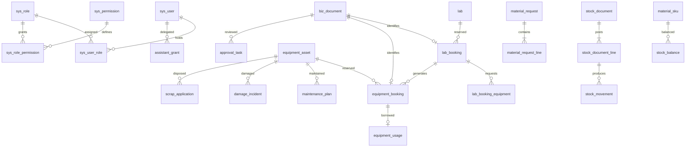

# 实训室管理系统数据库设计

版本：评审稿 v1.1（2026-10-13 将空间四表修订为 biz_space 单表，见 4.2 节变更说明）；数据库：MySQL 8.4.11 LTS。

> **⚠️ 2026-10-14 数据库适配变更（以数据库为准）**：场地表已由 `biz_space` 更名为 `lab`，字段同步更名：`space_name`→`lab_name`、`space_type`→`lab_type`、`location`→`location_detail`（建表脚本见 [sql/lab_management_all(1).sql](../sql/lab_management_all(1).sql)，旧 `sql/biz_space.sql` 已删除）。后端代码（`@TableName("lab")`、DTO/VO 的 `labName`/`labType`/`locationDetail` 字段）与前端已同步适配；`sys_user_data_scope.lab_id` 等下游引用目标即 `lab.id`。本文正文中的 `biz_space` / `space_name` 等字样为历史表述，均按本条映射读取；全文修订待下一版本统一处理。

本方案用于确认数据模型、字段、关系、状态、索引及事务边界。按用户确认，一期以项目现有流程与权限清单为依据；附件中的安全准入、采购审批、实训项目考核等作为扩展。本文不包含建表、初始化或迁移 SQL，不表示相关表已经建立，也不自动改变现有业务规则。

## 1 业务依据与设计选择

| 资料 | 采用内容 |
| --- | --- |
| [流程清单](流程清单.md) | 七大主流程、助理授权、异常处理、工位、课程导入、预约与报废状态 |
| [权限清单](权限清单.md) | 三类用户、四种角色、数据范围、审批链、账号安全 |
| [UI 设计规范](UI设计规范.md) | 看板需要的状态和统计展示；颜色、样式不进入业务数据库 |
| [高校实训室统一工作流程看板.html](C:/Users/Jinbin/Desktop/高校实训室统一工作流程看板.html) | 实训室分类、库存预警、资产生命周期与后续扩展业务 |
| [实训室设备物料清单与工作流程.docx](C:/Users/Jinbin/Desktop/实训室设备物料清单与工作流程.docx) | 设备型号、数量、参考价格、位置、物料规格、计量单位和补货信息 |
| 项目 AGENTS.md 与 BaseEntity | 小写下划线命名、UTC 时间、既有 id/createTime/updateTime/deleted 映射 |

附件 HTML 汇总了其他七份资料，展示的 129 类设备、61 类物料和预算总额不等于当前 DOCX 的明细总量，不能据此虚构资产或初始化库存。DOCX 数量为标准配置，价格为参考价，不能直接视为已验收入库或实际采购成本。

### 1.1 有分歧的规则

| 分歧 | 本设计建议默认值 | 数据模型处理 |
| --- | --- | --- |
| 流程清单要求场地管理员人工审批；权限清单写老师场地单 24 小时自动通过 | 场地不自动通过，到开始时间未批则取消 | 保留审批策略版本与超时动作字段；实施前统一源文档 |
| 助理流程仅领还；权限矩阵增加代盘点 | 一期助理只代领、归还，不允许调账 | 授权动作显式保存，盘点扩展权限不默认授予 |
| 库存预警有小于和小于等于两种规则 | 采用库存小于等于安全库存触发；库存为 0 单独标缺货 | 策略中记录比较规则，可审计 |
| 补货建议有两倍缺口、补至两倍安全库存两种公式 | 补至两倍安全库存，建议量为 max(0, 2 × 安全库存 − 可用库存) | 目标库存与建议量分开；建议量为派生值 |
| 固定资产“低价工具”与物料工具重叠 | 逐件有责任追踪需求的建资产；按数量领还的建可回收物料 | 同一实物不能同时计入资产数量和物料库存 |
| 资料提到院部，但一期只有四种角色 | 学院管理人员使用管理员身份和本学院数据范围 | 不新增第五种院部角色；后续审批阶段可增加 |

器材价值分类保存 NORMAL/VALUABLE；建议实际单价达到 5000 元或进入贵重清单即 VALUABLE，允许有理由的人工覆盖。价格缺失不得默认为普通：先保留待分类标记，完成分类才开放预约。阈值和例外清单都纳入版本化策略。

### 1.2 一期模块

| 模块 | 负责内容 |
| --- | --- |
| 身份与权限 | 用户、预置角色、菜单、权限、管理员数据范围、预约限制 |
| 教学与空间 | 场地（biz_space 单表）、开放时段、学期、班级、课程、排课及导入 |
| 资产与工位 | 型号与单件资产、位置变更、工位、学生绑定 |
| 预约与使用 | 场地申请、器材申请、老师背书、审批、借还、配套资源与照片 |
| 物料库存 | SKU、库存余额、申领、领还、采购到货登记、盘点与流水 |
| 保养与报废 | 三级保养、损坏登记、线下维修结果、鉴定、审批和处置 |
| 公共支撑 | 单据索引、审批记录、附件、消息、审计、规则与任务幂等 |

## 2 全局字段和存储约定

### 2.1 类型记号

后面的表目录使用以下类型记号。字段未标 `?` 即必填；`?` 表示可空。字段后的“→ 表”是关联目标，引用字段默认使用 ID 类型。未重复列出公共字段。

| 记号 | MySQL 类型 | 含义 |
| --- | --- | --- |
| ID | BIGINT | 正数雪花 ID，Java Long，接口作为字符串输出以避免 JavaScript 精度损失 |
| CODE | VARCHAR(64) | 业务编号、唯一标识；大小写规范化后比较 |
| NAME | VARCHAR(128) | 名称、标题 |
| SHORT | VARCHAR(32) | 状态、类型、角色码，Java 枚举映射，不使用 MySQL ENUM |
| STR(n) | VARCHAR(n) | 指定长度的字符串 |
| TXT | TEXT | 说明、意见和备注 |
| INT | INT | 整数；人数、节次、周次由约束限定为非负或正数 |
| BOOL | TINYINT | 仅允许 0/1 |
| QTY | DECIMAL(18,3) | 统一基础单位数量；不使用浮点数 |
| MONEY | DECIMAL(18,2) | 人民币金额 |
| PRICE | DECIMAL(18,4) | 物料计价单价 |
| TIME | DATETIME(3) | UTC 时间点、毫秒精度 |
| DATE | DATE | 不换算时区的纯日期 |
| CLOCK | TIME(0) | 上海本地日历的开放时间、节次时间；不能当 UTC 时间点使用 |
| JSON | JSON | 固定结构的规则快照和导入错误信息；不用来替代关联表 |

使用 InnoDB、utf8mb4；文本默认 utf8mb4_0900_ai_ci，用户名、业务码等归一化保存，需严格区分字节的请求键和存储键使用二进制比较规则。文件本体放文件存储，不放数据库 BLOB。

### 2.2 公共字段与删除策略

| 字段 | 类型 | 要求 |
| --- | --- | --- |
| id | ID | 每张表主键；MyBatis-Plus ASSIGN_ID，关联使用同一值类型 |
| create_time | TIME | 服务端写入，与既有 BaseEntity.createTime 对齐 |
| update_time | TIME | 服务端更新，与 BaseEntity.updateTime 对齐 |
| deleted | BOOL | 与既有 BaseEntity.deleted 对齐，默认 0；有历史引用的记录禁止物理删除 |
| create_user_id | ID? → sys_user | 操作来源；系统任务可空，另以审计标记 SYSTEM |
| update_user_id | ID? → sys_user | 最后操作者；系统任务可空 |
| version | INT | 可变业务聚合与余额表使用，从 0 开始，条件更新并递增 |

业务主档、单据和可变关联记录采用上述公共字段；追加事件、流水、操作日志至少保留 id/create_time/deleted/create_user_id，其中 deleted 固定 0，不允许普通业务修改或删除，update_time 可保持创建值。version 仅用于需要并发控制的可变表。

已提交单据使用取消、驳回、冲销等状态保留历史。业务码和学工号即使逻辑删除也不复用。关系表保持一行唯一关系，通过恢复原行、禁用或时效字段调整，不用 `(业务键, deleted)` 来解决重复创建，因为反复删除仍会冲突。

### 2.3 时间及引用完整性

业务展示时区为 Asia/Shanghai；所有 TIME 字段存 UTC。接口示例 `2026-10-13T01:00:00.000Z` 等价于上海 `2026-10-13 09:00:00`。使用既定 Instant 与 UTC LocalDateTime TypeHandler，数据库全局和连接会话时区为 +00:00。

DATE/CLOCK 用于学期日期、开放规则和节次，配合显式 Asia/Shanghai 生成 UTC 实际占用时间。按上海日期筛选转换为 UTC 半开区间；TIME 不接受无偏移量字符串。

本方案中的关联默认建立外键，删除策略为 RESTRICT，不级联删除历史业务。组织、用户、课程、资产使用禁用状态维持历史引用。逻辑删除不会被外键自动过滤，业务仍需检查对象可用性。来源名称可保存提交时快照，查询条件、授权和统计仍使用关联 ID。

## 3 核心关系

下面只画主要聚合，完整关联见字段表。

单据先登记 biz_document，具体业务表 document_id 唯一且必填。document_type 必须与业务表类型对应，创建在同一事务完成；不能同时挂到两种业务表。审批、附件、消息由统一单据 ID 关联，避免大量无法校验的 `business_type + business_id` 悬空引用。

## 4 表目录与字段设计

本节是逻辑表设计，字段类型可以用于后续实体和迁移评审，但这里不生成 SQL。提交时条件必填的字段会在说明中额外标出。

### 4.1 身份与 RBAC

| 表名 | 业务字段及类型 | 主要约束与关联 |
| --- | --- | --- |
| sys_department | parent_id: ID? → 本表；department_code: CODE；department_name: NAME；department_type: SHORT；enabled: BOOL | 类型 SCHOOL/COLLEGE/ASSET_OFFICE；码唯一，禁止组织循环 |
| sys_person_roster | person_no: CODE；person_type: SHORT；real_name: NAME；phone: STR(32)；department_id: ID → sys_department；enabled: BOOL | 学校预录入的学生/老师身份名单，学工号唯一、手机号唯一；不能由待登录用户自行修改身份类型 |
| sys_user | roster_id: ID? → sys_person_roster；user_type: SHORT；real_name: NAME；account_name: CODE?；phone: STR(32)?；person_no: CODE?；department_id: ID → sys_department；password_hash: STR(255)?；password_changed_at: TIME?；failed_login_count: INT；locked_until: TIME?；enabled: BOOL | 类型 STUDENT/TEACHER/ADMIN；roster_id、手机号、账号、学工号分别唯一；管理员账号与密码必填，学生老师身份匹配有效名单后首次登录建档 |
| sys_role | role_code: CODE；role_name: NAME；enabled: BOOL | 预置 STUDENT/TEACHER/ASSISTANT/ADMIN，码唯一；一期不开放自定义角色 |
| sys_permission | permission_code: STR(128)；permission_name: NAME；module_code: CODE；enabled: BOOL | `模块:资源:操作` 唯一，例如 item:material:create |
| sys_menu | parent_id: ID? → 本表；menu_code: CODE；menu_name: NAME；route_path: STR(255)?；component_key: CODE?；permission_id: ID? → sys_permission；menu_type: SHORT；sort_order: INT；enabled: BOOL | DIRECTORY/PAGE/ACTION；菜单码唯一；组件键只能对应前端白名单 |
| sys_role_permission | role_id: ID → sys_role；permission_id: ID → sys_permission；enabled: BOOL | 角色和权限组合唯一 |
| sys_role_menu | role_id: ID → sys_role；menu_id: ID → sys_menu；enabled: BOOL | 角色和菜单组合唯一 |
| sys_user_role | user_id: ID → sys_user；role_id: ID → sys_role；enabled: BOOL | 组合唯一；主身份角色只能有一个，ASSISTANT 不在此手动授予，见助理授权 |
| sys_user_data_scope | user_id: ID → sys_user；scope_type: SHORT；department_id: ID? → sys_department；campus_id: ID?；building_id: ID?；lab_id: ID? → biz_space；access_mode: SHORT | 类型 ALL/DEPARTMENT/CAMPUS/BUILDING/LAB，对应目标唯一有效；READ/WRITE；按具体目标建立去重约束，不能依靠可空列组合唯一；单表修订后 lab_id 目标为 biz_space.id，campus_id/building_id 为保留列（无挂靠表，暂不授予） |
| user_booking_restriction | user_id: ID → sys_user；source_document_id: ID? → biz_document；restriction_type: SHORT；reason: TXT；start_at: TIME；end_at: TIME?；revoked_at: TIME?；revoked_by: ID? → sys_user | 时间内禁止指定 EQUIPMENT/LAB/ALL 预约；自动逾期冻结有源单据，source_document_id + restriction_type 唯一 |

密码只保存带算法参数的单向散列，不存明文；敏感操作要求密码确认，因此老师初次手机号登录后需设置敏感操作密码，再开放审批和签批。不能通过客户端指定 user_type 或 role_code 自动获得老师身份；首次建档需匹配 sys_person_roster 中学校预录入的学工号与手机号关系，角色由服务端按名单派生。名单更新、停用和手机号变更经过管理员核验与审计，不能绕过已有账号唯一约束。

管理员写范围按归口部门授权，跨归口只读用显式 READ 范围配置；没有范围记录时不自动授予全校数据。非管理员的范围由本人、课程名单和有效助理授权计算，不能通过添加管理员范围行扩大权限。ALL 范围不填目标 ID，其他类型恰好填写对应目标；WRITE 包含该范围的 READ，冲突时取允许的最高操作级别，仍受实体状态与审批资格限制。

ASSISTANT 是依据有效 assistant_grant 动态计算的附加角色，不再持久化一份可失真的永久用户角色。至少一条有效授权时显示助理入口；每次执行仍检查具体授权范围与动作。Sa-Token 会话、短信验证码属于认证运行态，不写入业务单据；多实例部署时另定共享会话存储，不在数据库设计中假定已有 Redis。

### 4.2 空间与教学基础

> **单表修订（v1.1，2026-10-13）**：经业务确认，原 campus / building / lab / lab_open_rule 四表取消，场地统一为 **biz_space 单表**（建表脚本 [sql/biz_space.sql](../sql/biz_space.sql)，旧 sql/sys_space.sql 废弃删除）。开放规则简化为每日单时段 open_start/open_end；状态 AVAILABLE/MAINTAINING/CLOSED 落库，取代原"派生不入库"方案。本文后续章节（4.3/4.5/4.6/4.7/第 9 节）中原 `lab_id` 的引用目标统一指 `biz_space.id`；CAMPUS/BUILDING 数据范围为 RBAC 保留类型，暂无挂靠表。

| 表名 | 业务字段及类型 | 主要约束与关联 |
| --- | --- | --- |
| biz_space | space_name: NAME；space_type: SHORT；location: NAME?；capacity: INT；facilities: TXT?；open_start: CLOCK；open_end: CLOCK；status: SHORT | space_name 全局唯一，逻辑删除后不复用；space_type 为 CLASSROOM/TRAINING_ROOM；status 为 AVAILABLE/MAINTAINING/CLOSED；capacity > 0；open_start < open_end（上海本地时间，每日单时段） |
| academic_semester | semester_code: CODE；semester_name: NAME；start_date: DATE；end_date: DATE；week_one_monday: DATE；week_count: INT；enabled: BOOL | 码唯一，保存第 1 教学周的周一，实际日期落在学期范围 |
| teaching_class | department_id: ID → sys_department；class_code: CODE；class_name: NAME；enrollment_year: INT；enabled: BOOL | 班级码唯一 |
| class_member | class_id: ID → teaching_class；student_id: ID → sys_user；joined_on: DATE；left_on: DATE? | 学生只能有一个当前行政班，通过学生行锁与当前关系校验；退班保留历史 |
| course | course_code: CODE；course_name: NAME；department_id: ID → sys_department；enabled: BOOL | 码唯一 |
| course_offering | course_id: ID → course；semester_id: ID → academic_semester；offering_code: CODE；offering_name: NAME；enabled: BOOL | 某学期的开课实例，码唯一，后续单据关联此表而非仅课程名 |
| offering_teacher | offering_id: ID → course_offering；teacher_id: ID → sys_user；is_lead: BOOL；enabled: BOOL | 组合唯一；每实例一个有效主教师，可多授课老师 |
| offering_class | offering_id: ID → course_offering；class_id: ID → teaching_class；enabled: BOOL | 组合唯一，支持合班授课 |
| offering_student | offering_id: ID → course_offering；student_id: ID → sys_user；enabled: BOOL | 组合唯一；独立课程名单支持选课和历史追踪，不实时用行政班成员代替 |
| teaching_period | semester_id: ID → academic_semester；period_no: INT；start_time: CLOCK；end_time: CLOCK | 学期内节次号唯一，上海本地时间，开始早于结束 |
| course_schedule | offering_id: ID → course_offering；teacher_id: ID → sys_user；lab_id: ID → lab；weekday: INT；period_start: INT；period_end: INT；import_job_id: ID? → import_job；source_code: CODE?；external_row_key: STR(128)?；enabled: BOOL | 节次对应 teaching_period；老师须属于开课实例，工作日 1–7；来源码与稳定外部行键成对填写并组合唯一 |
| schedule_week | schedule_id: ID → course_schedule；week_no: INT | 组合唯一，替代不可维护的 week_mask 字符串，周次在学期范围内 |
| schedule_occurrence | schedule_id: ID → course_schedule；week_no: INT；class_date: DATE；start_at: TIME；end_at: TIME；status: SHORT | 对排课规则展开实际日期，占用统一进入 lab_slot；规则和周次组合唯一；SCHEDULED/CANCELLED/FINISHED |

课程批量导入先暂存、校验老师/实验室/节次/周次，再在事务中发布规则、实际课次及占用。禁止直接覆盖有预约冲突的课表，管理员仲裁需有取消记录。导入同一行可更新同一规则，依赖 import_job 的文件哈希和稳定 external_row_key，不靠行号猜测新旧身份；手工新增的排课允许来源键为空。

### 4.3 设备、位置和工位

| 表名 | 业务字段及类型 | 主要约束与关联 |
| --- | --- | --- |
| equipment_category | parent_id: ID? → 本表；category_code: CODE；category_name: NAME；enabled: BOOL | 分类码唯一，不能循环 |
| equipment_model | category_id: ID → equipment_category；model_code: CODE；equipment_name: NAME；brand: NAME?；specification: STR(500)；unit_name: STR(16)；reference_price: MONEY?；expected_life_months: INT?；requires_data_erasure: BOOL | 型号码唯一；参考单价与每台实际采购价分开 |
| equipment_asset | model_id: ID → equipment_model；asset_code: CODE；serial_no: STR(128)?；lab_id: ID → lab；department_id: ID → sys_department；location_detail: STR(255)?；custodian_id: ID? → sys_user；purchase_date: DATE?；purchase_price: MONEY?；warranty_until: DATE?；value_level: SHORT?；classification_reason: TXT?；classified_by: ID? → sys_user；classified_at: TIME?；status: SHORT；enabled: BOOL | 资产编号唯一；每台、每套一行；序列号不强制全局唯一；未分类禁止借用 |
| equipment_location_history | asset_id: ID → equipment_asset；from_lab_id: ID? → lab；to_lab_id: ID → lab；from_location: STR(255)?；to_location: STR(255)?；moved_at: TIME；operator_id: ID → sys_user；reason: TXT | 追加位置历史；仅允许空闲且无冲突业务的资产迁移，当前台账与历史同事务更新 |
| workstation | lab_id: ID → lab；workstation_code: CODE；main_asset_id: ID? → equipment_asset；status: SHORT；description: TXT? | 同实验室工位号唯一；主设备只能绑定一个工位且位于同室；NORMAL/FAULT/DISABLED |
| workstation_binding | workstation_id: ID → workstation；student_id: ID → sys_user；offering_id: ID → course_offering；bound_by: ID → sys_user；bound_at: TIME | 仅存有效绑定，student_id 唯一、workstation_id 唯一；解绑物理移除此投影，历史留在下一表 |
| workstation_binding_event | workstation_id: ID → workstation；student_id: ID → sys_user；offering_id: ID → course_offering；action: SHORT；occurred_at: TIME；operator_id: ID → sys_user；reason: TXT? | BIND/UNBIND，追加事件；有效绑定修改与事件同事务 |

设备状态为 IDLE/RESERVED/IN_USE/MAINTAINING/SCRAPPED。未来预约以预约时段为准，不能因一张未来预约就把设备永久标为 RESERVED 并拒绝其他不相交预约。页面状态由实体物理状态与当前生效预约派生；报废为最终态。实验室禁用不自动报废室内设备。

### 4.4 公共单据与审批

| 表名 | 业务字段及类型 | 主要约束与关联 |
| --- | --- | --- |
| biz_document | document_no: CODE；document_type: SHORT；owner_user_id: ID → sys_user；department_id: ID → sys_department；policy_id: ID? → business_policy；submitted_at: TIME?；idempotency_key: STR(128) | 单号唯一；owner_user_id + document_type + idempotency_key 唯一；来源人归属与经办人分开 |
| approval_task | document_id: ID → biz_document；stage_code: CODE；sequence_no: INT；round_no: INT；required_role: CODE；assigned_user_id: ID? → sys_user；assigned_department_id: ID? → sys_department；status: SHORT；available_at: TIME；remind_at: TIME?；escalate_at: TIME?；timeout_at: TIME?；timeout_action: SHORT；decided_by: ID? → sys_user；decided_at: TIME?；decision_comment: TXT? | 单据+阶段+序号+轮次唯一；WAITING/READY/APPROVED/REJECTED/CANCELLED；角色码关联 sys_role.role_code，待办权限还需范围校验 |
| document_event | document_id: ID → biz_document；event_type: SHORT；from_status: SHORT?；to_status: SHORT?；actor_id: ID? → sys_user；actor_type: SHORT；occurred_at: TIME；reason: TXT?；task_id: ID? → approval_task；request_key: STR(128) | 状态变更、代批、超时自动通过留痕；单据+请求键唯一，SYSTEM 操作不能冒充管理员 |

业务表 status 是当前业务状态的唯一来源；biz_document 不另存一份 status。approval_task 是阶段待办，document_event 是不可变过程历史。代批保存实际审批人和原 assigned_user_id；超时自动通过先重新检验可用性及资源冲突，不能把“超时”当作跳过事务校验的理由。

### 4.5 场地预约和器材借还

| 表名 | 业务字段及类型 | 主要约束与关联 |
| --- | --- | --- |
| lab_booking | document_id: ID → biz_document；lab_id: ID → lab；applicant_id: ID → sys_user；offering_id: ID? → course_offering；class_id: ID? → teaching_class；purpose: TXT；participant_count: INT；start_at: TIME；end_at: TIME；status: SHORT；endorse_teacher_id: ID? → sys_user；endorse_at: TIME?；endorse_comment: TXT?；cancel_reason: TXT?；cancel_type: SHORT?；cancelled_at: TIME? | document_id 唯一；提交后人数与时段必校验；学生必须指定背书老师；批准时 endorsement 必完整 |
| lab_slot | lab_id: ID → lab；booking_id: ID? → lab_booking；schedule_occurrence_id: ID? → schedule_occurrence；start_at: TIME；end_at: TIME；released_at: TIME?；release_reason: TXT? | booking_id 和 schedule_occurrence_id 恰一非空，分别唯一；仅未释放的记录参与冲突；重复审批不能插第二份占用 |
| lab_usage | booking_id: ID → lab_booking；actual_start_at: TIME；actual_end_at: TIME?；finish_type: SHORT?；finished_by: ID? → sys_user；note: TXT? | booking_id 唯一；SYSTEM/FORCE，自动开始结束的系统使用档案，不强制人工签到 |
| lab_booking_equipment | booking_id: ID → lab_booking；asset_id: ID → equipment_asset；required_note: TXT? | 预约和资产组合唯一；配套设备逐台选定，批准时生成器材预约 |
| lab_booking_material | booking_id: ID → lab_booking；sku_id: ID → material_sku；requested_qty: QTY；note: TXT? | 组合唯一，预登记不是出库，也不自动减少库存 |
| equipment_booking | document_id: ID → biz_document；asset_id: ID → equipment_asset；applicant_id: ID → sys_user；approval_teacher_id: ID? → sys_user；offering_id: ID? → course_offering；lab_booking_id: ID? → lab_booking；purpose: TXT；start_at: TIME；end_at: TIME；value_level_snapshot: SHORT；status: SHORT；cancel_reason: TXT?；cancelled_at: TIME? | document_id 唯一，单据关联一台实物；lab_booking_id + asset_id 唯一（独立申请前者可空）；分类在提交时快照 |
| equipment_usage | booking_id: ID → equipment_booking；borrower_id: ID → sys_user；checkout_operator_id: ID → sys_user；checked_out_at: TIME；due_at: TIME；return_operator_id: ID? → sys_user；returned_at: TIME?；return_condition: SHORT?；checkout_note: TXT?；return_note: TXT?；status: SHORT | booking_id 唯一；CHECKED_OUT/RETURNED；归还所有字段与照片条件校验；代借还保存实际操作者 |

场地状态采用 PENDING_ENDORSE/PENDING/APPROVED/IN_USE/FINISHED/REJECTED/CANCELLED；cancel_type 区分 MANUAL/FORCE/AUTO_EXPIRED/ENDORSE_TIMEOUT。器材预约采用 PENDING_TEACHER/PENDING_ADMIN/APPROVED/CHECKED_OUT/RETURNED/REJECTED/CANCELLED。

一期器材一次预约一台，批量申请创建多张关联单据。若需批量整体撤回，biz_document 可增加 batch_key: CODE? 作为批次索引，不将 ID 列表写进字符串。混合贵重与普通设备逐件执行对应审批链。

器材借出至少有一张 CHECKOUT_PHOTO，归还至少有一张 RETURN_PHOTO；DAMAGED 同时要求描述及 DAMAGE_PHOTO。附件通过 document_attachment 关联器材预约的 document_id，使用记录只引用预约。RETURNED 后逾期已结束，归还损坏另建 damage_incident 并置设备 MAINTAINING。

场地 end_at 是预约资源释放边界；end_at+2h 是系统归档 FINISHED 的宽限时间，不能默默多占用两小时影响下一场。lab_usage 保存系统记录，并不证明人员实际进入或离开。审批过期、无借出预约到期、人工取消都写 document_event，不删除原单。

### 4.6 助理授权

| 表名 | 业务字段及类型 | 主要约束与关联 |
| --- | --- | --- |
| assistant_grant | teacher_id: ID → sys_user；student_id: ID → sys_user；start_at: TIME；end_at: TIME；status: SHORT；revoked_at: TIME?；revoked_by: ID? → sys_user；reason: TXT? | ACTIVE/REVOKED/EXPIRED；仅老师授权学生，最长一学年，时间半开区间 |
| assistant_grant_scope | grant_id: ID → assistant_grant；scope_type: SHORT；offering_id: ID? → course_offering；lab_id: ID? → lab；action_code: CODE | OFFERING/LAB，对应目标恰一非空；分别保证授权+目标+动作唯一；动作 ISSUE/RETURN |

范围满足“任意一条授权范围命中”即可，但老师本人必须有目标课程或实验室的可操作权限；LAB 授权不能允许助理代领其他老师的物料。每笔代办同时保存 operator_id、owner_teacher_id、grant_id、offering_id、lab_id。

授权撤销或到期立即阻止新的代办。已出库未归还项保留，由老师或管理员跟进，不删除流水，不假装助理已归还。同一学生可被多位老师授权，一笔动作必须明确选用一条授权。撤销、范围修改写 sys_operation_log，并使权限缓存失效。

### 4.7 物料和库存

| 表名 | 业务字段及类型 | 主要约束与关联 |
| --- | --- | --- |
| material_category | parent_id: ID? → 本表；category_code: CODE；category_name: NAME；enabled: BOOL | 类别码唯一 |
| material_sku | category_id: ID → material_category；sku_code: CODE；material_name: NAME；specification: STR(500)；base_unit: STR(16)；quantity_scale: INT；material_type: SHORT；is_hazardous: BOOL；is_valuable: BOOL；enabled: BOOL | SKU 码唯一；CONSUMABLE/RETURNABLE；单位固定，quantity_scale 0–3，整数单位不能领用小数 |
| stock_location | lab_id: ID → lab；location_code: CODE；location_name: NAME；location_detail: STR(255)?；enabled: BOOL | 同实验室库位码唯一；一期库存归属于具体实验室，不使用无归属“公共库存” |
| stock_balance | location_id: ID → stock_location；sku_id: ID → material_sku；stock_qty: QTY；safe_qty: QTY；target_qty: QTY；moving_average_price: PRICE；version: INT | 库位+SKU 唯一，数量非负；safe_qty/target_qty 非负且 target_qty ≥ safe_qty；余额为可重建投影 |
| material_quota | offering_id: ID → course_offering；sku_id: ID → material_sku；qty_per_student_period: QTY；enabled: BOOL | 开课实例+SKU 唯一；每人每课时定额，用学生人数×课时计算并保存申请快照 |
| material_request | document_id: ID → biz_document；lab_id: ID → lab；owner_teacher_id: ID → sys_user；operator_id: ID → sys_user；grant_id: ID? → assistant_grant；offering_id: ID → course_offering；lab_booking_id: ID? → lab_booking；schedule_occurrence_id: ID? → schedule_occurrence；participant_count: INT；period_count: INT；purpose: TXT；status: SHORT | document_id 唯一；预约或实际课次至少一项且不能同时填；无授权时操作人须老师本人或管理员 |
| material_request_line | request_id: ID → material_request；sku_id: ID → material_sku；requested_qty: QTY；quota_qty_snapshot: QTY；requires_extra_approval: BOOL；requires_dual_sign: BOOL；approved_qty: QTY?；fulfilled_qty: QTY | request_id+SKU 唯一；申请量 > 0，实发不超过批准量；缺定额策略要求老师确认，不按无限量处理 |
| stock_document | document_id: ID → biz_document；movement_type: SHORT；status: SHORT；operator_id: ID → sys_user；owner_teacher_id: ID? → sys_user；grant_id: ID? → assistant_grant；material_request_id: ID? → material_request；lab_booking_id: ID? → lab_booking；occurred_at: TIME；posted_at: TIME?；reversal_of_id: ID? → 本表；reason: TXT? | document_id 唯一；OPENING/PURCHASE_IN/ISSUE/RETURN_IN/TRANSFER/ADJUST/SCRAP/REVERSAL；DRAFT/PENDING/APPROVED/POSTED/CANCELLED；已过账不能编辑 |
| stock_document_line | stock_document_id: ID → stock_document；line_no: INT；sku_id: ID → material_sku；from_location_id: ID? → stock_location；to_location_id: ID? → stock_location；quantity: QTY；unit_price_snapshot: PRICE；amount_snapshot: MONEY；request_line_id: ID? → material_request_line；original_issue_line_id: ID? → 本表；adjust_direction: SHORT? | 单据+行号唯一，quantity > 0；出入方向由类型校验；归还绑定原出库行，不能仅凭 booking_id 随意归还 |
| stock_movement | document_line_id: ID → stock_document_line；location_id: ID → stock_location；sku_id: ID → material_sku；direction: SHORT；qty_delta: QTY；before_qty: QTY；after_qty: QTY；value_delta: MONEY；before_avg_price: PRICE；after_avg_price: PRICE；occurred_at: TIME；movement_key: STR(128) | movement_key 唯一；IN/OUT；净变动可正负且与方向一致；调拨同一行产生两条流水；只追加 |
| material_settlement | issue_line_id: ID → stock_document_line；settlement_type: SHORT；quantity: QTY；operator_id: ID → sys_user；settled_at: TIME；return_line_id: ID? → stock_document_line；document_id: ID → biz_document；reason: TXT? | RETURNED/CONSUMED/LOST/DAMAGED；同归还行唯一，其他用单据幂等；归还登记与核销同事务 |
| stocktake | document_id: ID → biz_document；location_id: ID → stock_location；semester_id: ID? → academic_semester；count_date: DATE；status: SHORT；started_at: TIME?；finished_at: TIME?；adjust_document_id: ID? → stock_document | document_id 唯一；DRAFT/COUNTING/PENDING_REVIEW/COMPLETED/CANCELLED；同一库位最多一张 COUNTING/PENDING_REVIEW 盘点单，由库位行锁保证；调账前审批 |
| stocktake_line | stocktake_id: ID → stocktake；sku_id: ID → material_sku；book_qty_snapshot: QTY；counted_qty: QTY?；balance_version_snapshot: INT；difference_reason: TXT?；counted_by: ID? → sys_user；counted_at: TIME? | 盘点+SKU 唯一；实盘量非负；差异派生，非零须填写原因 |

“物料申领”和“实际出库”分开：请求通过只表示可领取，不预扣库存。一期不做库存预占，余额 stock_qty 即可用库存；领用时可能缺货，需要重新校验。若以后做库存预占，新增预占明细及 reserved_qty，不把批准数量直接当库存。

回收物料在出库后允许多次部分归还；累计 RETURNED+CONSUMED+LOST+DAMAGED 不超过原出库量，未结数量按原行计算。耗材实际发出后登记 CONSUMED 核销，不要求归还；可回收件损坏归还不重新增加可用库存，管理员处理后才能用独立批准的入库动作恢复。损失核销不再扣一次库存，因为库存已在出库时扣减。

材料高价值/危险“双人签字”通过 material_request 的两个独立 approval_task 保存，必须不同人员且具有相应权限；助理本人不能签自己代领的单据。超过定额签批使用老师阶段。归还、调拨和采购到货登记也必须记录实际经办人，不从库存余额倒推责任。

计价采用移动加权平均；入库更新平均成本，出库按过账时平均成本快照计算价值，调拨以来源库位成本转入。数量盘盈使用审批确认的单价，盘亏使用账面均价。金额是管理成本口径，不声称替代学校财务核算。safe_qty 与 target_qty 按库位/SKU 设置；汇总预警先按实验室合并，不能把其他实验室的库存视为本室可用。

### 4.8 损坏、保养与报废

| 表名 | 业务字段及类型 | 主要约束与关联 |
| --- | --- | --- |
| damage_incident | document_id: ID → biz_document；asset_id: ID? → equipment_asset；workstation_id: ID? → workstation；usage_id: ID? → equipment_usage；reported_by: ID → sys_user；reported_at: TIME；description: TXT；status: SHORT；handle_result: SHORT?；handle_note: TXT?；handle_user_id: ID? → sys_user；handle_at: TIME?；repair_cost: MONEY?；vendor_name: NAME?；test_passed: BOOL? | document_id 唯一，设备或工位至少一项；OPEN/HANDLED；REPAIRED/TO_SCRAP；保留线下处理结果，不建线上维修派单流程 |
| maintenance_rule | asset_id: ID → equipment_asset；maintenance_level: SHORT；weekday: INT?；responsible_user_id: ID → sys_user；vendor_name: NAME?；checklist: JSON；enabled: BOOL | DAILY/WEEKLY/SEMESTER；每资产每级别唯一有效规则；清单版本修改须生成规则快照 |
| maintenance_plan | document_id: ID → biz_document；asset_id: ID → equipment_asset；rule_id: ID? → maintenance_rule；maintenance_level: SHORT；period_key: CODE；semester_id: ID? → academic_semester；due_at: TIME；executor_id: ID → sys_user；vendor_name: NAME?；checklist_snapshot: JSON；status: SHORT | document_id 唯一；asset_id+maintenance_level+period_key 唯一，周计划重跑不重复；PENDING/COMPLETED/CANCELLED |
| maintenance_record | plan_id: ID? → maintenance_plan；asset_id: ID → equipment_asset；lab_booking_id: ID? → lab_booking；maintenance_level: SHORT；executor_id: ID → sys_user；performed_at: TIME；result: SHORT；description: TXT；check_results: JSON；document_id: ID → biz_document | document_id 唯一；有计划时 plan_id 唯一；日常保养无计划也可独立登记；PASS/ISSUE_FOUND |
| scrap_application | document_id: ID → biz_document；asset_id: ID → equipment_asset；applicant_id: ID → sys_user；source_incident_id: ID? → damage_incident；reason: TXT；asset_status_before: SHORT；original_value_snapshot: MONEY?；status: SHORT；appraisal_user_id: ID? → sys_user；appraisal_at: TIME?；appraisal_result: SHORT?；appraisal_note: TXT?；approved_by: ID? → sys_user；approved_at: TIME?；disposal_method: SHORT?；disposed_by: ID? → sys_user；disposed_at: TIME?；data_erasure_required: BOOL；data_erasure_confirmed: BOOL；data_erasure_evidence_file_id: ID? → sys_file；residual_value: MONEY? | document_id 唯一；每资产最多一条进行中的报废单，资产锁保证；PENDING/APPRAISING/APPROVED/DISPOSED/REJECTED |

报废申请开始将资产置 MAINTAINING，并记录原状态；DISPOSED 才将资产置 SCRAPPED。驳回恢复前重新核验未修复故障、其他保养与借用情况，不能盲目恢复快照中的 IDLE。需要数据擦除的资产必须确认并有证据才能处置；无需擦除的资产记录不适用，不强制伪造证据。

保养逾期由 due_at 与当前时间派生，不另加会失真的 OVERDUE 状态。周计划按上海教学日历生成，以周期键去重；日常登记和期初批量计划都可关联单据。贵重报废审批必须在管理员数据范围内，批准记录和实际处置人分开。

### 4.9 公共支撑

| 表名 | 业务字段及类型 | 主要约束与关联 |
| --- | --- | --- |
| business_policy | policy_code: CODE；policy_version: INT；policy_name: NAME；effective_from: TIME；effective_to: TIME?；config: JSON；enabled: BOOL | 码+版本唯一，同码生效区间不能重叠；发布后不可修改，新增版本；存审批超时、提醒、冻结、预警、定额等参数 |
| sys_file | storage_key: STR(512)；original_name: STR(255)；mime_type: STR(128)；size_bytes: BIGINT；sha256: STR(64)；uploaded_by: ID → sys_user；uploaded_at: TIME；status: SHORT | 存储键唯一；UPLOADED/BOUND/REJECTED；访问需要鉴权，不存短期签名 URL |
| document_attachment | document_id: ID → biz_document；file_id: ID → sys_file；attachment_type: SHORT；sort_order: INT | 单据+文件+用途唯一；CHECKOUT_PHOTO/RETURN_PHOTO/DAMAGE_PHOTO/APPRAISAL/DISPOSAL/OTHER |
| notification_event | document_id: ID? → biz_document；event_type: SHORT；dedupe_key: STR(128)；payload: JSON；occurred_at: TIME；status: SHORT；attempt_count: INT；next_attempt_at: TIME?；last_error: TXT? | 去重键唯一；事务发件箱，PENDING/SENDING/SENT/FAILED；租约恢复避免发送线程崩溃永久卡住 |
| user_notification | event_id: ID → notification_event；recipient_id: ID → sys_user；channel: SHORT；title: NAME；content: TXT；read_at: TIME?；delivered_at: TIME?；status: SHORT | 事件+接收人+渠道唯一，站内消息与短信渠道分开跟踪 |
| sys_operation_log | actor_id: ID? → sys_user；actor_type: SHORT；document_id: ID? → biz_document；module_code: CODE；action_code: CODE；target_table: CODE；target_id: ID?；request_id: STR(128)；client_ip: STR(45)?；before_value: JSON?；after_value: JSON?；success: BOOL；occurred_at: TIME | 只追加；目标多态字段仅用于审计，核心业务关系不用它；密码、验证码、token 不记录 |
| import_job | import_type: SHORT；file_id: ID → sys_file；file_sha256: STR(64)；source_code: CODE；uploaded_by: ID → sys_user；status: SHORT；total_rows: INT；success_rows: INT；failed_rows: INT；error_report_file_id: ID? → sys_file；started_at: TIME?；finished_at: TIME? | PENDING/VALIDATING/READY/COMPLETED/FAILED；导入类型+来源+文件哈希防重复发布，校验失败无业务过账 |
| scheduled_action | document_id: ID → biz_document；action_code: CODE；threshold_key: CODE；due_at: TIME；status: SHORT；lease_until: TIME?；attempt_count: INT；result_note: TXT? | 单据+动作+阈值唯一，READY/RUNNING/DONE/CANCELLED/FAILED；支持多实例争抢、崩溃租约恢复、失败重试 |

短信或外部通知发送不能与数据库事务天然原子化；提交后通过发件箱重试，下游用稳定业务键去重。系统时间驱动的催办、冻结、自动开始/结束由 scheduled_action 保存动作身份，执行时必须再检查单据当前状态及 version。每小时扫描是兜底发现机制，不保证正好到秒完成动作。

## 5 状态及业务不变量

### 5.1 审批与借用

| 场景 | 数据变化及要求 |
| --- | --- |
| 学生普通器材申请 | 预约 PENDING_TEACHER，建老师 READY 待办；通过后 APPROVED |
| 学生贵重器材申请 | 老师通过后 PENDING_ADMIN，再启用管理员待办；不能跳过老师阶段 |
| 老师普通器材申请 | 检查数据范围、限制及冲突后直接 APPROVED，仍写系统通过事件 |
| 老师贵重器材申请 | PENDING_ADMIN，按策略记录提醒与自动通过截止时间 |
| 确认借出 | 预约 APPROVED 且到时、资产可用、借出照片存在；同事务建使用记录并置 CHECKED_OUT/IN_USE |
| 归还完好 | 使用 RETURNED，预约 RETURNED，设备重新计算 IDLE/RESERVED |
| 归还损坏 | 同上加 damage_incident、照片与 MAINTAINING；多故障未解除前不可恢复空闲 |
| 超期 1h/24h | 对具体使用单和阈值生成一次催办；通知接收人不同但动作不能重复 |
| 超期 48h | 给借用人创建 7 天预约限制，固定 end_at；扫描重跑不能反复延长冻结 |

老师的普通免审批不意味着可以借其他学院停用或维修中的设备。管理员代借代还也不得跳过照片、库存或时间冲突校验。使用仍未归还的设备即使原预约 end_at 已过也不能再次借出。

### 5.2 物料与报废

审批任务必须明确“同级任一管理员可处理”或“指定某人处理”；双签则是两个均需通过的任务，不复用单个 approved_by 字段。库存单 POSTED 才产生流水与余额变动，拒绝、取消、重试不能重复扣减。

账实一致关系为：当前库存 = 所有已过账流水净变动之和（期初作为 OPENING 流水）；库存余额可以重建，原始流水不改写。冲销是新单据和相反流水，保留原单并链接 reversal_of_id；一期仅允许整单冲销一次，冲销前检查已产生的归还、核销和调拨依赖，冲销本身不再冲销。

## 6 并发和事务边界

### 6.1 防止重复预约

MySQL 普通唯一索引不能阻止时间区间重叠。所有产生或改变占用的路径使用同一规则：锁对应 lab 或 equipment_asset 行，再检查相交区间，更新状态/占用并提交；不能只在控制器先查一次。

两个区间相交的判断为 `existing.start_at < request.end_at` 且 `existing.end_at > request.start_at`，即 [start_at, end_at)。器材有效冲突状态为 APPROVED/CHECKED_OUT；场地检查未释放的 lab_slot。待审批不永久占用，提交和审批都校验，最后批准者若发生冲突需重新申请，不能自动抢占。

多设备场地单批准，按 lab ID、asset ID 固定顺序锁定，重新校验全套设备后一次提交 lab_slot、生成器材预约与审批事件；任一失败整单回滚。课程导入、取消、强制结束、资产迁移、保养和报废也使用相同资源锁协议。正在借出的资产不得进入处置销账，先归还并核验。

### 6.2 库存过账

同事务完成：权限与授权复核 → 申领批准量复核 → 锁库位/SKU 余额 → 校验数量与精度 → 生成实际单据明细和不可变流水 → 更新余额和均价 → 更新实发/核销量 → 写事件与通知发件箱。

多 SKU 按 location_id、sku_id 排序锁定，调拨两边一起锁，余额不足整笔失败，禁止先扣一部分再静默跳过缺货项。首次创建余额行依赖唯一键处理并发；版本或条件更新失败必须回滚重试，不能覆盖较新的余额。

盘点一期采用库位冻结：COUNTING 到批准调账/取消期间，所有库存写入路径都检查并锁 stock_location，禁止新出入库；允许只读查询。锁不是跨数小时持有数据库事务，冻结是持久业务状态。盘点提交先验证余额 version 与快照一致；产生一个 ADJUST 单据后解冻。冻结、调账与完成状态变更均有审计。

### 6.3 幂等与权限失效

| 操作 | 幂等依据 |
| --- | --- |
| 单据创建 | 所有人+单据类型+客户端请求键唯一 |
| 借出/归还 | 使用记录 booking_id 唯一，事件请求键唯一，状态条件更新 |
| 库存过账 | 单据由 APPROVED 变 POSTED 只能一次；流水 movement_key 唯一 |
| 场地批准生成器材单 | 场地预约+asset_id 唯一 |
| 周保养生成 | 资产+级别+周期键唯一 |
| 超期提醒/冻结 | 单据+动作+阈值唯一，冻结源单据唯一 |
| 消息 | 事件 dedupe_key 和接收人/渠道组合唯一 |
| 工位绑定 | 当前学生唯一、当前工位唯一；历史事件与投影同事务 |

授权撤销与代办过账同时发生时，双方锁同一 assistant_grant 行，服务端在锁内复核有效期和范围，再完成流水。修改范围也锁授权父行；不能只依赖前端菜单或旧 token 中的 ASSISTANT 字符串。老师课程名单、管理员范围变化及时失效权限缓存，业务写入每次重新校验。

## 7 索引和约束重点

业务码、单据编号和幂等键按上文建立唯一约束；所有外键有索引。日期范围 start_at < end_at，库存与数量约束在数据库和服务端同时校验。仅靠跨表条件的规则用事务保证，不能声称 CHECK 可以完成跨表角色和重叠区间校验。

| 表 | 建议主要查询索引 | 对应查询 |
| --- | --- | --- |
| sys_user | department_id, user_type, enabled；phone；person_no | 用户检索与数据范围 |
| biz_space | space_name 唯一；space_type；status；capacity | 场地检索、类型/状态筛选与容量查询 |
| equipment_asset | lab_id, status, enabled；department_id, status；model_id | 设备台账、故障看板 |
| equipment_booking | asset_id, status, start_at, end_at；applicant_id, create_time；approval_teacher_id, status | 时间冲突、个人申请、老师待批 |
| equipment_usage | status, due_at；borrower_id, status | 超期扫描、使用历史 |
| lab_slot | lab_id, released_at, start_at, end_at | 场地/课表冲突统一查询 |
| lab_booking | applicant_id, create_time；lab_id, status, start_at；endorse_teacher_id, status | 个人预约、背书、周视图 |
| approval_task | assigned_user_id, status, available_at；assigned_department_id, required_role, status；status, timeout_at | 待办和超时扫描 |
| assistant_grant | student_id, status, end_at；teacher_id, status | 代办授权与过期回收 |
| stock_balance | location_id, sku_id 唯一 | 库位余额；小于安全库存为比较查询，普通索引不天然加速 |
| stock_movement | location_id, sku_id, occurred_at, id；document_line_id | 流水月报和重建 |
| material_request | owner_teacher_id, status, create_time；grant_id | 老师归属和授权审计 |
| maintenance_plan | status, due_at；asset_id, maintenance_level, period_key 唯一 | 保养逾期、计划去重 |
| damage_incident | status, reported_at；asset_id, status | 异常清单 |
| scrap_application | asset_id, status；status, create_time | 进行中报废、资产生命周期 |
| scheduled_action | status, due_at, lease_until | 到期任务争抢和恢复 |
| user_notification | recipient_id, read_at, create_time | 未读通知 |
| sys_operation_log | actor_id, occurred_at；document_id, occurred_at | 管理员操作审计 |

组合唯一含可空列时，MySQL 允许多个 NULL。数据范围、授权范围、主设备绑定等需要非空目标的独立唯一约束或生成的有效键；不能用一个全可空联合索引冒充完整去重。当前工位绑定直接使用唯一非空学生/工位 ID；已解除历史放事件表避免逻辑删除占住唯一键。

status、权限码、数量和范围类型由明确枚举及 CHECK/服务端校验限制；不要为每个布尔字段建索引。索引先围绕查询设计，初始化后通过实际执行计划调整。

## 8 看板和报表口径

| 指标 | 数据来源与计算口径 |
| --- | --- |
| 设备种类数 | equipment_model 有效去重数，与 equipment_asset 实物数量分别展示 |
| 资产总值 | 实际 purchase_price 合计，缺价单列；参考价×标准配置数量只能显示预算 |
| 设备利用率 | 周期内实际使用区间与统计周期/开放窗口的交集时长之和，除以可使用开放时长；报废及维护时间剔除，规则版本留痕 |
| 场地预约率 | 已批准预约与周期开放窗口交集时长，除以可预约开放时长；课程占用独立显示或明确是否含课表 |
| 场地使用率 | 课表实际课次与 lab_usage 系统生效记录合并后计算；没有签到数据时标明为“系统记录使用率” |
| 库存预警 | 按实验室/SKU 汇总余额与对应安全库存；0 为缺货，小于等于阈值为预警，建议量按目标量差额 |
| 保养完成率 | 到期计划中 COMPLETED 数 / 应完成数，取消计划剔除；日常无计划登记不充当周计划完成 |
| 报废量与残值 | 仅统计 DISPOSED，申请或 APPROVED 不算已报废 |
| 老师课程物料成本 | material_request → 实发 stock_document_line 的成本快照，扣归还或冲销；区别经办助理和归属老师 |

看板初期从业务表聚合，不另建一份可手改的“看板数值表”。需要优化再加日汇总投影，标明统计日期与刷新时间，并可从原始业务重建。

## 9 附件业务扩展表

以下为扩展模型，一期不默认启用对应入口或审批，也不将物理门禁/签到要求硬塞进当前自动使用流程。扩展表复用公共字段、biz_document、approval_task、sys_file；增设权限需另行评审。

| 扩展表 | 核心字段与关系 | 用途 |
| --- | --- | --- |
| safety_training | training_code: CODE；name: NAME；lab_type: SHORT；valid_days: INT；enabled: BOOL | 安全培训与有效期规则 |
| safety_assessment | training_id: ID → safety_training；student_id: ID → sys_user；score: DECIMAL(5,2)；passed: BOOL；assessed_at: TIME；expires_at: TIME；examiner_id: ID → sys_user | 多次考试记录，准入检查最新有效合格记录 |
| lab_access_grant | lab_id: ID → lab；user_id: ID → sys_user；assessment_id: ID? → safety_assessment；start_at: TIME；end_at: TIME；revoked_at: TIME? | 账号/门禁准入，与预约权限分开 |
| lab_attendance | lab_booking_id: ID? → lab_booking；schedule_occurrence_id: ID? → schedule_occurrence；user_id: ID → sys_user；checked_in_at: TIME；checked_out_at: TIME?；method: SHORT | 物理签到，课次或预约恰一非空；外部门禁事件需幂等键 |
| procurement_request | document_id: ID → biz_document；department_id: ID → sys_department；budget_amount: MONEY；needed_on: DATE；status: SHORT | 院部采购审批，不代替一期实际到货入库 |
| procurement_request_line | request_id: ID → procurement_request；sku_id: ID? → material_sku；model_id: ID? → equipment_model；quantity: QTY；estimated_price: PRICE；spec_snapshot: TXT | SKU/设备型号恰一非空，实际采购成本验收后确认 |
| procurement_receipt | document_id: ID → biz_document；request_id: ID → procurement_request；accepted_by: ID → sys_user；accepted_at: TIME；status: SHORT | 分批到货验收，验收后生成资产或物料入库 |
| procurement_receipt_line | receipt_id: ID → procurement_receipt；request_line_id: ID → procurement_request_line；accepted_qty: QTY；rejected_qty: QTY；actual_unit_price: PRICE | 累计收货不能超过审批采购量；设备资产增加 receipt_line_id 引用 |
| asset_stocktake | document_id: ID → biz_document；lab_id: ID → lab；count_date: DATE；status: SHORT | 单件资产月盘与学期大盘 |
| asset_stocktake_line | stocktake_id: ID → asset_stocktake；asset_id: ID → equipment_asset；expected_lab_id: ID → lab；observed_lab_id: ID? → lab；result: SHORT；note: TXT? | PRESENT/MISSING/LOCATION_MISMATCH；不直接生成物料 ADJUST |
| inspection | document_id: ID → biz_document；lab_id: ID → lab；inspector_id: ID → sys_user；inspected_at: TIME；inspection_type: SHORT；result: SHORT | 每两小时巡检和每日闭室检查 |
| inspection_item | inspection_id: ID → inspection；item_code: CODE；result: SHORT；description: TXT?；file_id: ID? → sys_file | 电源、门窗、消防、安全红线逐项记录 |
| training_project | document_id: ID → biz_document；offering_id: ID → course_offering；teacher_id: ID → sys_user；name: NAME；status: SHORT | 项目立项、执行、验收与归档 |
| project_member | project_id: ID → training_project；student_id: ID → sys_user；group_code: CODE；member_role: SHORT | 组员与组长，项目+学生唯一 |
| project_checkpoint | project_id: ID → training_project；name: NAME；due_at: TIME；max_score: DECIMAL(6,2)；weight: DECIMAL(6,4) | 阶段任务与考核规则 |
| project_assessment | checkpoint_id: ID → project_checkpoint；student_id: ID → sys_user；score: DECIMAL(6,2)；assessor_id: ID → sys_user；assessed_at: TIME；comment: TXT? | 阶段成绩，检查学生归属与分数范围 |
| project_deliverable | project_id: ID → training_project；file_id: ID → sys_file；submitted_by: ID → sys_user；submitted_at: TIME；version_no: INT | 成果文件、版本与归档 |
| software_license | license_code: CODE；product_name: NAME；seat_count: INT；expires_on: DATE?；secret_reference: STR(255)? | 软件许可，密钥使用安全存储引用 |
| software_license_assignment | license_id: ID → software_license；asset_id: ID? → equipment_asset；user_id: ID? → sys_user；assigned_at: TIME；released_at: TIME? | 设备/用户恰一非空，座席上限事务校验 |
| compensation_case | document_id: ID → biz_document；incident_id: ID → damage_incident；liable_user_id: ID → sys_user；assessed_amount: MONEY；status: SHORT | 遗失/损坏认定与赔偿，付款凭据需要独立交易表后再实施 |
| equipment_booking_extension | document_id: ID → biz_document；booking_id: ID → equipment_booking；old_due_at: TIME；new_due_at: TIME；applicant_id: ID → sys_user；status: SHORT；reason: TXT | 续借申请，批准时锁资产并检查新增时间冲突，更新预约 end_at、使用 due_at 并留事件；提前一天及最长借期作为待确认策略 |

扩展的院部加签使用审批阶段与学院数据范围，不必为每个流程建一套审批表。备份执行、恢复演练属于运维审计；如需产品展示可另加备份作业记录，但绝不能把该记录当作实际完成文件备份。

## 10 初始数据清洗与实施顺序

### 10.1 附件数据如何进入系统

1. 部门、真实场地（biz_space）先核实。附件“公共”“各实训室”是分类或描述，不能直接当具体库位；A303 等示例位置要核实后拆成场地与 location（单表模式下写入 biz_space.location / 下游 location_detail）。
2. 设备名称和规格形成 equipment_model；采购验收后的真实数量逐台生成 equipment_asset，补资产编号、实际位置和实际采购价格。附件“在用”是管理台账标签，不能自动映射成正在借用 IN_USE。
3. 合并名称和混合单位拆成独立 SKU：键盘/鼠标分开，电阻包/电位器分开，酒精按瓶或毫升选定单一基础单位，扎带/PVC线槽/螺丝分开。多颜色、多接口若不可互换也分 SKU。
4. DOCX 库存值经实盘确认后用 OPENING 单据入账，不能直接更新 stock_balance。预警线由责任管理员确认到具体实验室库位，期初金额与单位保持一致。
5. 导入报告保留源文件、每行解析结果与错误，缺少价格用 NULL 并标待完善，不填 0；未确认的型号数量、预算和库存建议不写为实际余额。

### 10.2 实施分组

| 分组 | 先落地内容 | 必须验证 |
| --- | --- | --- |
| A 公共基础 | 用户、组织、RBAC、空间、教学、文件、统一单据、规则与审计 | 主身份、范围过滤、UTC 往返与 ID 字符串 |
| B 预约借还 | 资产、工位、场地、课表占用、审批、器材预约及使用 | 双并发预约只能一个成功、照片必填、取消与审批竞争 |
| C 物料闭环 | SKU、库位、余额、助理、申领、流水、核销与盘点 | 并发不超扣、部分归还、耗材不重复扣、撤销授权竞争 |
| D 生命周期 | 异常、保养、报废、超期任务与消息 | 多实例任务去重、冻结不延长、报废前数据擦除 |
| E 扩展 | 安全、采购、资产盘点、巡检、项目与许可 | 另行确认启用范围与新增审批规则 |

先确认本设计的表边界与有分歧规则，再生成建表与迁移。当前项目基础类已存在，后续补公共操作者、版本字段和关系实体时评估 BaseEntity 兼容性；不可假设普通实体继承后自动具备追加流水不可变规则。

## 11 评审检查清单

- 每个核心流程有主单据、明细、实际执行记录与可追踪操作者；设备、场地、物料的不同状态不混在同一个 status 字段。
- 同一个实体关系可由外键验证；多态引用仅用于审计，不用于库存、审批或授权的核心关联。
- 数量、单位、成本与参考预算分开；库存余额和器材型号数量均能从事实记录重建。
- 数据范围按照关联链计算，写操作验证角色和归属；手机号首登不能自行提升老师或管理员身份。
- 预约区间、库存、授权、工位绑定有明确锁协议与唯一键；版本字段不能代替跨行事务。
- 时间点全部 UTC，日期与本地节次明确区分；上海午夜与不同浏览器时区测试纳入验收。
- 不改写已过账流水，不删除审批、使用、报废和审计历史；纠错保留原记录与冲销关系。
- 一期未启用的扩展流程不成为当前线上预约的额外门槛；源文档的冲突项实施前统一确认。
