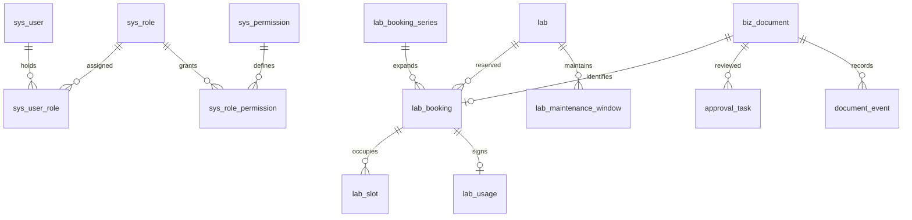

# 实训室管理系统数据库设计

版本：评审稿 v1.1；日期：2026-10-27；数据库：MySQL 8.4.11 LTS。

本方案用于确认数据模型、字段、关系、状态、索引及事务边界。现行范围包括认证与 RBAC、场地管理、场地预约、共享单据与日志，以及 2026-10-27 定稿的物料与固定资产模块；课程教学及安全、巡检、项目等扩展模型按原文保留，未实施不代表当前已经建表或开放入口。本文不包含建表、初始化或迁移 SQL，不表示相关表已经建立，也不自动改变现有业务规则。物料详细契约见 [物料数据库设计](../../物料数据库设计.md)，可执行结构见 `sql/item_material.sql` 与 `sql/new_system_baseline.sql`。

## 1 业务依据与设计选择

| 资料 | 采用内容 |
| --- | --- |
| [流程清单](流程清单.md) | 场地单次/周期预约、课程导入、异常处理与预约状态 |
| [权限清单](权限清单.md) | 三类用户、四种角色、数据范围、审批链、账号安全 |
| [UI 设计规范](UI设计规范.md) | 看板需要的状态和统计展示；颜色、样式不进入业务数据库 |
| 项目 AGENTS.md 与 BaseEntity | 小写下划线命名、UTC 时间、既有 id/createTime/updateTime/deleted 映射 |

### 1.1 有分歧的规则

| 分歧 | 本设计建议默认值 | 数据模型处理 |
| --- | --- | --- |
| 早期资料对场地是否需要前置背书、是否存在自动通过表述不一 | 学生与老师均只经过管理员一级审批，不自动通过 | 预约只保存当前审批状态与过程事件；实施文档统一以现行流程为准 |
| 资料提到院部，但一期只有四种预置角色 | 学院管理人员使用管理员身份和本学院数据范围 | 不新增院部角色；后续审批阶段可增加 |

### 1.2 现行模块与保留扩展

| 模块 | 负责内容 |
| --- | --- |
| 身份与权限 | 用户、预置角色、菜单、权限、管理员数据范围、预约限制 |
| 教学与空间 | 单表场地、开放时间、维修窗口、学期、班级、课程、排课及导入 |
| 预约与使用 | 场地单次/周期申请、管理员一级审批、12 节次、跳选拆分、签到签退、取消与占用 |
| 共享单据 | 单据索引、审批记录、过程事件、附件关联与消息关联 |
| 物料与固定资产 | 物料档案、单台资产、库位余额、预设方案、申领预占、库存单据、H2移动、复核核销、流水与逾期通知 |
| 公共支撑 | 文件、通知、审计、规则与任务幂等 |
| 保留扩展 | 安全准入、巡检、实训项目考核等；不默认开放入口 |

## 2 全局字段和存储约定

### 2.1 类型记号

后面的表目录使用以下类型记号。字段未标 `?` 即必填；`?` 表示可空。字段后的“→ 表”是关联目标，引用字段默认使用 ID 类型。未重复列出公共字段。

| 记号 | MySQL 类型 | 含义 |
| --- | --- | --- |
| ID | BIGINT | 正数雪花 ID，Java Long，接口作为字符串输出以避免 JavaScript 精度损失 |
| CODE | VARCHAR(64) | 业务编号、唯一标识；大小写规范化后比较 |
| NAME | VARCHAR(128) | 名称、标题 |
| SHORT | VARCHAR(32) | 状态、类型、角色码，Java 枚举映射，不使用 MySQL ENUM |
| STR(n) | VARCHAR(n) | 指定长度的字符串 |
| TXT | TEXT | 说明、意见和备注 |
| INT | INT | 整数；人数、节次、周次由约束限定为非负或正数 |
| BOOL | TINYINT | 仅允许 0/1 |
| TIME | DATETIME(3) | UTC 时间点、毫秒精度 |
| DATE | DATE | 不换算时区的纯日期 |
| CLOCK | TIME(0) | 上海本地日历的开放时间、节次时间；不能当 UTC 时间点使用 |
| JSON | JSON | 固定结构的规则快照和导入错误信息；不用来替代关联表 |

使用 InnoDB、utf8mb4；文本默认 utf8mb4_0900_ai_ci，用户名、业务码等归一化保存，需严格区分字节的请求键和存储键使用二进制比较规则。文件本体放文件存储，不放数据库 BLOB。

### 2.2 公共字段与删除策略

| 字段 | 类型 | 要求 |
| --- | --- | --- |
| id | ID | 每张表主键；MyBatis-Plus ASSIGN_ID，关联使用同一值类型 |
| create_time | TIME | 服务端写入，与既有 BaseEntity.createTime 对齐 |
| update_time | TIME | 服务端更新，与 BaseEntity.updateTime 对齐 |
| deleted | BOOL | 与既有 BaseEntity.deleted 对齐，默认 0；有历史引用的记录禁止物理删除 |
| create_user_id | ID? → sys_user | 操作来源；系统任务可空，另以审计标记 SYSTEM |
| update_user_id | ID? → sys_user | 最后操作者；系统任务可空 |
| version | INT | 需要并发控制的可变业务聚合使用，从 0 开始，条件更新并递增 |

业务主档、单据和可变关联记录采用上述公共字段；追加事件、流水、操作日志至少保留 id/create_time/deleted/create_user_id，其中 deleted 固定 0，不允许普通业务修改或删除，update_time 可保持创建值。version 仅用于需要并发控制的可变表。

已提交单据使用取消、驳回、冲销等状态保留历史。除 `stock_location.location_code` 按 2026-10-29 需求仅未删除行唯一、删除后可复用外，其他业务码和学工号即使逻辑删除也不复用。关系表保持一行唯一关系，通过恢复原行、禁用或时效字段调整，不用 `(业务键, deleted)` 来解决重复创建，因为反复删除仍会冲突；库位使用生成列 `active_location_code` 实现活跃编码唯一。

### 2.3 时间及引用完整性

业务展示时区为 Asia/Shanghai；所有 TIME 字段存 UTC。接口示例 `2026-10-13T01:00:00.000Z` 等价于上海 `2026-10-13 09:00:00`。使用既定 Instant 与 UTC LocalDateTime TypeHandler，数据库全局和连接会话时区为 +00:00。

DATE/CLOCK 用于学期日期、开放规则和节次，配合显式 Asia/Shanghai 生成 UTC 实际占用时间。按上海日期筛选转换为 UTC 半开区间；TIME 不接受无偏移量字符串。

本方案中的关联默认建立外键，删除策略为 RESTRICT，不级联删除历史业务。组织、用户、课程使用禁用状态维持历史引用。逻辑删除不会被外键自动过滤，业务仍需检查对象可用性。来源名称可保存提交时快照，查询条件、授权和统计仍使用关联 ID。

## 3 核心关系

下面只画主要聚合，完整关联见字段表。

单据先登记 biz_document，具体业务表的共享单据关联字段唯一且必填（场地为 `document_id`，物料申领与库存单据为 `biz_document_id`）。document_type 必须与业务表类型对应，创建在同一事务完成；不能同时挂到两种业务表。审批、附件、消息由统一单据 ID 关联，避免大量无法校验的 `business_type + business_id` 悬空引用。

## 4 表目录与字段设计

本节是逻辑表设计，字段类型可以用于后续实体和迁移评审，但这里不生成 SQL。提交时条件必填的字段会在说明中额外标出。

### 4.1 身份与 RBAC

| 表名 | 业务字段及类型 | 主要约束与关联 |
| --- | --- | --- |
| sys_department | parent_id: ID? → 本表；department_code: CODE；department_name: NAME；department_type: SHORT；enabled: BOOL | 类型 SCHOOL/COLLEGE/ASSET_OFFICE；码唯一，禁止组织循环 |
| sys_person_roster | person_no: CODE；person_type: SHORT；real_name: NAME；phone: STR(32)；department_id: ID → sys_department；enabled: BOOL | 学校预录入的学生/老师身份名单，学工号唯一、手机号唯一；不能由待登录用户自行修改身份类型 |
| sys_user | roster_id: ID? → sys_person_roster；user_type: SHORT；real_name: NAME；account_name: CODE?；phone: STR(32)?；person_no: CODE?；department_id: ID → sys_department；password_hash: STR(255)?；password_changed_at: TIME?；failed_login_count: INT；locked_until: TIME?；enabled: BOOL | 类型 STUDENT/TEACHER/ADMIN；roster_id、手机号、账号、学工号分别唯一；账号由管理员预建，名单用于身份核验预留 |
| sys_role | role_code: CODE；role_name: NAME；enabled: BOOL | 预置 STUDENT/TEACHER/ADMIN/OPS_ADMIN，码唯一；一期不开放自定义角色。OPS_ADMIN 为最高级运维角色，仅 SQL 预置，仅绑定 system 模块权限和 system% 菜单，不参与业务流程，不受数据范围约束 |
| sys_permission | permission_code: STR(128)；permission_name: NAME；module_code: CODE；enabled: BOOL | `模块:资源:操作` 唯一，例如 booking:lab:create |
| sys_menu | parent_id: ID? → 本表；menu_code: CODE；menu_name: NAME；route_path: STR(255)?；component_key: CODE?；permission_id: ID? → sys_permission；menu_type: SHORT；sort_order: INT；enabled: BOOL | DIRECTORY/PAGE/ACTION；菜单码唯一；组件键只能对应前端白名单 |
| sys_role_permission | role_id: ID → sys_role；permission_id: ID → sys_permission；enabled: BOOL | 角色和权限组合唯一 |
| sys_role_menu | role_id: ID → sys_role；menu_id: ID → sys_menu；enabled: BOOL | 角色和菜单组合唯一 |
| sys_user_role | user_id: ID → sys_user；role_id: ID → sys_role；enabled: BOOL | 组合唯一；主身份角色只能有一个，所有角色均来自显式持有关系 |
| sys_user_data_scope | user_id: ID → sys_user；scope_type: SHORT；department_id: ID? → sys_department；campus_id: ID?；building_id: ID?；lab_id: ID? → lab；access_mode: SHORT | 一期开放 ALL/DEPARTMENT；CAMPUS/BUILDING/LAB 预留不开放；READ/WRITE；按具体目标建立去重约束，不能依靠可空列组合唯一 |
| user_booking_restriction | user_id: ID → sys_user；source_document_id: ID? → biz_document；restriction_type: SHORT；reason: TXT；start_at: TIME；end_at: TIME?；revoked_at: TIME?；revoked_by: ID? → sys_user | 当前预约业务使用 LAB/ALL；自动逾期冻结有源单据，source_document_id + restriction_type 唯一 |

密码只保存带算法参数的单向散列，不存明文；敏感操作要求密码确认。不能通过客户端指定 user_type 或 role_code 自动获得老师或管理员身份；账号与角色由管理员按核验结果预建和绑定。名单更新、停用和手机号变更经过管理员核验与审计，不能绕过已有账号唯一约束。

管理员写范围按归口部门授权，跨归口只读用显式 READ 范围配置；没有范围记录时不自动授予全校数据。非管理员的范围由本人和课程名单计算，不能通过添加管理员范围行扩大权限。ALL 范围不填目标 ID，其他类型恰好填写对应目标；WRITE 包含该范围的 READ，冲突时取允许的最高操作级别，仍受实体状态与审批资格限制。

JWT 会话为无状态运行态（角色权限每请求实时加载），不写入业务单据，数据库设计中不假定已有 Redis 等共享会话存储。

### 4.2 空间与教学基础

| 表名 | 业务字段及类型 | 主要约束与关联 |
| --- | --- | --- |
| lab | department_id: ID? → sys_department；lab_code: CODE?；lab_name: NAME；lab_type: SHORT；location_detail: TXT?；capacity: INT；area_sqm: DECIMAL(10,2)?；facilities: TXT?；open_start: CLOCK；open_end: CLOCK；visible: BOOL；status: SHORT；enabled: BOOL | 场地名称全局唯一且删除后不复用，capacity > 0；`facilities` 仅保存“配套设备”自由文本说明；open_start < open_end；AVAILABLE/MAINTAINING/CLOSED |
| academic_semester | semester_code: CODE；semester_name: NAME；start_date: DATE；end_date: DATE；week_one_monday: DATE；week_count: INT；enabled: BOOL | 码唯一，保存第 1 教学周的周一，实际日期落在学期范围 |
| teaching_class | department_id: ID → sys_department；class_code: CODE；class_name: NAME；enrollment_year: INT；enabled: BOOL | 班级码唯一 |
| class_member | class_id: ID → teaching_class；student_id: ID → sys_user；joined_on: DATE；left_on: DATE? | 学生只能有一个当前行政班，通过学生行锁与当前关系校验；退班保留历史 |
| course | course_code: CODE；course_name: NAME；department_id: ID → sys_department；enabled: BOOL | 码唯一 |
| course_offering | course_id: ID → course；semester_id: ID → academic_semester；offering_code: CODE；offering_name: NAME；enabled: BOOL | 某学期的开课实例，码唯一，后续单据关联此表而非仅课程名 |
| offering_teacher | offering_id: ID → course_offering；teacher_id: ID → sys_user；is_lead: BOOL；enabled: BOOL | 组合唯一；每实例一个有效主教师，可多授课老师 |
| offering_class | offering_id: ID → course_offering；class_id: ID → teaching_class；enabled: BOOL | 组合唯一，支持合班授课 |
| offering_student | offering_id: ID → course_offering；student_id: ID → sys_user；enabled: BOOL | 组合唯一；独立课程名单支持选课和历史追踪，不实时用行政班成员代替 |
| class_period | period_no: INT；start_time: CLOCK；end_time: CLOCK；enabled: BOOL | 节次号唯一；当前开放 1–12 节，上海本地时间，开始早于结束 |
| course_schedule | offering_id: ID → course_offering；teacher_id: ID → sys_user；lab_id: ID → lab；weekday: INT；period_start: INT；period_end: INT；import_job_id: ID? → import_job；source_code: CODE?；external_row_key: STR(128)?；enabled: BOOL | 节次对应 class_period；老师须属于开课实例，工作日 1–7；来源码与稳定外部行键成对填写并组合唯一 |
| schedule_week | schedule_id: ID → course_schedule；week_no: INT | 组合唯一，替代不可维护的 week_mask 字符串，周次在学期范围内 |
| schedule_occurrence | schedule_id: ID → course_schedule；week_no: INT；class_date: DATE；start_at: TIME；end_at: TIME；status: SHORT | 对排课规则展开实际日期，占用统一进入 lab_slot；规则和周次组合唯一；SCHEDULED/CANCELLED/FINISHED |
| lab_maintenance_window | lab_id: ID → lab；start_at: TIME；end_at: TIME；reason: TXT?；enabled: BOOL | 同一场地维修窗口按 start_at/end_at 半开区间判断；预约提交与批准均检查有效重叠记录 |

课程批量导入先暂存、校验老师/实验室/节次/周次，再在事务中发布规则、实际课次及占用。禁止直接覆盖有预约冲突的课表，管理员仲裁需有取消记录。导入同一行可更新同一规则，依赖 import_job 的文件哈希和稳定 external_row_key，不靠行号猜测新旧身份；手工新增的排课允许来源键为空。

### 4.3 公共单据与审批

| 表名 | 业务字段及类型 | 主要约束与关联 |
| --- | --- | --- |
| biz_document | document_no: CODE；document_type: SHORT；owner_user_id: ID → sys_user；department_id: ID → sys_department；policy_id: ID? → business_policy；submitted_at: TIME?；idempotency_key: STR(128) | 单号唯一；owner_user_id + document_type + idempotency_key 唯一；来源人归属与经办人分开 |
| approval_task | document_id: ID → biz_document；stage_code: CODE；sequence_no: INT；round_no: INT；required_role: CODE；assigned_user_id: ID? → sys_user；assigned_department_id: ID? → sys_department；status: SHORT；available_at: TIME；remind_at: TIME?；escalate_at: TIME?；timeout_at: TIME?；timeout_action: SHORT；decided_by: ID? → sys_user；decided_at: TIME?；decision_comment: TXT? | 单据+阶段+序号+轮次唯一；WAITING/READY/APPROVED/REJECTED/CANCELLED；角色码关联 sys_role.role_code，待办权限还需范围校验 |
| document_event | document_id: ID → biz_document；event_type: SHORT；from_status: SHORT?；to_status: SHORT?；actor_id: ID? → sys_user；actor_type: SHORT；occurred_at: TIME；reason: TXT?；task_id: ID? → approval_task；request_key: STR(128) | 状态变更与系统动作留痕；单据+请求键唯一，SYSTEM 操作不能冒充管理员 |

业务表 status 是当前业务状态的唯一来源；biz_document 不另存一份 status。approval_task 是阶段待办，document_event 是不可变过程历史。自动动作先重新检验可用性及资源冲突，不能把“超时”当作跳过事务校验的理由。

### 4.4 场地预约与使用

| 表名 | 业务字段及类型 | 主要约束与关联 |
| --- | --- | --- |
| lab_booking | document_id: ID → biz_document；lab_id: ID → lab；series_id: ID? → lab_booking_series；applicant_id: ID → sys_user；teacher_id: ID? → sys_user；course_name: NAME?；class_name: NAME?；purpose: TXT；participant_count: INT；booking_date: DATE；start_period_id: ID? → class_period；end_period_id: ID? → class_period；start_at: TIME；end_at: TIME；status: SHORT；cancel_reason: TXT?；cancel_type: SHORT?；cancelled_at: TIME? | document_id 唯一；提交后人数、日期与节次必校验；单次跳选按连续段拆单；日期+节次推导 UTC 起止时间 |
| lab_booking_series | applicant_id: ID → sys_user；lab_id: ID → lab；teacher_id: ID? → sys_user；weekday: INT；start_period_id: ID → class_period；end_period_id: ID → class_period；start_date: DATE；end_date: DATE；purpose: TXT；participant_count: INT；status: SHORT；idempotency_key: STR(128)；cancel_reason: TXT?；cancel_type: SHORT?；cancelled_at: TIME? | 周期规则与申请人+幂等键唯一；批准后展开预约；PENDING/APPROVED/REJECTED/CANCELLED |
| lab_slot | lab_id: ID → lab；booking_id: ID? → lab_booking；schedule_occurrence_id: ID? → schedule_occurrence；start_at: TIME；end_at: TIME；released_at: TIME?；release_reason: TXT? | booking_id 和 schedule_occurrence_id 恰一非空，分别唯一；仅未释放的记录参与冲突；重复审批不能插第二份占用 |
| lab_usage | booking_id: ID → lab_booking；actual_start_at: TIME；actual_end_at: TIME?；finish_type: SHORT?；finished_by: ID? → sys_user；note: TXT? | booking_id 唯一；保存本人签到、签退与系统归档时间和操作者 |

场地审批状态采用 PENDING/APPROVED/REJECTED/CANCELLED；IN_USE/FINISHED 按预约时间、签到签退记录与当前时间派生，不另写一套审批状态。周期规则批准后展开的单次预约复用同一状态机。

跳选节次必须按连续段拆单，不能用一段起止时间覆盖中间未选节次。单次和周期均在提交与批准时校验场地状态、开放窗口、维修窗口与有效占用；待审批不永久占用，最后批准者遇冲突失败，不自动抢占。

场地 end_at 是预约资源释放边界；end_at+2h 是系统归档 FINISHED 的宽限时间，不能默默多占用两小时影响下一场。lab_usage 保存签到签退与结束操作；审批过期、人工取消和系统归档都写事件，不删除原单。

### 4.5 公共支撑

| 表名 | 业务字段及类型 | 主要约束与关联 |
| --- | --- | --- |
| business_policy | policy_code: CODE；policy_version: INT；policy_name: NAME；effective_from: TIME；effective_to: TIME?；config: JSON；enabled: BOOL | 码+版本唯一，同码生效区间不能重叠；发布后不可修改，新增版本；存审批超时、提醒、冻结等参数 |
| sys_file | storage_key: STR(512)；original_name: STR(255)；mime_type: STR(128)；size_bytes: BIGINT；sha256: STR(64)；uploaded_by: ID → sys_user；uploaded_at: TIME；status: SHORT | 存储键唯一；UPLOADED/BOUND/REJECTED；访问需要鉴权，不存短期签名 URL |
| document_attachment | document_id: ID → biz_document；file_id: ID → sys_file；attachment_type: SHORT；sort_order: INT | 单据+文件+用途唯一；OTHER 或经评审登记的业务附件类型 |
| notification_event | document_id: ID? → biz_document；event_type: SHORT；dedupe_key: STR(128)；payload: JSON；occurred_at: TIME；status: SHORT；attempt_count: INT；next_attempt_at: TIME?；last_error: TXT? | 去重键唯一；事务发件箱，PENDING/SENDING/SENT/FAILED；租约恢复避免发送线程崩溃永久卡住 |
| user_notification | event_id: ID → notification_event；recipient_id: ID → sys_user；channel: SHORT；title: NAME；content: TXT；read_at: TIME?；delivered_at: TIME?；status: SHORT | 事件+接收人+渠道唯一，站内消息与短信渠道分开跟踪 |
| sys_operation_log | actor_id: ID? → sys_user；actor_type: SHORT；document_id: ID? → biz_document；module_code: CODE；action_code: CODE；target_table: CODE；target_id: ID?；request_id: STR(128)；client_ip: STR(45)?；before_value: JSON?；after_value: JSON?；success: BOOL；occurred_at: TIME | 只追加；目标多态字段仅用于审计，核心业务关系不用它；密码、验证码、token 不记录 |
| import_job | import_type: SHORT；file_id: ID → sys_file；file_sha256: STR(64)；source_code: CODE；uploaded_by: ID → sys_user；status: SHORT；total_rows: INT；success_rows: INT；failed_rows: INT；error_report_file_id: ID? → sys_file；started_at: TIME?；finished_at: TIME? | PENDING/VALIDATING/READY/COMPLETED/FAILED；导入类型+来源+文件哈希防重复发布，校验失败无业务过账 |
| scheduled_action | document_id: ID → biz_document；action_code: CODE；threshold_key: CODE；due_at: TIME；status: SHORT；lease_until: TIME?；attempt_count: INT；result_note: TXT? | 单据+动作+阈值唯一，READY/RUNNING/DONE/CANCELLED/FAILED；支持多实例争抢、崩溃租约恢复、失败重试 |

短信或外部通知发送不能与数据库事务天然原子化；提交后通过发件箱重试，下游用稳定业务键去重。系统时间驱动的催办、冻结、过期取消与归档由 scheduled_action 保存动作身份，执行时必须再检查单据当前状态及 version。每小时扫描是兜底发现机制，不保证正好到秒完成动作。

### 4.6 物料与固定资产（2026-10-27 定稿；2026-10-29 扩展业务通知）

本模块新增 18 表，与既有 22 表合计 40 表。数量字段统一为 `quantity` 或 `*_quantity`，类型为 `DECIMAL(18,3)`；除 `fixed_asset.price` 外不保存价格、金额快照或价值追踪。历史外键均为 RESTRICT，审计 `create_user_id/update_user_id` 不建外键。助理授权、申领、库存单据、核销、预占、通知、流水和库位负责人变动历史等历史表的 `deleted` 固定为 0。

| 表名 | 业务字段及类型 | 主要约束与关联 |
| --- | --- | --- |
| material | material_type/track_mode: SHORT；sku_code: CODE?；material_name: NAME；specification: STR(256)?；base_unit: SHORT；quantity_mode: SHORT；enabled: BOOL | 耗材 CONSUMABLE+QUANTITY 且 sku_code 始终为空；固定资产 FIXED_ASSET+SERIAL，sku_code 非空时唯一；EXACT/ESTIMATE |
| fixed_asset | material_id: ID → material；asset_code: CODE；price: DECIMAL(18,2)?；location_id: ID → stock_location；position_text: STR(256)?；status: SHORT；custodian_user_id: ID? → sys_user（遗留列） | asset_code 唯一；price 非负；IDLE/ON_LOAN/MAINTENANCE/IN_TRANSIT/LOST/SCRAPPED；全库保有统计排除 LOST/SCRAPPED；仅所属库位管理员可在 IDLE↔MAINTENANCE 间直接切换，其他状态禁止直接切换；遗留负责人列不再由应用读写，资产负责人按当前 location_id 取库位全部负责人 |
| stock_location | location_code: CODE；location_name: NAME；description: STR(512)?；enabled: BOOL；active_location_code: 生成列 | 仅未删除行的 location_code 唯一，删除后编码可复用；仍有耗材保有、有效固定资产或未完成移动时禁止删除；创建/删除历史读取审计字段，库位停用不删除历史 |
| stock_location_admin | location_id: ID → stock_location；user_id: ID → sys_user | 库位+用户唯一；一个库位可有多名负责人，关系停用后恢复原行；双人复核规则不变 |
| stock_location_responsible_history | location_id: ID → stock_location；location_code: CODE；location_name: NAME；before_snapshot/after_snapshot: TXT（JSON数组）；operator_id: ID → sys_user；operator_name: NAME；occurred_at: TIME | 库位负责人集合实际变化时与同事务只追加一条；快照元素为 userId/realName/accountName；无变化、校验失败或回滚不写；deleted 固定 0 |
| stock_balance | material_id: ID → material；location_id: ID → stock_location；position_text: STR(256)?；position_key: 生成列；owned_quantity/available_quantity: DECIMAL(18,3)；version: INT | 物料+库位+归一位置唯一；owned_quantity >= available_quantity >= 0；余额更新必须携带 version |
| material_booking_plan | owner_teacher_id: ID → sys_user；plan_name: NAME；enabled: BOOL；remark: STR(512)? | 仅所属教师维护和使用 |
| material_booking_plan_line | plan_id: ID → material_booking_plan；material_id: ID → material；default_quantity: DECIMAL(18,3) | 方案+物料唯一；default_quantity > 0 |
| material_assistant_grant | teacher_id/student_id: ID → sys_user；start_at/end_at: TIME；revoked_at: TIME?；revoked_by: ID? → sys_user；reason: STR(512)? | 师生不同且 start_at < end_at；授权、撤销历史不删除；有效期按 UTC 当前时间计算，不恢复 ASSISTANT 角色 |
| material_claim | biz_document_id: ID → biz_document；applicant_id: ID → sys_user；purpose: STR(512)；booking_date: DATE；start/end_period_id: ID → class_period；booking_start_at/booking_end_at/return_deadline: TIME；status: SHORT；revision_no: INT；pickup_mode: SHORT；delegate_student_id: ID? → sys_user；delegate_grant_id: ID? → material_assistant_grant；delegated_at: TIME?；审核、放弃请求、关闭、取消字段 | biz_document_id 唯一；id 同时是 business_chain_id；revision_no 从 1 递增；归还期限为上海预约当天 23:59；SELF 时委派字段全空，ASSISTANT 时全有值；历史不删除 |
| material_claim_line | claim_id: ID → material_claim；revision_no: INT；material_id: ID → material；requested_quantity/issued_quantity: DECIMAL(18,3) | 申领+版本+物料唯一；requested_quantity > 0；0 <= issued_quantity <= requested_quantity；旧版本行保留 |
| material_claim_allocation | claim_id/claim_line_id: ID；revision_no: INT；location_id: ID → stock_location；planned_quantity: DECIMAL(18,3) | 申领行+库位唯一；planned_quantity > 0；当前版本分配决定审核权限 |
| material_reservation | claim_id/claim_line_id/allocation_id: ID；revision_no: INT；material_id/location_id: ID；fixed_asset_id: ID?；reservation_subject_id: 生成列；reservation_rule: SHORT；asset_total_snapshot: INT?；reserved_quantity/consumed_quantity/released_quantity: DECIMAL(18,3)；reservation_start_at/end_at: TIME；status: SHORT | consumed_quantity+released_quantity <= reserved_quantity；BOOKING_WINDOW/SHANGHAI_DAY_LOW_TOTAL；allocation_id+reservation_subject_id 唯一；资产每条预占数量为 1；物料库位与资产重叠索引；快照不回写 |
| material_document | biz_document_id: ID → biz_document；document_no: CODE；business_chain_id: ID? → material_claim；document_type/business_scene: SHORT；document_seq: INT?；source_material_document_id: ID? → 本表；库位、移动、接收、复核、经办、逾期字段；responsible_teacher_id: ID? → sys_user；pickup_user_id: ID? → sys_user；posted_at: TIME?；idempotency_key: STR(128)；version: INT | document_no/biz_document_id 唯一；业务链+类型+序号唯一；经办人+类型+幂等键唯一；移动待接收索引；待复核或驳回 posted_at 为空，复核人不得是经办人；申领出库记录实际领取人，归还复制来源出库领取人 |
| material_document_line | material_document_id: ID → material_document；claim_line_id: ID?；source_material_document_line_id: ID? → 本表；material_id/fixed_asset_id: ID；quantity: DECIMAL(18,3)；position_text: STR(256)? | quantity > 0；固定资产单行数量为 1；来源行业务链由事务校验；已过账行及原移动发出行不可覆盖 |
| material_settlement | material_document_id: ID → material_document；source_material_document_line_id: ID? → material_document_line；material_id/fixed_asset_id: ID；settlement_type: SHORT；quantity: DECIMAL(18,3)；target_asset_status: SHORT?；reason: STR(512) | CONSUMED/LOST/DAMAGED/SCRAP/ADJUST；quantity > 0；ADJUST 用于在库差异调减；固定资产数量为 1；target_asset_status 记录 IDLE/MAINTENANCE/LOST/SCRAPPED，耗材必须为空 |
| stock_movement | movement_key: STR(128)；movement_type: SHORT；direction: SHORT；material_id/fixed_asset_id/location_id: ID；quantity: DECIMAL(18,3)；material_document_id: ID；material_document_line_id: ID?；operator_id: ID → sys_user；occurred_at: TIME；before/after_owned_quantity、before/after_available_quantity: DECIMAL(18,3)? | movement_key 唯一；只追加；非负余额前后值；无实体行的核销允许单据行为空；固定资产数量为 1 |
| material_notification | dedupe_key: STR(128)；recipient_user_id: ID → sys_user；notification_type/notification_stage: SHORT；reminder_date: DATE?；claim_id: ID → material_claim；material_document_id: ID? → material_document；biz_document_id: ID → biz_document；title/content；read_at: TIME? | 接收人+dedupe_key 唯一；类型为 CLAIM_REVIEW_PENDING/CLAIM_APPROVED/RETURN_REMINDER/PICKUP_DELEGATED/OVERDUE_UNRETURNED；阶段为 IMMEDIATE/DAILY/TWO_HOURLY；每日事件带上海 reminder_date，其余阶段为空；非逾期事件可不关联出库单；已读只写 read_at，通知永久保留；共享单据关联用于过程留痕 |

四类 ID 不得混用：`material_claim.id` 是业务链 ID；`material_document.id` 是库存单据主键；两个业务表各自的 `biz_document_id` 关联共享单据；`source_material_document_id/source_material_document_line_id` 只表示来源库存单据及行。复用 `biz_document + approval_task + document_event`，不新增物料审批或事件表。

## 5 状态及业务不变量

### 5.1 场地预约与共享单据

| 场景 | 数据变化及要求 |
| --- | --- |
| 单次预约提交 | 校验场地、人数、日期、1–12 节次、开放窗口、维修与占用；跳选按连续段拆分创建 PENDING 单据 |
| 周期预约提交 | 保存重复规则与幂等键，状态 PENDING；不得在提交时绕过同一级管理员审批 |
| 管理员批准 | 在事务内锁场地并重验维修与占用；单次批准写入占用，周期批准后逐周展开；任一冲突不得静默覆盖 |
| 管理员驳回 | 状态 REJECTED，保存审批人、时间与意见；原单和事件保留 |
| 本人取消 | 仅允许当前状态与时间节点支持的取消；写取消类型、原因、时间并释放可释放占用 |
| 签到签退 | 已批准且归属本人的预约记录 actual_start_at/actual_end_at；IN_USE/FINISHED 由使用记录与时间派生 |

审批任务必须明确“同级任一管理员可处理”或“指定某人处理”。业务状态只保留一个当前来源，审批任务用于待办，事件用于过程历史；拒绝、取消或重试不能重复创建占用。

### 5.2 物料关键状态与业务不变量

| 场景 | 已定稿规则 |
| --- | --- |
| I2 归还与预占 | 所有归还期限为上海预约当天 23:59；同一 material 的全库固定资产保有总数（排除 LOST/SCRAPPED）<5 时按上海预约日 [00:00,次日00:00) 预占，其他固定资产与耗材按 booking_start_at/booking_end_at 预占；4 台触发、5 台不触发，快照不回写 |
| J2 实发 | 实发窗口为上海预约当天 [00:00, 次日00:00)；到达次日 00:00 后禁止实发。时段预占不等于实发时实物保证，实发必须重新校验实际库存 |
| 修改与放弃 | 首次实发前可修改/取消；修改释放旧预占、revision_no+1 并保留旧版本行；部分实发后只能由申请人请求放弃剩余，再由有计划库位权限的管理员关闭 |
| 助理委派与实发 | 老师在 PENDING/APPROVED 且未出库前可委派、改派或撤回，原单审核与预占不变；实发锁申领及授权并复核有效期，记录实际领取人；授权失效只阻止新实发，不影响归还和历史 |
| H2 移动 | 原 TRANSFER 只扣源库，固定资产转 IN_TRANSIT；TRANSFER_RECEIPT 实收进目标库，短收可补收；拒收只登记事件，源管理员实际收到后以 TRANSFER_RETURN 恢复源库；在途损失以 TRANSFER_SETTLEMENT 经源库原经办人与另一名源库管理员复核核销 |
| 原移动待处理量 | 原行发出 quantity - Σ已过账 TRANSFER_RECEIPT 子行 - Σ已过账 TRANSFER_RETURN 子行 - Σ已复核 TRANSFER_SETTLEMENT 核销量；接收、退回、核销都锁原移动主行，不覆盖原行 |
| K 在库复核 | 在库 SCRAP/ADJUST 由一名实际库位管理员经办、另一名同库位管理员复核，不能自审；PENDING_REVIEW/REJECTED 的 posted_at 为空且不得改变库存，APPROVED 才过账 |
| L 业务与逾期通知 | 新建及修改重审按当前版本计划库位通知持有审核权限的库位管理员，批准通知申请人，委派通知指定学生；预约结束且仍有未还/未核销物料时立即提醒申请人，之后按上一条持久化通知每满2小时再提醒一次，按申领和时间段去重；全部实发的 FULFILLED 状态仍需继续提醒，全部归还/核销或 ABANDONED 后停止。超期立即通知申请人及出库库位全部管理员，未还期间每上海自然日最多再提醒一次；所有通知历史均保留 |

## 6 并发和事务边界

### 6.1 防止重复预约

MySQL 普通唯一索引不能阻止时间区间重叠。所有产生或改变占用的路径使用同一规则：锁对应 lab 行，再检查相交区间，更新状态/占用并提交；不能只在控制器先查一次。

两个区间相交的判断为 `existing.start_at < request.end_at` 且 `existing.end_at > request.start_at`，即 [start_at, end_at)。场地检查未释放的 lab_slot 与有效维修窗口。待审批不永久占用，提交和审批都校验，最后批准者若发生冲突需重新申请，不能自动抢占。

周期预约展开按 lab ID、日期与节次固定顺序处理，在同一事务协议下重验冲突并写占用；任一失败不得留下无法追踪的半套占用。课程导入、取消、强制结束、场地状态变更和维修窗口维护使用相同资源锁协议。

### 6.2 幂等与权限失效

| 操作 | 幂等依据 |
| --- | --- |
| 单据创建 | 所有人+单据类型+客户端请求键唯一 |
| 周期规则创建 | 申请人+客户端请求键唯一，展开按 series_id+实际日期/节次去重 |
| 场地批准 | 预约当前状态条件更新，booking_id 占用唯一 |
| 签到/签退 | 使用记录 booking_id 唯一，事件请求键唯一，状态条件更新 |
| 催办/冻结/归档 | 单据+动作+阈值唯一，冻结源单据唯一 |
| 消息 | 事件 dedupe_key 和接收人/渠道组合唯一 |

角色持有关系、活动角色或管理员范围变化后，业务写入每次重新校验，不依赖旧菜单或客户端提交的角色字符串。取消与审批、签到与取消、维修维护与批准并发时，均须在同一锁与状态条件内复核，不允许以先查结果代替最终写入校验。

### 6.3 物料过账与预占并发

- 审核使用 `id + PENDING + revision_no` 条件更新，并在同事务重验库存、创建预占；修改、取消、关闭、过期和实发均先锁申领主行。实发再按固定顺序锁当前行、预占、余额和资产，余额条件更新必须携带 `stock_balance.version`。
- MySQL 普通唯一索引不能阻止时间区间重叠；固定资产预占按固定顺序锁资产行后重查半开区间重叠，耗材按库位锁余额后重查。预占消耗与释放还受 `consumed_quantity + released_quantity <= reserved_quantity` 约束。
- 归还锁来源出库主行，移动接收、退回与在途核销锁原移动主行，后续子单按来源行求和，防止并发超还或超处理。共享单据幂等键、库存单据幂等键、流水 `movement_key` 和通知去重键共同保证重试安全。
- 在库及在途复核使用 `id + PENDING_REVIEW + version` 条件更新；复核人身份和同库位关系必须实时查询，不能由角色权限或页面按钮代替。

## 7 索引和约束重点

业务码、单据编号和幂等键按上文建立唯一约束；所有外键有索引。日期范围 start_at < end_at，数量与人数约束在数据库和服务端同时校验。仅靠跨表条件的规则用事务保证，不能声称 CHECK 可以完成跨表角色和重叠区间校验。

| 表 | 建议主要查询索引 | 对应查询 |
| --- | --- | --- |
| sys_user | department_id, user_type, enabled；phone；person_no | 用户检索与数据范围 |
| lab | department_id, status, enabled；lab_type, status | 场地目录、状态统计 |
| lab_maintenance_window | lab_id, enabled, start_at, end_at | 提交与批准时的维修重叠检查 |
| lab_slot | lab_id, released_at, start_at, end_at | 场地/课表冲突统一查询 |
| lab_booking | applicant_id, create_time；lab_id, status, booking_date；series_id | 个人预约、审批、日视图、周期展开 |
| lab_booking_series | applicant_id, status, create_time；lab_id, status, weekday | 周期规则查询与审批 |
| approval_task | assigned_user_id, status, available_at；assigned_department_id, required_role, status；status, timeout_at | 待办和超时扫描 |
| scheduled_action | status, due_at, lease_until | 到期任务争抢和恢复 |
| material_claim_line | claim_id, revision_no；claim_id, revision_no, material_id 唯一 | 当前版本行与版本历史 |
| material_reservation | material_id, location_id, status, reservation_start_at, reservation_end_at；fixed_asset_id, status, reservation_start_at, reservation_end_at；claim_id, revision_no | 耗材与单台资产预占重叠、当前版本追溯 |
| material_document | business_chain_id, document_type, occurred_at；source_material_document_id；to_location_id, document_type, transfer_status, occurred_at | 业务链、子单求和、移动待接收 |
| stock_balance | material_id, location_id, position_key 唯一；location_id, material_id | 库内余额与条件更新 |
| stock_location_responsible_history | location_id, occurred_at, id；occurred_at, id；operator_id | 全部或指定库位的负责人变动历史分页、操作人关联 |
| material_notification | recipient_user_id, dedupe_key 唯一；recipient_user_id, read_at, create_time；material_document_id, notification_stage, reminder_date；claim_id | 通知去重、未读列表、每日/每2小时提醒及最新事件扫描 |
| user_notification | recipient_id, read_at, create_time | 未读通知 |
| sys_operation_log | actor_id, occurred_at；document_id, occurred_at | 管理员操作审计 |

组合唯一含可空列时，MySQL 允许多个 NULL。数据范围等需要非空目标的独立唯一约束或生成的有效键；不能用一个全可空联合索引冒充完整去重。

status、权限码、人数和范围类型由明确枚举及 CHECK/服务端校验限制；不要为每个布尔字段建索引。索引先围绕查询设计，初始化后通过实际执行计划调整。

## 8 看板和报表口径

| 指标 | 数据来源与计算口径 |
| --- | --- |
| 场地预约率 | 已批准预约与周期开放窗口交集时长，除以可预约开放时长；课程占用独立显示或明确是否含课表 |
| 场地使用率 | 课表实际课次与 lab_usage 签到签退记录合并后计算；没有使用记录时标明统计口径 |
| 审批效率 | PENDING 到管理员审批结果的时长，按单次/周期及申请角色分组；驳回与取消不混入批准时长 |
| 场地状态分布 | 按 lab.status 统计 AVAILABLE/MAINTAINING/CLOSED；与节次占用、维修窗口分开呈现 |

看板初期从业务表聚合，不另建一份可手改的“看板数值表”。需要优化再加日汇总投影，标明统计日期与刷新时间，并可从原始业务重建。

## 9 附件业务扩展表

以下为扩展模型，一期不默认启用对应入口或审批，也不将物理门禁要求硬塞进当前预约流程。扩展表复用公共字段、biz_document、approval_task、sys_file；增设权限需另行评审。

| 扩展表 | 核心字段与关系 | 用途 |
| --- | --- | --- |
| safety_training | training_code: CODE；name: NAME；lab_type: SHORT；valid_days: INT；enabled: BOOL | 安全培训与有效期规则 |
| safety_assessment | training_id: ID → safety_training；student_id: ID → sys_user；score: DECIMAL(5,2)；passed: BOOL；assessed_at: TIME；expires_at: TIME?；examiner_id: ID → sys_user | 多次考试记录，准入检查最新有效合格记录 |
| lab_access_grant | lab_id: ID → lab；user_id: ID → sys_user；assessment_id: ID? → safety_assessment；start_at: TIME；end_at: TIME；revoked_at: TIME? | 账号/门禁准入，与预约权限分开 |
| lab_attendance | lab_booking_id: ID? → lab_booking；schedule_occurrence_id: ID? → schedule_occurrence；user_id: ID → sys_user；checked_in_at: TIME；checked_out_at: TIME?；method: SHORT | 物理签到，课次或预约恰一非空；外部门禁事件需幂等键 |
| inspection | document_id: ID → biz_document；lab_id: ID → lab；inspector_id: ID → sys_user；inspected_at: TIME；inspection_type: SHORT；result: SHORT | 每两小时巡检和每日闭室检查 |
| inspection_item | inspection_id: ID → inspection；item_code: CODE；result: SHORT；description: TXT?；file_id: ID? → sys_file | 电源、门窗、消防、安全红线逐项记录 |
| training_project | document_id: ID → biz_document；offering_id: ID → course_offering；teacher_id: ID → sys_user；name: NAME；status: SHORT | 项目立项、执行、验收与归档 |
| project_member | project_id: ID → training_project；student_id: ID → sys_user；group_code: CODE；member_role: SHORT | 组员与组长，项目+学生唯一 |
| project_checkpoint | project_id: ID → training_project；name: NAME；due_at: TIME；max_score: DECIMAL(6,2)；weight: DECIMAL(6,4) | 阶段任务与考核规则 |
| project_assessment | checkpoint_id: ID → project_checkpoint；student_id: ID → sys_user；score: DECIMAL(6,2)；assessor_id: ID → sys_user；assessed_at: TIME；comment: TXT? | 阶段成绩，检查学生归属与分数范围 |
| project_deliverable | project_id: ID → training_project；file_id: ID → sys_file；submitted_by: ID → sys_user；submitted_at: TIME；version_no: INT | 成果文件、版本与归档 |

扩展的院部加签使用审批阶段与学院数据范围，不必为每个流程建一套审批表。备份执行、恢复演练属于运维审计；如需产品展示可另加备份作业记录，但绝不能把该记录当作实际完成文件备份。

## 10 初始数据清洗与实施顺序

### 10.1 附件数据如何进入系统

1. 校区、学院、楼栋、真实实验室先核实。附件“公共”“各实训室”是分类或描述，不能直接当具体场地；A303 等示例位置要核实后拆成场地名称与 location_detail。
2. 场地 `facilities` 仅作为“配套设备”自由文本说明导入，不据此生成独立业务主档或预约关系。
3. 用户、班级、课程、排课与节次先核验来源和归属，再按导入报告逐行处理；重复行使用稳定来源键识别，不靠文件行号猜测身份。
4. 导入报告保留源文件、每行解析结果与错误，缺失信息用 NULL 并标待完善，不填虚构默认值；未确认的排课与场地信息不发布为有效占用。

### 10.2 实施分组

| 分组 | 先落地内容 | 必须验证 |
| --- | --- | --- |
| A 公共基础 | 用户、组织、RBAC、文件、统一单据、规则与审计 | 主身份、活动角色、范围过滤、UTC 往返与 ID 字符串 |
| B 场地与预约 | 单表场地、维修窗口、节次、单次/周期预约、占用与使用记录 | 双并发批准只能一个成功、跳选拆分、维修拦截、取消与审批竞争 |
| C 教学接入 | 学期、课程、班级、课表导入与周视图 | 来源键幂等、课次展开、课表与预约冲突 |
| D 保留扩展 | 安全、巡检、项目等 | 另行确认启用范围与新增审批规则 |

先确认本设计的表边界与有分歧规则，再生成建表与迁移。当前项目基础类已存在，后续补公共操作者、版本字段和关系实体时评估 BaseEntity 兼容性；不可假设普通实体继承后自动具备追加事件不可变规则。

## 11 评审检查清单

- 每个核心流程有主单据、实际执行记录与可追踪操作者；场地主档、预约审批和使用阶段不混在同一个 status 字段。
- 同一个实体关系可由外键验证；多态引用仅用于审计，不用于审批或占用的核心关联。
- 数据范围按照关联链计算，写操作验证角色和归属；客户端不能自行提升老师或管理员身份。
- 预约区间、维修窗口、周期展开有明确锁协议与唯一键；版本字段不能代替跨行事务。
- 时间点全部 UTC，日期与本地节次明确区分；上海午夜与不同浏览器时区测试纳入验收。
- 不改写过程事件与操作日志，不删除审批、使用和取消历史；纠错保留原记录与关联关系。
- 一期未启用的扩展流程不成为当前线上预约的额外门槛；源文档的冲突项实施前统一确认。
