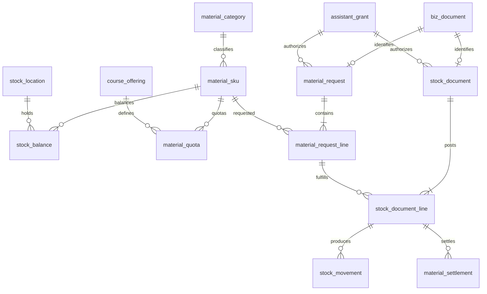

# 实验室设备管理系统 · 物料管理模块设计

版本：评审稿 v0.1；日期：2026-10-13；模块：物料库存（实施分组 C）；负责人分支：`dev/item`。

> 依据：[数据库设计.md](数据库设计.md)（评审稿 v1.0，Final）§1.2/§4.6/§4.7/§5.2/§6.2/§8、[流程清单.md](流程清单.md) 流程 4/流程 6、[权限清单.md](权限清单.md) 二/三/五、[AGENTS.md](../AGENTS.md)。本文不推翻定稿模型，字段与约束以数据库设计 v1.0 为准；与定稿存在差异处以"待评审"显式标注，经评审通过后同步登记至数据库设计文档。
>
> 类型记号沿用定稿：`ID=BIGINT 雪花`（接口序列化为字符串）、`CODE=VARCHAR(64)`、`NAME=VARCHAR(128)`、`SHORT=VARCHAR(32)`（Java 枚举映射，不用 MySQL ENUM）、`STR(n)=VARCHAR(n)`、`TXT=TEXT`、`QTY=DECIMAL(18,3)`、`MONEY=DECIMAL(18,2)`、`PRICE=DECIMAL(18,4)`、`TIME=DATETIME(3) 存 UTC`、`DATE=DATE`、`BOOL=TINYINT 仅 0/1`。所有表含公共字段 `id/create_time/update_time/deleted/create_user_id/update_user_id`，下文不重复列出；流水类表 deleted 固定为 0 且不可改写，version 仅余额等需并发控制的可变表使用。

## 一、模块边界

| 范围 | 内容 |
| --- | --- |
| 负责 | SKU 主档、物料分类、库位、库存余额、物料申领、领用出库、归还核销、采购到货登记、盘点、库存流水、库存预警 |
| 不负责 | 采购审批流（数据库设计 §9 procurement_request 扩展表，一期不启用）、设备类资产（逐件资产归设备模块）、物料成本的学校财务核算（仅管理成本口径） |
| 关键原则 | "物料申领"与"实际出库"分离：申领批准不等于扣减库存；一期不做库存预占，`stock_balance.stock_qty` 即可用量，实际出库时重新校验缺货 |

资产/物料归属判定：逐件有责任追踪需求的建 `equipment_asset`，按数量领还的建可回收物料 SKU；同一实物不能同时计入资产数量和物料库存。

## 二、详细字段设计

### 2.1 物料基本信息

**material_category 物料分类**（树形）

| 字段 | 类型 | 说明 |
| --- | --- | --- |
| parent_id | ID? → 本表 | 上级分类，禁止组织循环 |
| category_code | CODE | 分类码唯一；逻辑删除后不复用 |
| category_name | NAME | 分类名 |
| enabled | BOOL | 停用不影响历史引用 |

**material_sku 物料 SKU**（按"不可互换即分 SKU"建档；合并名称、混合单位必须拆分为独立 SKU）

| 字段 | 类型 | 说明 |
| --- | --- | --- |
| category_id | ID → material_category | 所属分类 |
| sku_code | CODE | SKU 码唯一；逻辑删除后不复用 |
| material_name | NAME | 物料名称 |
| specification | STR(500) | 规格型号 |
| base_unit | STR(16) | 基础计量单位，单位固定 |
| quantity_scale | INT | 数量精度 0–3；整数单位不允许小数领用 |
| material_type | SHORT | CONSUMABLE 耗材 / RETURNABLE 可回收 |
| is_hazardous | BOOL | 危险品，触发双人签字 |
| is_valuable | BOOL | 高价值，触发双人签字 |
| enabled | BOOL | 停用不影响历史引用 |

说明：物料"当前数量"不在 SKU 主档上；实时数量在 `stock_balance`，历史变动在 `stock_movement`，两者可互相重建校验。预警线由责任管理员确认到具体实验室库位，不跨室共享。

### 2.2 存放位置

**stock_location 库位**（一期库存归属具体实验室，不使用无归属"公共库存"）

| 字段 | 类型 | 说明 |
| --- | --- | --- |
| lab_id | ID → lab | 所属实验室 |
| location_code | CODE | 同实验室内库位码唯一 |
| location_name | NAME | 库位名 |
| location_detail | STR(255)? | 位置详述（如货架-层号） |
| enabled | BOOL | 停用规则同上 |

### 2.3 库存状态

**stock_balance 库存余额**（可重建投影；库位+SKU 唯一）

| 字段 | 类型 | 说明 |
| --- | --- | --- |
| location_id | ID → stock_location | 库位 |
| sku_id | ID → material_sku | SKU |
| stock_qty | QTY | 当前库存量，非负 |
| safe_qty | QTY | 安全库存（最低库存，即预警阈值），非负 |
| target_qty | QTY | 补货目标库存，非负且 ≥ safe_qty |
| moving_average_price | PRICE | 移动加权平均成本 |
| version | INT | 乐观锁版本，从 0 起条件更新递增 |

**预警规则**（定稿口径，比较规则记入策略版本可审计）：

- `stock_qty = 0`：单独标记缺货；
- `stock_qty ≤ safe_qty`：触发预警（采用"小于等于"规则）；
- 建议补货量 = `max(0, target_qty − 可用库存)`，默认 `target_qty = 2 × safe_qty`（补至两倍安全库存）；目标量与建议量分开，建议量为派生值；
- 汇总先按实验室合并，不把其他实验室库存视为本室可用；
- 触发后经 `notification_event` 发件箱每日推送管理员直至补充，重试不重复通知。

### 2.4 采购信息（采购到货登记）

**stock_document 库存单据**（单据头；movement_type 区分业务动作）

| 字段 | 类型 | 说明 |
| --- | --- | --- |
| document_id | ID → biz_document | 统一单据（单号、幂等键、审批在此），document_id 唯一必填 |
| movement_type | SHORT | OPENING / PURCHASE_IN / ISSUE / RETURN_IN / TRANSFER / ADJUST / SCRAP / REVERSAL |
| status | SHORT | DRAFT / PENDING / APPROVED / POSTED / CANCELLED；已过账不可编辑 |
| operator_id | ID → sys_user | 实际经办人，不从余额倒推责任 |
| owner_teacher_id | ID? → sys_user | 归属老师（助理代办时记录） |
| grant_id | ID? → assistant_grant | 使用的助理授权，代办必选一条 |
| material_request_id | ID? → material_request | 关联申领单 |
| lab_booking_id | ID? → lab_booking | 关联场地预约 |
| occurred_at | TIME | 业务发生时间（采购/领用/归还日期） |
| posted_at | TIME? | 过账时间 |
| reversal_of_id | ID? → 本表 | 冲销原单；一期仅允许整单冲销一次 |
| reason | TXT? | 事由 |
| vendor_name | NAME? | 【待评审】供应商名称快照；定稿 v1.0 无此字段，为满足采购信息需求建议新增（见第七节差异 1） |

**stock_document_line 单据行**（单据+行号唯一；quantity > 0；出入方向由 movement_type 校验）

| 字段 | 类型 | 说明 |
| --- | --- | --- |
| stock_document_id | ID → stock_document | 所属单据 |
| line_no | INT | 行号 |
| sku_id | ID → material_sku | 物料 |
| from_location_id | ID? → stock_location | 出库位（调拨必填） |
| to_location_id | ID? → stock_location | 入库位 |
| quantity | QTY | 数量 |
| unit_price_snapshot | PRICE | 单价快照（采购价格 / 过账时成本） |
| amount_snapshot | MONEY | 金额快照 |
| request_line_id | ID? → material_request_line | 绑定申领行（实发） |
| original_issue_line_id | ID? → 本表 | 归还绑定的原出库行 |
| adjust_direction | SHORT? | 盘点调账方向 |

### 2.5 领用记录（申领单 + 出库单）

**material_request 物料申领单**（单据头；document_id 唯一）

| 字段 | 类型 | 说明 |
| --- | --- | --- |
| document_id | ID → biz_document | 统一单据 |
| lab_id | ID → lab | 领用实验室 |
| owner_teacher_id | ID → sys_user | 归属老师 |
| operator_id | ID → sys_user | 经办人；助理代领时为助理本人 |
| grant_id | ID? → assistant_grant | 命中的授权；无授权时操作人须老师本人或管理员 |
| offering_id | ID → course_offering | 课程实例 |
| lab_booking_id | ID? → lab_booking | 预约与实际课次恰一非空 |
| schedule_occurrence_id | ID? → schedule_occurrence | 同上，不能同时填 |
| participant_count | INT | 参与人数 |
| period_count | INT | 课时数 |
| purpose | TXT | 用途 |
| status | SHORT | 【待评审】定稿未枚举取值；建议 DRAFT / PENDING / APPROVED / PARTIALLY_FULFILLED / FULFILLED / REJECTED / CANCELLED（见第七节差异 3） |

**material_request_line 申领行**（request_id+SKU 唯一）

| 字段 | 类型 | 说明 |
| --- | --- | --- |
| request_id | ID → material_request | 所属申领单 |
| sku_id | ID → material_sku | 物料 |
| requested_qty | QTY | 申请量 > 0 |
| quota_qty_snapshot | QTY | 定额快照（参与人数 × 课时 × 每人每课时定额）；缺定额策略须老师确认，不按无限量处理 |
| requires_extra_approval | BOOL | 超定额，进入老师签批阶段 |
| requires_dual_sign | BOOL | 危险/高价值，双人签字 |
| approved_qty | QTY? | 批准量 |
| fulfilled_qty | QTY | 实发量，不超过批准量 |

签字规则（定稿）：高价值/危险双人签字通过 material_request 的两个独立 `approval_task` 保存，必须不同人员且具有相应权限；助理本人不能签自己代领的单据；超过定额签批使用老师阶段。

实际领用出库 = `stock_document(movement_type=ISSUE)` 及其行，行上 `request_line_id` 回绑申领行，`occurred_at` 即领用日期；过账时更新 `fulfilled_qty`。

**material_quota 领用定额**（对接课程教学；开课实例+SKU 唯一）

| 字段 | 类型 | 说明 |
| --- | --- | --- |
| offering_id | ID → course_offering | 开课实例 |
| sku_id | ID → material_sku | 物料 |
| qty_per_student_period | QTY | 每人每课时定额 |
| enabled | BOOL | 停用后新申请不再取默认定额 |

### 2.6 归还记录与核销

**归还单** = `stock_document(movement_type=RETURN_IN)`，行上 `original_issue_line_id` 绑定原出库行，quantity 为本次归还量。可回收物料出库后允许多次部分归还；累计结算量不超过原出库量，未结数量按原行计算。不能仅凭 booking_id 随意归还。

**material_settlement 物料结算**（归还登记与核销同事务）

| 字段 | 类型 | 说明 |
| --- | --- | --- |
| issue_line_id | ID → stock_document_line | 原出库行 |
| settlement_type | SHORT | RETURNED / CONSUMED / LOST / DAMAGED |
| quantity | QTY | 本次结算量 |
| operator_id | ID → sys_user | 经办人 |
| settled_at | TIME | 结算时间 |
| return_line_id | ID? → stock_document_line | 对应归还行（同归还行唯一） |
| document_id | ID → biz_document | 幂等单据 |
| reason | TXT? | 差异/核销原因 |

核销规则：耗材实际发出后登记 CONSUMED，不要求归还；可回收件 DAMAGED 归还不重新增加可用库存，由管理员批准独立入库动作后才恢复；LOST/DAMAGED 核销不再扣一次库存（出库时已扣减）。

### 2.7 库存流水（不可变，只追加）

**stock_movement**（movement_key 唯一）

| 字段 | 类型 | 说明 |
| --- | --- | --- |
| document_line_id | ID → stock_document_line | 来源单据行 |
| location_id | ID → stock_location | 库位 |
| sku_id | ID → material_sku | 物料 |
| direction | SHORT | IN / OUT |
| qty_delta | QTY | 净变动，可正负且与方向一致 |
| before_qty | QTY | 变更前余额 |
| after_qty | QTY | 变更后余额 |
| value_delta | MONEY | 价值变动 |
| before_avg_price | PRICE | 过账前均价 |
| after_avg_price | PRICE | 过账后均价 |
| occurred_at | TIME | 发生时间 |
| movement_key | STR(128) | 幂等键唯一；调拨同一行产生两条流水 |

计价：移动加权平均。入库更新平均成本，出库按过账时平均成本快照计算价值，调拨以来源库位成本转入；盘盈使用审批确认单价，盘亏使用账面均价。金额是管理成本口径，不替代学校财务核算。

### 2.8 盘点

**stocktake 盘点单**（document_id 唯一；同一库位最多一张 COUNTING/PENDING_REVIEW 盘点单，由库位行锁保证）

| 字段 | 类型 | 说明 |
| --- | --- | --- |
| document_id | ID → biz_document | 统一单据 |
| location_id | ID → stock_location | 盘点库位 |
| semester_id | ID? → academic_semester | 学期 |
| count_date | DATE | 盘点日期（纯日期，不做时区转换） |
| status | SHORT | DRAFT / COUNTING / PENDING_REVIEW / COMPLETED / CANCELLED |
| started_at | TIME? | 开始时间 |
| finished_at | TIME? | 完成时间 |
| adjust_document_id | ID? → stock_document | 生成的调账单 |

**stocktake_line 盘点行**（盘点+SKU 唯一）

| 字段 | 类型 | 说明 |
| --- | --- | --- |
| stocktake_id | ID → stocktake | 所属盘点单 |
| sku_id | ID → material_sku | 物料 |
| book_qty_snapshot | QTY | 账面量快照 |
| counted_qty | QTY? | 实盘量，非负 |
| balance_version_snapshot | INT | 余额版本快照，提交时校验一致 |
| difference_reason | TXT? | 差异非零必填原因 |
| counted_by | ID? → sys_user | 盘点人 |
| counted_at | TIME? | 实盘时间 |

## 三、数据关系说明

核心关系规则（均来自定稿，实施必须遵守）：

1. **单据先行**：每张业务单先登记 `biz_document`（单号唯一；owner+单据类型+客户端请求键唯一保证创建幂等），业务表 document_id 唯一必填，创建在同一事务完成；审批（老师签批、双人签字、盘点调账审批）、附件、消息全部挂统一单据 ID，杜绝 `business_type + business_id` 悬空引用。
2. **余额是投影**：当前库存 = 所有已过账流水净变动之和（期初作为 OPENING 流水）；原始流水不改写，纠错用 REVERSAL 新单和相反流水（整单冲销一次，冲销前检查已产生的归还、核销与调拨依赖，冲销本身不再冲销），余额可随时重建。
3. **归还绑定原行**：归还必须通过 `original_issue_line_id` 追溯原出库行；责任归属以单据上的 operator_id/owner_teacher_id 为准，不从余额倒推。
4. **跨模块引用**：`lab_id`、`offering_id` 等跨模块引用只建列与索引，外键由所属模块脚本补充（AGENTS.md 约定）；单据内关联默认外键 RESTRICT，不级联删除历史业务。
5. **幂等键**：库存单据由 APPROVED 变 POSTED 只能一次；流水 movement_key 唯一；单据创建 owner+类型+请求键唯一。

## 四、基本操作流程

### 4.1 入库（期初 OPENING / 采购到货 PURCHASE_IN）

登记单据（DRAFT，采购到货填 occurred_at 与行单价）→ 审批 APPROVED → 过账 POSTED：同事务完成"锁库位+SKU 余额 → 校验数量与精度 → 生成不可变流水 → 更新余额与移动加权均价 → 写事件与通知发件箱"。期初库存必须以 OPENING 单据入账，禁止直接 UPDATE stock_balance；附件数量、预算建议未确认前不得写入实际余额。

### 4.2 领用出库（申领 → 批准 → 实发）

老师或授权助理创建申领单（自动取 material_quota 定额快照；超定额 requires_extra_approval 进入老师签批；危险/高价值 requires_dual_sign 双人签字）→ 批准（不扣库存）→ 实际发放时建 ISSUE 单过账：同事务完成"权限与授权复核 → 申领批准量复核 → 按 location_id、sku_id 排序锁定余额 → 数量与精度校验 → 生成明细与不可变流水 → 更新余额和均价 → 更新 fulfilled_qty → 写事件与通知发件箱"。缺货整笔失败，禁止先扣一部分再静默跳过缺货项；申领通过后领取时缺货需重新校验。

助理代办：须命中一条有效 `assistant_grant`（范围 OFFERING/LAB 恰一目标，动作 ISSUE/RETURN）；每次执行在锁内复核有效期与范围，经办人=助理、归属=老师课程，流水同时记录 operator_id、owner_teacher_id、grant_id；授权撤销或到期立即阻止新的代办，在途未回库流水保留并由老师/管理员跟进。

### 4.3 归还与核销

清点后建 RETURN_IN 单绑原出库行（多次部分归还可行）→ 过账回增库存并同事务生成 material_settlement；数量差异必填原因；耗材课后仅登记 CONSUMED 核销，不回库；损坏归还可回收件触发 DAMAGED 核销，不重新增加可用库存，管理员处理并经独立批准的入库动作才恢复。

### 4.4 盘点

建盘点单 → 库位冻结（COUNTING/PENDING_REVIEW 期间所有库存写入路径检查并锁 stock_location，禁止新出入库；允许只读查询；冻结是持久业务状态，不是长数据库事务）→ 实盘录入 → 提交时校验余额 version 与快照一致 → 生成一张 ADJUST 调账单 → 审批过账后解冻。冻结、调账与完成状态变更均有审计。

### 4.5 预警

每日任务比对 `stock_qty ≤ safe_qty`（0 单独标缺货）→ 经 notification_event 发件箱推送管理员，重试与多实例以 dedupe_key 去重；看板口径按实验室/SKU 汇总余额与安全库存，建议量按目标量差额。

### 4.6 冲销与调拨

错账建 REVERSAL 新单链接 reversal_of_id，写相反流水，保留原单；调拨 TRANSFER 双边库位一起锁、同一行产生两条流水，以来源库位成本转入。

## 五、对接接口与权限

| 对接模块 | 接口点 |
| --- | --- |
| 人员管理 | operator_id / owner_teacher_id → sys_user；助理由 `assistant_grant`(+scope) 动态计算（ASSISTANT 不持久化到 sys_user_role）；代办与授权变更互斥时双方锁同一授权行 |
| 设备管理 | 资产/物料归属判定（见第一节）；损坏归还触发的设备异常走 damage_incident，不在本模块重复建模 |
| 场地预约 | material_request.lab_booking_id 关联场地预约；lab_booking_material 支持预约时预登记物料（预登记不是出库，不自动减少库存） |
| 课程教学 | material_quota 按开课实例+SKU 设定额，驱动申请快照；课次关联 schedule_occurrence_id |
| 统一单据/审批/附件 | biz_document + approval_task（超定额老师签批、危险/高价值双签、盘点调账审批）+ document_attachment（照片/凭证）；事件留痕走 document_event |
| 看板报表 | 库存预警口径（§4.5）；老师课程物料成本 = material_request → 实发 stock_document_line 成本快照，扣归还或冲销，区分经办助理与归属老师 |

权限标识按 `模块:资源:操作` 规范（模块码 `item`），前后端一致，随本模块 SQL 脚本登记到 sys_permission，示例：

- 物料主档：`item:material:list / create / update / enable`
- 分类与库位：`item:category:*`、`item:location:*`
- 申领与审批：`item:request:create / approve / sign`
- 库存过账与核销：`item:stock:post`、`item:settlement:create`
- 盘点与调账：`item:stocktake:create / count / complete`、`item:adjust:approve`

角色映射（对齐权限清单矩阵）：老师=申领、定额签批、双签、授权助理；助理=授权范围内代领（ISSUE）与代还（RETURN_IN），一期不做代盘点调账；管理员=台账、采购入库、盘点、调账审批、预警处理、全部领用记录审计。

## 六、并发与事务边界（实施关键）

同事务完成过账全链路：权限与授权复核 → 申领批准量复核 → 锁库位/SKU 余额 → 校验数量与精度 → 生成实际单据明细和不可变流水 → 更新余额和均价 → 更新实发/核销量 → 写事件与通知发件箱。

- 多 SKU 按 location_id、sku_id 排序锁定；调拨两边一起锁；余额不足整笔失败。
- 首次创建余额行依赖唯一键处理并发；version 或条件更新失败必须回滚重试，不能覆盖较新的余额。
- 单据 APPROVED→POSTED 只能一次；movement_key 唯一；拒绝、取消、重试不能重复扣减。
- 授权撤销与代办过账同时发生时，双方锁同一 assistant_grant 行，在锁内复核有效期与范围。

## 七、与定稿 v1.0 的差异记录（需评审确认）

| # | 差异 | 本设计建议 | 处理 |
| --- | --- | --- | --- |
| 1 | 定稿 stock_document 无供应商信息，需求要求采购信息含供应商 | 扩展 `vendor_name NAME?` 名称快照；完整供应商主数据与采购审批属数据库设计 §9 扩展，一期不启用 | 评审通过后在数据库设计文档登记，建表脚本纳入 |
| 2 | 需求中"最低库存量"与"库存预警阈值"为两个概念 | 定稿以 `safe_qty` 单字段承担（≤ 触发、0 缺货、比较规则进策略版本），另有 `target_qty` 表达补货目标，无第三个独立阈值字段 | 若坚持两字段分离，升级数据库设计文档版本；否则以定稿为准 |
| 3 | material_request.status 定稿仅标 SHORT 未枚举取值 | 建议 DRAFT / PENDING / APPROVED / PARTIALLY_FULFILLED / FULFILLED / REJECTED / CANCELLED | 评审定稿后登记 |
| 4 | 建表脚本范围 | 按实施分组 C 输出至 `sql/`（如 `sql/item_material.sql`），外键 RESTRICT、时间列 DATETIME(3) UTC、类型记号与审计字段按 AGENTS.md；权限与菜单初始数据由本模块脚本按 `模块:资源:操作` 登记 | 不另行设计表结构 |

### 7.1 第一阶段实施差异（2026-10-13 落地记录）

第一阶段实现物料分类、物料主档、库位、单据登记/审批/过账（期初入库、采购入库、领用出库）、库存余额、台账与预警查询；与设计的差异如下，均不改变定稿表结构：

| # | 差异 | 实施处理 | 后续动作 |
| --- | --- | --- | --- |
| 5 | movement_type 仅开放 OPENING / PURCHASE_IN / ISSUE | TRANSFER / ADJUST / RETURN_IN / SCRAP / REVERSAL 及申领（material_request）、结算（material_settlement）、盘点调账未实施，服务端对未开放类型返回 40000 | 后续阶段放开并补冲销/调拨双边锁 |
| 6 | stock_location.lab_id 允许 NULL | 空间模块（分组 A）未建表，可先建通用库位 | 空间模块脚本补外键与实验室过滤 |
| 7 | stock_document.document_id 由本模块 IdWorker 预生成 | biz_document（分组 B）未建表，暂由模块占位 | 单据中心落地后迁移 |
| 8 | operator_id / grant_id / owner_teacher_id 及审计字段建列暂不写入 | 登录与 RBAC 会话未接入，公共 BaseEntity 不含操作者字段，不改公共层 | 会话接入后统一回填 |
| 9 | stock_document.status 保留 PENDING 枚举但第一阶段不使用 | 状态机为 DRAFT → APPROVED → POSTED / CANCELLED，SQL CHECK 允许 PENDING | 审批流接入后再启用 |
| 10 | 出库行成本快照过账时回填 | ISSUE 登记不接受单价（40000），过账按移动加权均价回填 unit_price_snapshot / amount_snapshot | 与设计一致，登记此处留痕 |
| 11 | 库存预警第一阶段为查询接口 | `GET /api/v1/stock-warnings` 分页返回（stock_qty ≤ safe_qty，0 标 OUT_OF_STOCK，建议量 = max(0, target − stock)）；每日任务与 notification_event 发件箱未实施 | 通知模块落地后接入推送 |
| 12 | @SaCheckPermission 已标注但暂不强制执行 | item:* 权限 20 项已登记 sys_permission（ID 101-120）并绑定管理员角色；Sa-Token 注解拦截器由登录/RBAC 模块统一注册，当前注解不生效 | 会话模块注册拦截器后自动生效 |
| 13 | 唯一键与索引修正（2026-10-13 优化审查） | stock_location 唯一键改为 (lab_key, location_code)，lab_key 为 COALESCE(lab_id, 0) STORED 生成列（参照 sys_user_data_scope.scope_target_id），修复 lab_id 为 NULL 的通用库位组内库位码可重复的问题；stock_balance 补 sku_id 单列索引，支撑按物料过滤余额/预警 | 空间模块接入后唯一键语义不变 |
| 14 | 预警配置接口补充（2026-10-13） | 第一阶段预警仅查询，safe_qty/target_qty 无任何写入入口，预警规则将空转；新增 `PUT /api/v1/stock-balances/{id}/warning-config`（权限 `item:balance:update`，ID 121）设置安全库存与补货目标，version 乐观锁 + 精度校验 + target ≥ safe 校验 | 与定稿预警规则一致 |
| 15 | 菜单初始数据登记（2026-10-13） | sys_menu 此前无任何模块登记；本模块按 目录(151)→页面(152-158)→动作(159-179) 三层登记 29 条菜单，动作 menu_code 即权限码，管理员角色经 sys_role_menu（ID 301-329）预绑定；页面 component_key 留 NULL，前端物料页面落地时按白名单补登记，未命中白名单时路由守卫安全跳过 | 前端页面落地时补 component_key |
| 16 | 台账时间索引（2026-10-13） | stock_movement 补 occurred_at 单列索引，支撑按时间范围过滤台账（(location_id, sku_id, occurred_at) 复合索引无法覆盖纯时间条件） | 无 |

### 7.2 第二阶段实施差异（2026-10-14 落地记录）

第二阶段实现调拨、归还+核销、报废、冲销、盘点+差异调账、申领单+定额全流程（`sql/item_phase_2.sql` 6 张表 + 权限 ID 122-137）；均不改变定稿表结构：

| # | 差异 | 实施处理 | 后续动作 |
| --- | --- | --- | --- |
| 17 | movement_type 第二阶段全量放开 | TRANSFER 走 `POST /stock-documents/transfer` 专用端点（过账双边 (location_id, sku_id) 排序锁，出库腿按来源库位均价转成本）；RETURN_IN 绑定原出库行（未指定入库位默认回原出库位，按原出库成本快照 unit_price_snapshot 入库）；SCRAP 事由必填、按账面均价结转损失；REVERSAL 整单冲销一次（行由服务端复制并反转方向） | 与设计一致 |
| 18 | 冲销范围与互斥规则落地 | 可冲销类型限定 OPENING / PURCHASE_IN / ISSUE / SCRAP；带 material_request_id 的申领实发单禁止冲销（40900，提示走申领调整流程）；原出库行已产生任何结算（含 RETURNED）禁止冲销；仅 POSTED 单可冲、整单一次；REVERSAL 单自身不可再被冲销 | 审批流接入后保持一致 |
| 19 | 申领单全生命周期 | 定额快照 = 参与人数 × 课时 × 每人每课时定额（无定额记 0，scale 3 HALF_UP），超定额行标 requires_extra_approval，危险/高价值物料标 requires_dual_sign；批准不扣库存（批准量 ≤ 申请量），实发生成关联申领行的 ISSUE 草稿单，过账回写 fulfilled_qty，全部行发完自动 FULFILLED；lab_booking_id 与 schedule_occurrence_id 互斥校验 | 双人签字 approval_task 待审批流模块接入 |
| 20 | 领用定额 upsert 语义 | `POST /material-quotas` 批量登记：offering_id + sku_id 已存在则更新定额量，不存在则新增并启用；停用后新申领不再取默认定额，历史快照不变 | 开课实例表落地后补存在性校验 |
| 21 | 核销结算约束 | CONSUMED / LOST / DAMAGED 手工登记：FOR UPDATE 锁原出库行，累计结算量（含 RETURNED）≤ 原出库量（40900）；RETURNED 类型仅由归还单过账同事务自动生成，手工登记返回 40000；核销不再扣库存 | 与设计一致 |
| 22 | 盘点状态机与冻结 | 建单（DRAFT）即快照 book_qty_snapshot + balance_version_snapshot，开始（COUNTING）才冻结；同一库位唯一活跃盘点单（active_key 生成列唯一键 + DuplicateKeyException 转 40900 兜底）；实盘可重复录入覆盖；提交复核校验全部行已录入、差异行必填原因、余额 version 与快照一致（不一致 40900 要求重新盘点）；差异自动生成 ADJUST 草稿单（盘盈 to=盘点位按账面均价入账 / 盘亏 from=盘点位按账面均价出库），approve-adjust 一步审批+过账后 CAS 关闭盘点单并解冻；无差异单走 complete 确认解冻 | 与设计一致 |
| 23 | 冻结校验放在过账而非登记 | COUNTING / PENDING_REVIEW 期间库位的出入库/调拨过账返回 40900，登记与审批不拦截（允许冻结前建单、解冻后过账） | 与第六节并发边界一致 |
| 24 | 第二阶段权限与菜单 | `sql/item_phase_2.sql` 登记 item:request:list/create/approve/cancel/issue、item:quota:list/create/update/enable、item:settlement:create/list、item:stocktake:list/create/count/complete、item:adjust:approve（ID 122-137）及对应页面/动作菜单并绑定管理员角色；调拨/归还/报废/冲销复用既有 item:stock:create（申领拒绝复用 item:request:approve） | 会话模块注册 Sa-Token 拦截器后自动生效 |

验证记录（2026-10-14）：后端 `./mvnw.cmd verify` BUILD SUCCESS（单元测试 106/106，含第二阶段 4 个新测试类 42 例）；实库端到端 `tools/e2e_item_phase_2.ps1` 61/61 PASS（重置 item 表后走定额→申领→实发→归还→核销→报废→调拨→冲销→盘点差异调账全链路，含 13 项负例断言）。

### 7.3 CRUD 补全与系统优化（2026-10-14 落地记录）

第三阶段补齐基础数据 CRUD（分类/物料/库位删除与启停）、查询性能索引与前端工作台全面改造；均不改变定稿表结构：

| # | 差异 | 实施处理 | 后续动作 |
| --- | --- | --- | --- |
| 25 | 基础数据删除端点与引用检查 | 物料分类 `DELETE /material-categories/{id}`（存在子分类或被物料引用时 40900）、物料 `DELETE /material-skus/{id}`（被库存余额/单据明细/申领行/定额/盘点行引用时 40900，按此优先级短路）、库位 `DELETE /stock-locations/{id}`（被余额/单据明细/进行中盘点引用时 40900），均为逻辑删除；编码删除后不可复用；权限 `item:category:delete` / `item:material:delete` / `item:location:delete`（ID 138-140），动作菜单 ID 200-202，管理员角色预绑定（role_permission 238-240、role_menu 350-352） | 登录模块注册 Sa-Token 拦截器后自动生效 |
| 26 | 逻辑删除同码重建的 40900 兜底 | 业务码唯一索引不含 deleted 列，MyBatis-Plus @TableLogic 使编码查重 selectCount 看不见已删行，同码 insert/update 触发 DB DuplicateKeyException，全局异常处理器无该异常映射将落 50000；三个 service（分类/物料/库位）的 create/update 落库点 catch DuplicateKeyException 转 40900"编码已存在，不得复用"（共 6 处，6 个单测固化） | 与定稿"业务码逻辑删除后不复用"约束一致 |
| 27 | 查询性能索引补齐 | stock_document 补 `idx_item_stock_doc_occurred (occurred_at)` 单列索引（纯时间范围过滤单据，既有 (status, occurred_at)/(movement_type, occurred_at) 复合索引无法覆盖无条件纯时间查询）；material_request 补 `idx_item_request_status (status)`、stocktake 补 `idx_item_stocktake_status (status)` 单列索引（状态分页过滤） | 已执行库内迁移并核对与正本一致 |
| 28 | 写路径批量化 | 单据登记/调拨/归还/报废明细行、盘点快照行、差异调账行、申领行、申领实发出库行由逐条 insert 改 `insertBatch` 批量插入（多行登记一次数据库往返） | 无 |
| 29 | 前端工作台补全（新增"基础数据"页签） | 分类/物料/库位三段 CRUD（新增/编辑/启停/删除，均带二次确认与 v-permission）；余额页签补预警配置弹窗（`PUT /stock-balances/{id}/warning-config`，target ≥ safe 前后端双校验）与"仅看预警"开关（切换走 `/stock-warnings/page`）；各页签过滤维度对齐后端 Query DTO：流水补物料/单据 ID/时间范围，单据补时间范围，申领补开课实例 ID，定额补物料，盘点补库位 | 登录接入后按白名单补 component_key |
| 30 | 前端结构重构与 UX 打磨 | DocumentPanel 753 行拆分为列表 + DocumentCreateDialog + DocumentDetailDrawer（详情改抽屉式）；分页统一 usePagedList + PagerBar（改页大小回第 1 页、末页删空自动回退、越界回退）；状态/类型标签统一 statusMap + StatusTag；数量展示去尾零（formatQty）；危险操作统一 confirmAction 确认（单据审批/过账/取消、基础数据启停/删除、开始盘点/确认完成/调账审批、定额启停）；物料/库位选择由一次性预取 100 条改为远程搜索选择器（每页 20 条、预置 ID 自动回显名称），移除工作台级 100 条预取与 props 下发 | 无 |
| 31 | v-permission 铺设与未登录放行策略 | 全部操作按钮铺设 v-permission（与后端 @SaCheckPermission 权限码一致：item:stock:create/approve/post/cancel、item:request:create/approve/cancel/issue、item:quota:create/update/enable、item:settlement:create、item:stocktake:create/count/complete、item:adjust:approve、item:balance:update、item:category|material|location:*\）；hasPermission 对空权限集（未登录/权限未加载）放行——前端仅体验控制，接口鉴权仍以后端 Sa-Token 为准，登录模块接入后 perms 加载即恢复精确控制 | 登录接入后按角色复核按钮可见性 |

验证记录（2026-10-14）：后端单元测试 146/146；实库端到端 `tools/e2e_item_crud.ps1` 39/39 PASS（基础数据 CRUD 全链路、删除引用矩阵、逻辑删除同码重建 40900、404 断言），既有 `tools/e2e_item.ps1` 18/18、`tools/e2e_item_phase_2.ps1` 61/61 回归通过；前端 ESLint 0 错误 0 警告（风格警告已批量修复）、Vitest 15/15、production build 成功。

## 八、评审检查清单

- [ ] 申领与出库分离：批准不扣库存、出库重新校验缺货，未被绕过；
- [ ] 余额可从流水重建，流水不可改写，冲销有 reversal_of_id 且整单一次；
- [ ] 归还绑定原出库行，累计结算量不超原出库量，耗材/损坏核销不重复扣库存；
- [ ] 双人签字为两个独立 approval_task，助理不能签自己代领单据；
- [ ] 库位冻结期间无新出入库，盘点 version 校验与 ADJUST 审批完整；
- [ ] 多 SKU 排序锁、调拨双边锁、movement_key 幂等等并发约束落实；
- [ ] 权限标识前后端一致并登记 sys_permission，接口返回 Result/PageResult 契约；
- [ ] 差异记录第七节四项已逐条决议并回写数据库设计文档。
