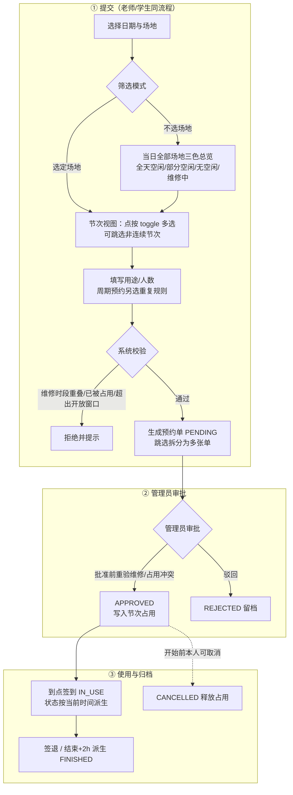
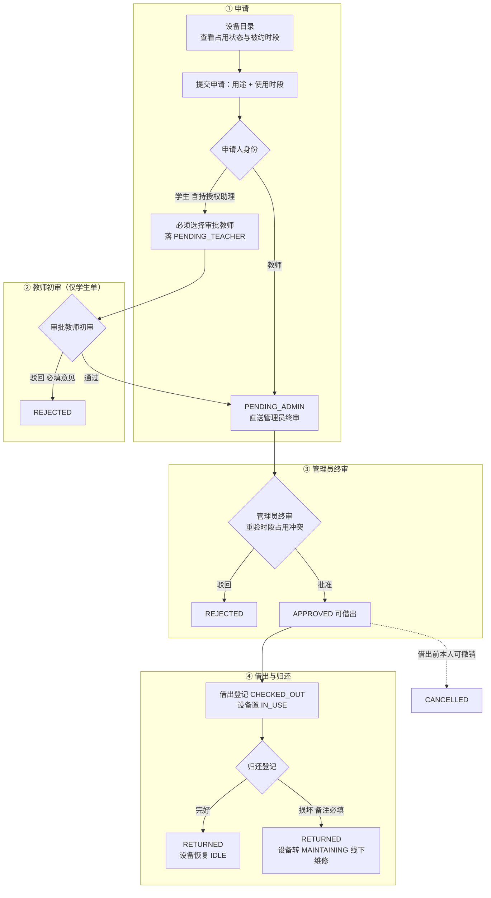
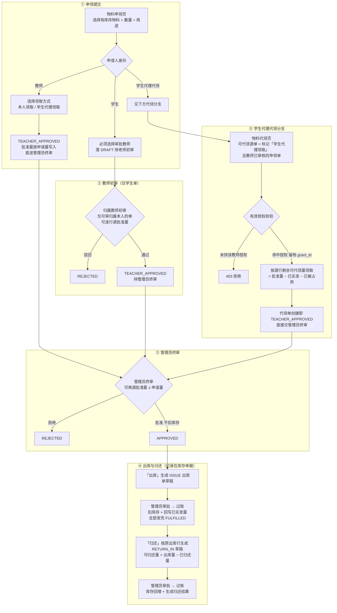
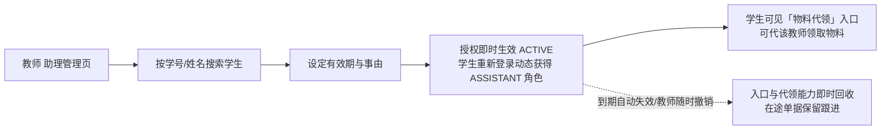

# 系统流程图（定稿版 · 按当前实现）

> 本文以 2026-10-24 系统实际实现为准，用流程图描述三大业务（场地预约、设备申请、物料申领领用）与助理授权的完整链路；与代码同步修订。
> 《流程清单.md》为 PRD 规划稿存档，其中未实施的功能（拍照留痕、超期督办、保养报废、工位等）以本文为准。

## 〇、角色一览

| 角色 | 说明 | 关键能力 |
| --- | --- | --- |
| 学生 STUDENT | 名单预录，首登匹配激活 | 场地预约、设备申请（须指定审批教师）、物料申领（须指定审批教师）、物料代领（须持有效助理授权） |
| 老师 TEACHER | 名单预录，首登匹配激活 | 场地预约、设备申请（直送管理员终审）、物料申领（直送管理员终审）、设备/学生物料初审、助理授权管理 |
| 学生助理 ASSISTANT | 不持久化，由有效 assistant_grant 动态计算 | 在授权有效期与范围内代老师领取物料 |
| 管理员 ADMIN | 业务管理员 | 场地/设备/物料全部终审，台账与库存管理，实发出库 |
| 运维 OPS_ADMIN | 系统运维 | 人员/角色/名单/权限/数据范围管理 |

---

## 一、场地预约流程

> 单次预约与周期预约同一审批链：**只有管理员一级审批**；系统节次 1–12（08:00–22:00），支持跳选多节次自动拆分为多张预约单；维修时段覆盖的节次前端置灰不可选，后端四入口（单次提交/批准、周期提交/批准）统一拦截重叠。

## 二、设备使用申请流程（两级审批）

> 2026-10-24 定稿：**所有学生单（含持助理授权的学生）必须指定审批教师**，初审通过一律转管理员终审；**教师单直送管理员终审**，不允许自动直通。设备目录实时展示三态占用（使用中/未来被约/无预约）与未来被约时段。

## 三、物料申领与领用流程（两级审核 + 实发出库）

> 2026-10-24 用户端初版定稿：**能申领的都是库存中有的**（选项与创建均校验全库位可用量 > 0；不预占库存，实发时重新校验缺货）；学生必填审批教师、教师直送终审；批准不扣库存，实发走库存单据过账回写。

## 四、助理授权流程（物料代领前提）

---

## 五、状态机速览

| 单据 | 状态流转 |
| --- | --- |
| 场地预约单 | PENDING →（管理员批准/驳回）→ APPROVED / REJECTED；PENDING·APPROVED →（取消/过期扫描）→ CANCELLED；IN_USE/FINISHED 按当前时间派生不落库 |
| 场地周期预约 | PENDING →（管理员批准→逐周生成预约单 / 驳回）→ APPROVED / REJECTED →（可取消）→ CANCELLED |
| 设备申请单 | 学生：PENDING_TEACHER →（教师初审通过）→ PENDING_ADMIN →（管理员终审）→ APPROVED；教师：直落 PENDING_ADMIN → APPROVED；APPROVED → CHECKED_OUT → RETURNED；各级可 REJECTED；借出前可 CANCELLED |
| 物料申领单 | 学生：DRAFT →（教师初审）→ TEACHER_APPROVED →（管理员终审）→ APPROVED →（实发过账）→ PARTIALLY_FULFILLED → FULFILLED；教师/代领单：直落 TEACHER_APPROVED 起走同一终审链；各级可 REJECTED；未实发可 CANCELLED |
| 库存单据 | DRAFT →（审批）→ APPROVED →（过账扣库存）→ POSTED；DRAFT·APPROVED 可 CANCELLED |
| 助理授权 | ACTIVE（生效中）→ EXPIRED（到期自动）/ REVOKED（教师撤销） |

## 六、通用约束（全业务生效）

- **权限模型**：每个受保护接口由后端 `@RequirePermission` 校验（标识 `模块:资源:操作`），前端路由守卫 + `v-permission` 仅为体验层；ASSISTANT 由有效授权动态计算，撤销/到期踢会话即时失效。
- **数据范围**：无终审权的用户查询申领/申请单时，仅能见到「本人经办或归属本人」的单据；教师初审/设备初审只能操作归属本人的待办。
- **库存原则**：申领批准不扣库存、不预占；实发 ISSUE 单过账时在事务内行锁校验缺货并回写已实发量。
- **时间口径**：存储传输统一 UTC 毫秒，页面按 Asia/Shanghai 展示；场地按上海日期与 12 节次开放窗口校验。
