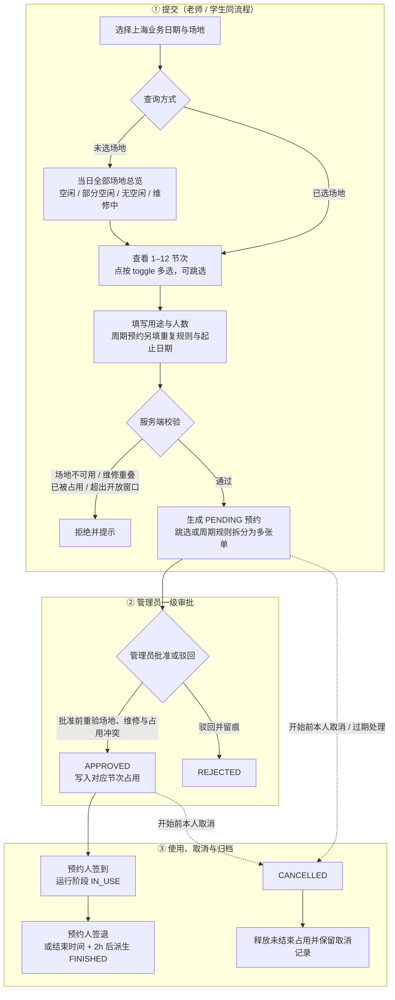
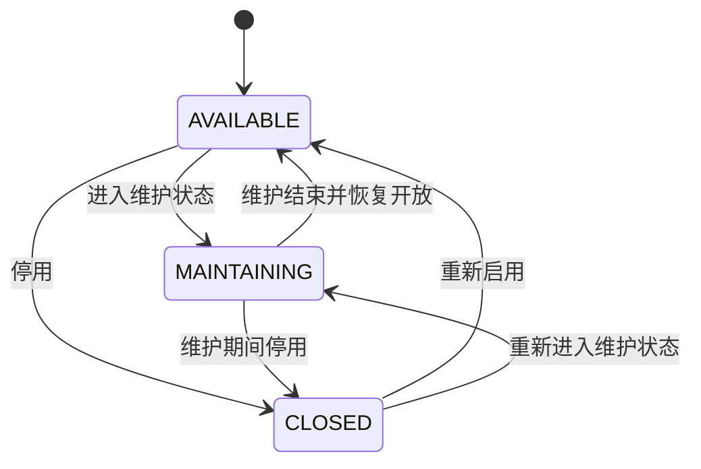

# 系统流程图（按当前有效模块）

> 本文仅描述当前保留的认证与 RBAC、场地管理、场地预约、共享单据与操作日志。
> 场地预约的实际规则以本文为准；《流程清单.md》保留其他未实施模块的规划内容，不作为当前预约实现依据。

## 〇、角色一览

| 角色 | 说明 | 关键能力 |
| --- | --- | --- |
| 学生 STUDENT | 学生账号 | 查看场地、提交单次或周期场地预约、查看与取消本人预约、按预约签到签退 |
| 老师 TEACHER | 授课老师账号 | 查看场地、提交单次或周期场地预约、查看与取消本人预约、按预约签到签退 |
| 管理员 ADMIN | 业务管理员 | 场地台账与维修时段管理、场地预约一级审批、业务日志查看；受数据范围约束 |
| 运维管理员 OPS_ADMIN | 最高级运维角色 | 人员、组织、角色、权限、数据范围、参数与全量日志管理；仅持有 system 权限和菜单，不参与场地、预约、物料等业务流程，不受数据范围约束 |

> 预置角色仅为 `ADMIN / TEACHER / STUDENT / OPS_ADMIN`。一人多角色时按活动角色装配菜单与权限，切换角色必须校验实际持有关系。

---

## 一、场地预约流程

> 单次预约与周期预约使用同一条审批链：**仅管理员一级审批**，老师与学生均不增加前置审批。
> 节次为 **1–12（08:00–22:00）**；点按节次可多选、跳选，非连续节次在提交时拆分为多张预约单。



### 1.1 单次与跳选拆分

1. 用户在同一日期、同一场地选择一个或多个节次；可连续选择，也可跳选。
2. 每个预约单表达一段连续节次；跳选形成的多个连续段分别创建预约单，不把非连续节次塞进一个起止区间。
3. 每张拆分单独立审批、取消和留痕；任一节次与维修窗口或有效占用冲突时，对应提交或批准被拒绝，不自动抢占。

### 1.2 周期预约

1. 周期预约保存重复规则、星期、连续节次与有效日期范围，提交时仍为 `PENDING`。
2. 管理员对周期规则执行同一级审批；批准后按规则展开各周预约单并写入占用。
3. 展开前逐次重验场地状态、维修窗口、开放窗口与占用冲突；冲突不静默跳过，也不覆盖已有占用。
4. 周期规则及已展开预约按各自状态保留审批、取消与审计记录。

### 1.3 维修拦截

- 管理端为场地维护维修窗口；与维修窗口重叠的节次在前端不可选。
- 后端在**单次提交、单次批准、周期提交、周期批准**四个入口统一校验，前端置灰不能替代服务端拦截。
- 批准时必须重新检查维修窗口和占用，避免待审期间新增维修或其他预约导致冲突。

### 1.4 签到、签退与取消

- 已批准预约由本人按当前实现执行签到、签退；`IN_USE`、`FINISHED` 是根据预约时间与使用记录派生的运行阶段，不另写一套审批状态。
- 预约 `end_at` 是资源释放边界；结束后的 2 小时宽限只用于运行阶段归档，不额外占用后续时段。
- 待审批或已批准且未到开始时间的本人预约可取消；取消后保留原单与原因，已写入的占用同步释放。
- 驳回、取消、签到、签退和审批动作均保留业务记录；共享单据与操作日志用于关联过程和追踪操作者。

---

## 二、场地与预约状态机

### 2.1 场地主档状态



| 状态 | 含义 | 预约约束 |
| --- | --- | --- |
| AVAILABLE | 场地开放 | 可提交预约，仍需通过时间、维修与冲突校验 |
| MAINTAINING | 场地维护中 | 新预约及批准不得绕过维修校验 |
| CLOSED | 场地关闭或停用 | 不允许新建预约；历史预约不物理删除 |

> 场地主档状态与某个节次是否空闲是两个维度；实时占用由预约及 `lab_slot` 等占用记录派生，不回写成第四套场地状态。场地 `facilities` 仅保存“配套设备”自由文本说明，不形成独立业务模块。

### 2.2 单次预约单

| 阶段 | 状态或派生结果 | 进入条件 |
| --- | --- | --- |
| 待审批 | PENDING | 单次提交或跳选拆分后生成 |
| 已批准 | APPROVED | 管理员批准且批准前重验通过，写入占用 |
| 已驳回 | REJECTED | 管理员驳回，原单留档 |
| 已取消 | CANCELLED | 本人有效取消或过期处理，释放可释放占用 |
| 使用中 | IN_USE（派生） | 已批准预约到使用阶段并完成签到 |
| 已结束 | FINISHED（派生） | 签退，或当前时间超过 `end_at + 2h` |

### 2.3 周期预约

`PENDING →（管理员批准）→ APPROVED → 按规则展开预约单`；驳回进入 `REJECTED`，有效取消进入 `CANCELLED`。展开后的单次预约沿用 2.2 的状态与运行阶段。

---

## 三、认证、共享单据与日志链路

```mermaid
flowchart LR
    A[账号密码登录] --> B[签发 access / refresh 双 token]
    B --> C[按活动角色实时装配角色、权限与菜单]
    C --> D[@RequirePermission 功能权限校验]
    D --> E[参数与业务状态校验]
    E --> F[ADMIN 数据范围校验<br/>OPS_ADMIN 按规则豁免]
    F --> G[场地 / 预约 / 共享单据事务]
    G --> H[操作日志只追加留痕]
```

- **认证**：access 与 refresh 使用 JWT 无状态会话；刷新时轮换双 token。前端动态菜单、路由守卫与 `v-permission` 只是体验层。
- **RBAC**：权限标识统一为 `模块:资源:操作`，每个受保护接口由后端校验；活动角色必须属于当前用户实际持有角色。
- **共享单据**：业务单号、审批过程、事件与附件等公共关联统一使用共享单据标识；业务状态以所属业务表为准，过程历史不因取消或驳回而删除。
- **日志**：关键认证、权限、场地、预约和共享单据操作写入操作日志；密码、token 等敏感信息不得入日志。ADMIN 仅查看业务模块日志，OPS_ADMIN 可查看全量日志。

## 四、通用数据与时间约束

### 4.1 数据范围

- STUDENT、TEACHER 的预约数据以本人及业务归属为边界，不能通过遍历 ID 查看或操作他人预约；学生代领另按 `delegate_student_id` 强制本人过滤。
- ADMIN 使用 `sys_user_data_scope`；一期开放 `ALL / DEPARTMENT` 与 `READ / WRITE`，`WRITE` 蕴含 `READ`。无范围记录不自动获得全校数据，部门精确匹配不向下继承。
- OPS_ADMIN 不受数据范围约束，但仍须通过接口权限、参数、归属和业务状态校验。
- 取消、审批等写操作不能仅依赖菜单或按钮权限；服务端每次重新核对当前身份、数据范围、单据归属和状态。

### 4.2 UTC 与上海业务日历

- 业务页面、本地日期、节次与业务日界线使用 `Asia/Shanghai`；时间点传输、计算和存储统一使用 UTC。
- 时间点入参必须带 `Z` 或数字偏移量，出参统一为 UTC 三位毫秒；禁止把无偏移量本地时间直接当作 UTC。
- 数据库时间点使用 `DATETIME(3)` 保存 UTC；纯日期使用 `DATE / LocalDate`，节次钟表时间使用上海本地 `TIME(0)`，二者不做时区换算。
- 按上海日期查询时，将当天与次日零点分别转换为 UTC，使用 `>= startUtc AND < endUtc` 半开区间。
- 预约提交、批准、维修校验、签到签退和取消均使用服务端 UTC 时钟，客户端不能覆盖服务端审计时间。

## 五、老师助理与学生代领流程


- 委派只改变原申领的领取人安排，不生成代领子单，不改变审核状态、版本、预占或审批任务；首次实发后禁止改派或撤回。
- 学生仅有本人被委派原单的只读权限，不能审核、实发或归还；管理员实发时必须再次检查授权有效期、撤销状态和学生启用状态。
- 授权撤销或过期后，相关申领暂停新的实发，老师可改派或恢复本人领取；既有出库仍按原领取人归还和审计。
